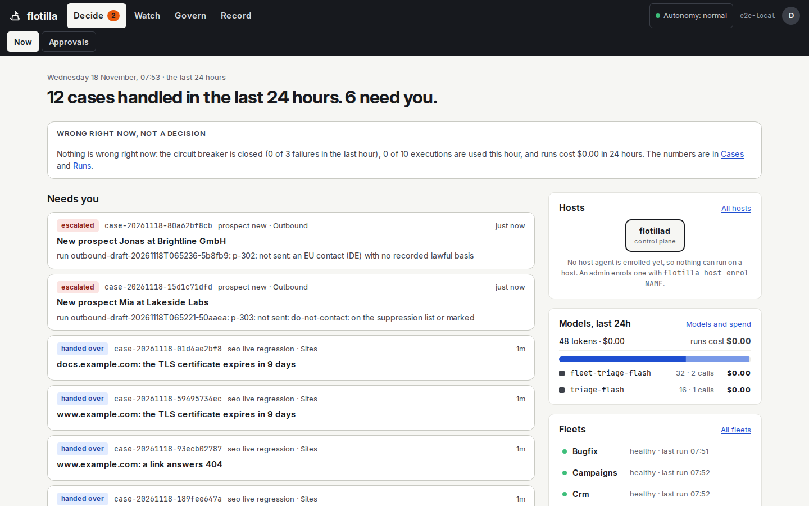
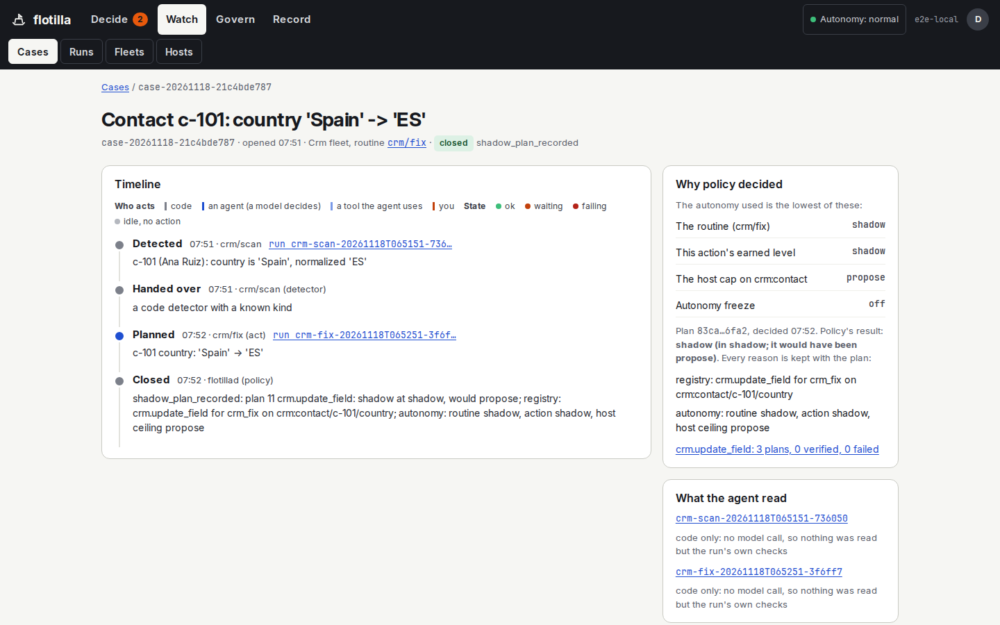
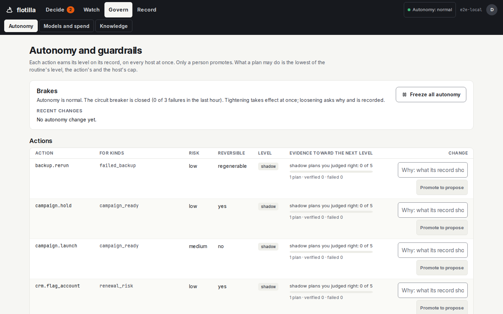
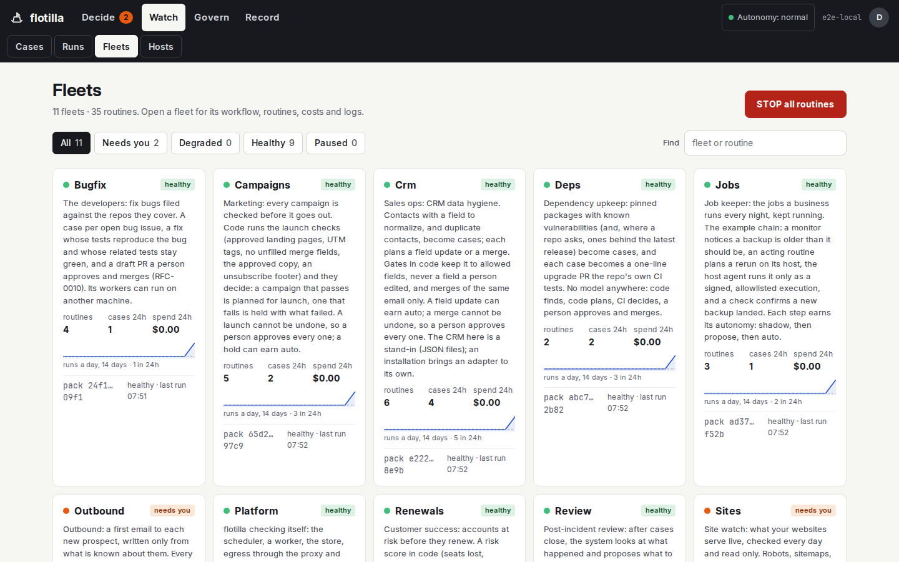
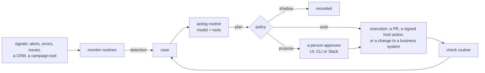

# flotilla

**Run your business processes on AI agents, and stay in control of them.** flotilla is a small,
plain platform for fleets of agents that work inside limits you set, show you everything they do,
and earn every bit of autonomy they get.

[](https://github.com/chipi/flotilla/actions/workflows/ci-fast.yml)
[](https://github.com/chipi/flotilla/actions/workflows/e2e.yml)
[](https://chipi.github.io/flotilla/)
[](LICENSE)



## Why

An agent that triages alerts, cleans a CRM or drafts a sales email is a business process with a
model inside it. You would not hand a process to a new hire without knowing what they may touch, seeing
what they did, and widening their remit only as they prove themselves. flotilla holds agents to the
same rules:

- **You see everything.** Every run, model call, plan, decision and approval is recorded with who
  made it and why. A case's page shows what the agent read, what it planned, and why policy let it
  act or stopped it.
- **Code decides, not the model.** A model reads through named tools and proposes a plan. What
  leaves the platform is decided after the model by deterministic checks: gates, an action registry,
  policy, caps.
- **Autonomy is earned, one action at a time.** Every action starts in `shadow` (record what it
  would have done), moves to `propose` (a person approves each one) and only then to `auto`, on the
  evidence of its record. An action that cannot be undone, such as a sent email or a merge, never acts
  alone.
- **You can stop it.** Pause a routine, stop a fleet, freeze all autonomy, or STOP everything, from
  the UI or the CLI. Approvals come from a person, in the UI, the CLI or Slack; an agent can never
  approve anything.
- **Changes are proven first.** A change to what a fleet decides is replayed against real past cases
  before it ships.

## See it run

```bash
git clone https://github.com/chipi/flotilla && cd flotilla
make demo        # DOCKER_CONTEXT_DEV=default make demo, on a machine with one Docker engine
```

You need Docker, make, Python 3 and openssl. The demo builds the images and runs the platform
and eleven example fleets against stand-ins for everything outside (GitHub, an error tracker, a
CRM, a mail service, the sites, a scripted model), so nothing reaches the internet. Open
<https://localhost:8443> and sign in with the token in `.e2e/demo-admin.token`. `make demo-down`
removes it. The full setup: [Developing flotilla](docs/development.md).

| A case: what was detected, planned and decided, and why | Autonomy: each action's level and the evidence for the next |
| --- | --- |
|  |  |



## The example fleets

| Fleet | The process | How trust is kept |
| --- | --- | --- |
| **triage** | alerts and errors become deduplicated cases; real problems are filed as issues | a model investigates; gates in code decide what is filed |
| **bugfix** | a bug issue becomes a draft PR whose test fails before the fix and passes after | a person approves the PR plan and always merges |
| **deps** | vulnerable or outdated packages become one-line upgrade PRs | no model: code finds and plans, the repo's CI tests |
| **jobs** | a failed backup is rerun on its host, then verified | a signed host action, allowed by the host itself, and a check |
| **sites** | robots, sitemaps, broken links and certificate expiry, read live | read only: findings are cases |
| **review** | closed cases become proposed lessons and process changes | the system proposes changes to itself; a person approves |
| **crm** (sales ops) | CRM fields normalized, duplicates merged | allowed fields only; a field fix can earn auto, a merge is always approved |
| **campaigns** (marketing) | every campaign checked before launch | launch checks in code; a launch is always approved |
| **outbound** (sales) | a first email per prospect, written from known facts only | consent, do-not-contact and a daily cap in code; every send approved |
| **renewals** (customer success) | accounts at risk flagged for their owner before renewal | a risk score replayed over past renewals; it never writes to the customer |
| **platform** | the platform checking itself: a heartbeat and the models' contracts | |

Each is a starting point: specs, playbooks and facts in [fleets/](fleets/README.md). Your own fleets
live in a private repo of yours and are mounted over the examples; `make lint` keeps your facts out
of flotilla's code.

## How it works



- **flotillad** (Go, one binary): schedules routines, keeps every case and decision in one SQLite
  store, applies policy and approvals, signs host actions, and serves the API, the CLI, an MCP
  server (other agents read and steer, never approve) and the operator UI. It holds no fleet
  credentials.
- **Workers** (Python, one container per role) run the routines: the model client, the harness, the
  fleets' code. Each holds only its role's credentials and reaches out through an egress
  allowlist; a worker can run on another machine.
- **`flotilla-host`** (Go) runs on each host flotilla may change: it connects out, checks the
  signature and its own allowlist, runs, and keeps a hash-chained audit log.
- **Models:** any OpenAI-compatible endpoint, local first, under each routine's declared model
  policy, every call through one client.

## Develop

```bash
make ci-fast      # lint and every unit test: what every push must pass
make test-e2e     # the whole platform in containers with stand-ins, the UI in Chromium
make docs-serve   # these docs at http://127.0.0.1:8765
```

No Go installed? `make ci-fast GO=scripts/go.sh GOFMT="scripts/go.sh gofmt"` runs the pinned Go
image. More in [Developing flotilla](docs/development.md).

## Docs

<https://chipi.github.io/flotilla/>, built from [docs/](docs/index.md):

- **Design:** [RFC-0001](docs/rfc/RFC-0001-fleet-platform.md) and the
  [decision records](docs/adr/README.md), starting with
  [ADR-0001](docs/adr/ADR-0001-platform-foundations.md);
- **Architecture:** [components, data, deployment, a run's lifecycle](docs/architecture/index.md);
- **Operating it:** host keys, Slack approvals, MCP and each fleet ([docs/operations](docs/operations/));
- **Security and testing:** [threat model and controls](docs/security.md), [testing](docs/testing.md);
- **How it got here:** [history](docs/history/README.md).

flotilla is built from scratch on purpose, to learn how agent systems work from the inside, and it
runs real work every day. Projects like Hermes Agent and OpenClaw are inspiration, not dependencies
([why](docs/history/0000-origin-evaluation.md)).

## License

[MIT](LICENSE)
