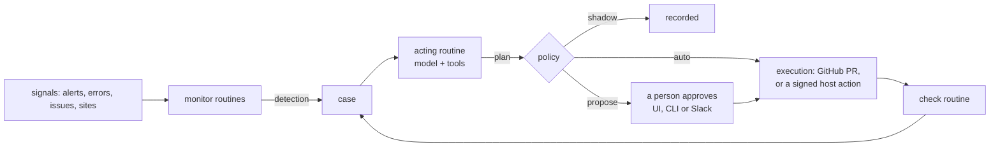

# flotilla

**A plain, spec-driven platform for small fleets of AI agents that act within limits you set and can
see.** A control plane decides and records, workers diagnose and plan, and host agents run only what
is signed and allowed on their host.

flotilla runs one homelab's operations: it triages its alerts and errors, watches its backups, checks
its sites' search reach and drafts fixes for its bugs. It is written so any installation can run its
own fleets on it. It is built from scratch on purpose, to learn how agent systems work from the inside.

## The idea

- **Every problem is a case.** Detected, diagnosed, handed to the routine that can act on it,
  planned, decided by policy, executed, checked and closed, with its whole timeline kept.
- **Agents plan; code decides.** A model reads through named tools and proposes a plan. What leaves
  the platform is decided by deterministic checks after the model: gates, policy, the action registry.
- **Autonomy is earned, per action.** Every routine and action starts in `shadow` (record what it
  would do), moves to `propose` (ask a person) and only then to `auto`. The evidence is the record of
  its shadow plans; only the operator promotes, and an agent can never approve.
- **Everything is recorded.** Every run, model call, decision and approval is in one store with its
  actor, and every model call through one client; a change to a decision is replayed against real
  past cases before it ships.
- **Hosts are changed only by signed, allowlisted executions.** A host agent connects out, checks
  the signature, its own allowlist and limits, runs, and keeps a hash-chained audit log.



## What runs today

On the reference installation (a Mac mini and a second machine), since November 2026:

| Fleet | What it does | Autonomy |
| --- | --- | --- |
| **triage** | reads error-tracker issues and firing alerts, investigates with probes, files or dismisses | `propose`: files real GitHub issues |
| **ops** | watches the off-site backup, plans its rerun on the host, verifies it; reviews closed cases and proposes what to learn | shadow |
| **seo** | checks what each site serves live, its visits and its search reach | shadow |
| **bugfix** | turns a bug issue into a case, fixes it under gates on a remote worker, proposes a draft PR | shadow (being evaluated) |
| **platform** | a heartbeat that proves the whole path every 10 minutes; daily contract checks of every model alias | `auto` |

Around them: an operator UI with a morning brief, a CLI, an MCP server (other agents read and
steer, never approve), a host agent on the mini, and the homelab's metrics, logs, traces, LLM traces
and errors. How it got here: [docs/history](docs/history/0002-design-to-running-platform.md).

## Your own fleets

`fleets/` holds **example fleets**, with placeholder repos, sites and hosts
([fleets/README.md](fleets/README.md)). An installation keeps its own fleets and their facts in a
private repo of its own and mounts them over the examples (`deploy/compose/fleets.yml`,
`deploy/server/deploy_fleets.sh`); its replay gates and real recorded cases live there too. `make lint`
refuses installation facts in flotilla's code.

## Shape

- **flotillad** (Go, one binary): specs, triggers, the runner, cases, policy and guardrails,
  approvals, the signer and the host gateway, budgets, one store (SQLite), and one API behind the
  CLI, the MCP server and a server-rendered UI. It holds no fleet credentials.
- **Workers** (Python, one container per role): the runtime (model client, harness, skills,
  recording) and the fleets' code. Each holds only its role's credentials and reaches out through an
  egress proxy; a worker can run on another machine through a link.
- **`flotilla-host`** (Go), on each host flotilla may change.
- **Any OpenAI-compatible model endpoint** (LiteLLM is the reference), under each routine's declared
  model policy.

## Develop

```bash
make ci-fast       # lint (gofmt, go vet, Python, llms.txt, installation facts) and every unit test
make test-e2e      # the whole platform in containers, with stand-in services
make replay        # an installation's replay gates (SF_REPLAYS, from its private fleets repo)
make docs-serve    # the docs site at http://127.0.0.1:8765
```

## Docs

<https://chipi.github.io/flotilla/>, built from [docs/](docs/index.md):

- **Design:** [RFC-0001](docs/rfc/RFC-0001-fleet-platform.md) and the
  [decision records](docs/adr/README.md), starting with
  [ADR-0001](docs/adr/ADR-0001-platform-foundations.md);
- **Architecture:** [components, data, deployment, a run's lifecycle](docs/architecture/index.md);
- **Operations:** each fleet's page, host keys, Slack and MCP ([docs/operations](docs/operations/));
- **Security and testing:** [threat model and controls](docs/security.md), [testing](docs/testing.md);
- **Where it is going:** [the plan](docs/wip/vision-plan.md).

Projects like Hermes Agent and OpenClaw are inspiration, not dependencies
([why](docs/history/0000-origin-evaluation.md)).

## License

[MIT](LICENSE)
