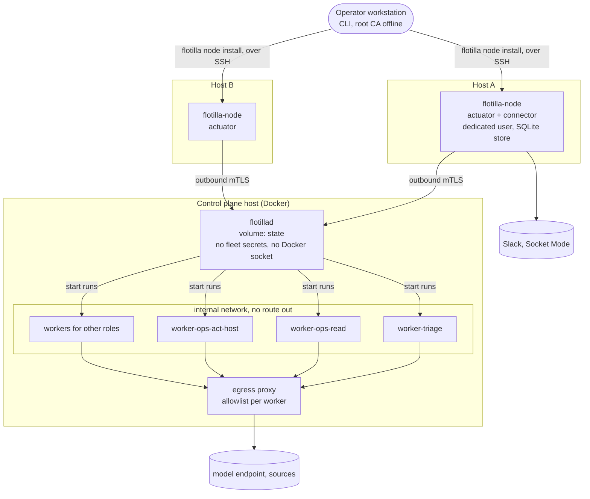

# Deployment

**Status:** the control plane in Docker is accepted in [ADR-0002](../adr/ADR-0002-run-in-docker.md)
(2026-11-08); workers per role in [ADR-0005](../adr/ADR-0005-agent-pipeline.md); host agents are
proposed in [ADR-0006](../adr/ADR-0006-node-agent.md).

A flotilla installation has two parts:
- **the control plane:** flotillad, the workers and the egress proxy, as one Compose stack on one
  host;
- **host agents:** `flotilla-node` on each host flotilla may change, installed from the control
  plane over SSH.

## Workers per role

One worker per **role**, not per fleet: a role is a set of credentials and a toolchain.

| Role | Credentials | Runs |
|---|---|---|
| `triage` | alerting and error tracking read, issue filing, the triage model key | the triage fleet |
| `ops-read` | read-only metrics, logs, traces; read-only database queries | Ops diagnosis, briefs, reviews |
| `ops-act-host` | none for hosts: it plans, flotillad signs, host agents execute | Ops remediation jobs |
| `ops-act-repo` (later) | a GitHub App limited to config repos | config changes as PRs |
| `marketing` | Search Console, web analytics read | the digital marketing fleet |
| `bugfix` | a GitHub App for branches and PRs; git and build toolchains | the bugfix fleet |
| `knowledge-refresh` | read access to recall sources | refreshing and indexing recall |

- **No Docker socket anywhere.** Workers are long-running; each run is a process in its role's
  worker.
- **Each worker has its own memory and CPU limits** and its own egress allowlist.

## Host agents

- **Installed from the control plane:** `flotilla node install <host>` over SSH with the operator's
  key. It copies the signed release binary for the host's platform, creates the dedicated user,
  writes the service unit (systemd or launchd) and the host's allowlist, generates the sudoers file
  (checked with `visudo -c`), and enrols the agent with a one-time token.
- **Upgrades are pushed:** `flotilla node upgrade`, verifying the release signature; the previous
  binary stays for rollback. `flotilla node list` shows each agent's version, certificate expiry,
  allowlist hash and last contact. `flotilla node remove` revokes the certificate and uninstalls.
- **Connects out:** the agent opens one connection to flotillad's node endpoint; nothing on the host
  listens. Which network carries it is the installation's choice (a VPN, a tailnet, a private
  network); mutual TLS is required on any of them.
- **The host's allowlist** (exact command templates per capability and the host's autonomy ceiling)
  lives in the installation's private config, is reviewed like code, and is installed with the agent.

## Keys and custody

| Key | Where | Used for |
|---|---|---|
| Root CA | offline, with the operator | signs the intermediate; never on a host |
| Intermediate CA | flotillad | issues short-lived certificates to host agents |
| Execution signing key (Ed25519) | flotillad | signs every execution; host agents hold the public key |
| Release signing key | CI only | signs `flotilla-node` releases |
| Host agent certificate | each host agent | its identity to flotillad; short-lived, renewed |
| Provider credentials (Slack) | the host agent with the connector role | Socket Mode connection |
| Fleet credentials | each role's worker, mode-600 files | that role's reads and repo writes |

## Hardening, every container

- Non-root user.
- Read-only root filesystem; writable volumes only where needed.
- All Linux capabilities dropped; `no-new-privileges`.
- Memory and CPU limits.
- Egress denied by default; see [Defaults](#defaults).
- Images:
  - built from pinned bases;
  - one image per role, built in CI and tagged `sha-<7>`;
  - pulled by digest.

## Deploy and rollback

- **Deploy:** a new image tag for each container, then `docker compose up -d`. Specs travel inside
  the image, so a spec change is a deploy. A changed config file recreates the service that reads it
  (a config hash in the service's environment).
- **Rollback:** the previous tag; for a host agent, the previous binary.
- **Observability:** every deploy writes a deploy event, so deploy checks and alert stand-downs see it.
- **State:** the database lives on a volume and survives restarts. Schema migrations run at
  flotillad start-up, forward-only, with a backup taken first.

## Development and tests

- **Development:** a separate Docker engine for development, never the production one.
- **End-to-end tests:** the whole stack in that engine, with a stub model endpoint and stub sources
  (see [Testing](../testing.md)).

## Defaults

Set 2026-11-08 at the operator's request ("take reasonable defaults"). Each one is changed by a
commit to this page, with the reason.

| Topic | Default |
|---|---|
| **Egress** | Deny by default. Workers sit on an `internal` Docker network with no route out. The only way out is one egress proxy, [Smokescreen](https://github.com/stripe/smokescreen) (MIT, approved as a dependency by the operator 2026-11-08), built from a pinned commit. Each worker has its own allowlist of `host:port`, kept in config. A denied connection is logged and counted, and any denial raises an alert. flotillad reaches only the observability stack. |
| **Reaching the UI, API and MCP** | Only on the network the installation chooses, never on a public interface. |
| **Operator identity** | The UI trusts the identity the installation's front proxy passes on, and only the operator's identity may approve. The CLI uses an operator token from a mode-600 file in the operator's home. Approvals also come from the operator's pinned Slack user, within ADR-0005's limits. |
| **Agent identity (MCP)** | A token per caller, minted by the operator with the CLI, scoped `read` or `read+act`. No scope can approve. |
| **Bugfix worker** | Builds and tests inside its own container, with its toolchain baked into the image. No Docker inside it, so repos whose tests need Docker are out of scope for now. Each run's worktree is on a scratch volume and deleted when the run ends. |
| **Images** | `ghcr.io/chipi/flotilla-<role>`, public (they hold no secrets or config), built in CI, tagged `sha-<7>`, deployed by digest. Signing (cosign) is added before any fleet reaches `live`. |
| **Credentials** | A GitHub App per role instead of personal tokens (installation tokens expire within an hour). A model key per role with a budget where the endpoint supports it. Other credentials are rotated every 90 days and at once on any suspicion. |
| **Resource limits** | flotillad 256 MiB and 0.5 CPU; the egress proxy 128 MiB; the triage, ops and marketing workers 1 GiB and 1 CPU each; the bugfix worker 4 GiB and 2 CPUs. Limits, not reservations, revised from measurements. |
| **State backup** | A nightly SQLite `.backup` into the host's offsite backup, with a "backup older than 26 h" alert, and a tested restore. |

## Reference installation

| What | Where |
|---|---|
| Control plane | the homelab Mac mini (Intel, macOS), in the production colima VM beside the homelab's other services, deployed by the operator account with `deploy/mini/deploy.sh` |
| Running today | `flotillad`, `worker-triage` (shadow), `worker-triage-candidate` (Compose profile `candidate`), `egress` |
| Model endpoint | the homelab's LiteLLM gateway, reached through the egress proxy |
| Network | a tailnet; the UI, API and MCP behind a caddy-tailscale node of their own |
| Host agents | the mini first (v1: `backup.rerun_observability`, in shadow), then the DGX and the production VPS |
| Credentials | each one has a row in the homelab handbook's credentials table, minted with its `mint-credential` skill |
