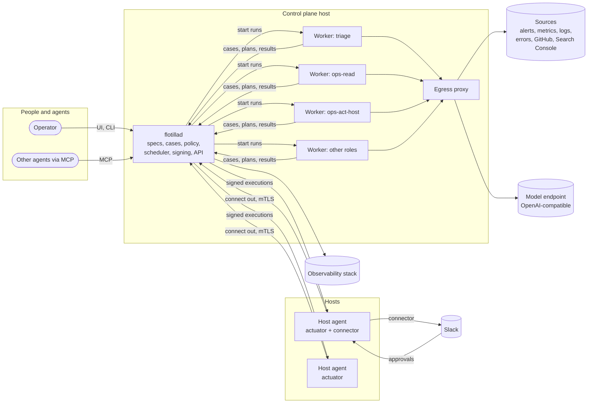

# Architecture

How flotilla is built. The decisions are in the ADRs: [ADR-0001](../adr/ADR-0001-platform-foundations.md)
(foundations), [ADR-0002](../adr/ADR-0002-run-in-docker.md) (Docker),
[ADR-0004](../adr/ADR-0004-job-runtime.md) (the runtime),
[ADR-0005](../adr/ADR-0005-agent-pipeline.md) (the agent pipeline) and
[ADR-0006](../adr/ADR-0006-node-agent.md) (host agents). The reasoning is in the RFCs they
came from.

These pages describe flotilla in general. Where a fact belongs to one installation, it is marked as
the **reference installation**: the homelab flotilla was built for (a Mac mini running the control
plane, a DGX and a production VPS as other hosts).

| Page | What it answers |
| --- | --- |
| [Context](context.md) | Who uses flotilla, and what it talks to |
| [Components](components.md) | What flotillad, the workers, the runtime and the host agents are made of |
| [A case, end to end](run-lifecycle.md) | What happens from a signal to a verified, recorded result |
| [Data](data.md) | What is stored where: specs, config, state, cases, recall |
| [Deployment](deployment.md) | How it is deployed: the control plane, the workers, the host agents, the keys |
| [Security](../security.md) | The threat model and the controls |
| [Testing and validation](../testing.md) | How the code, the platform and each fleet are proven |

## In one picture

- **flotillad** decides and records; it holds no fleet credentials and runs no fleet code.
- **Workers** run routines (one worker per role, each with only that role's credentials); routines diagnose,
  plan and report, and reach the outside only through the egress proxy.
- **Host agents** run on the machines flotilla may change; they connect out to flotillad and run only
  signed executions their host's own allowlist permits. One may also be the connector to a
  communication provider.

## Vocabulary

| Term | Meaning |
| --- | --- |
| **fleet** | a group of routines with one purpose: triage, Ops (the SRE team in action), digital marketing, bugfix |
| **routine** | a declared unit of work: its worker, trigger, steps, capabilities, autonomy, budget |
| **run** | one execution of a routine |
| **case** | one problem flotilla handles, with its lifecycle and its whole timeline ([A case, end to end](run-lifecycle.md)) |
| **case kind** | a type of problem (`failed_backup`, `code_bug`, …): its playbook and allowed capabilities |
| **capability** | a named, typed, scoped operation in one registry: a **read** (an agent may call it) or a **write** (an agent may only plan it) |
| **recall** | everything an agent may look up: what flotilla recorded (exact, by key) and plugged-in sources (repos, docs, MCP servers), each trusted or untrusted |
| **policy** | flotillad's code that decides each planned write: run, ask the operator, or refuse |
| **autonomy** | how far something may go without asking, as a lifecycle: `shadow` (plans recorded, nothing done), then `propose` (asks the operator), then `auto` (acts). Capped by the routine, earned by each write capability, capped by the host; promoted only by the operator ([ADR-0008](../adr/ADR-0008-autonomy.md)) |
| **worker** | a long-running container that runs routines for one role, with that role's credentials |
| **host agent** | `flotilla-node` on a host: the **actuator** (runs host writes) and, where configured, a **connector** (talks to a communication provider) |
| **channel** | where flotilla tells people things: `alerts`, `approvals`, `notifications`; routed to a provider |
| **project** | what cases are about (a codebase, a site, a service), with its names in signals, issue repo and recall sources |
| **playbook** | a routine's instructions to the model, Markdown in git |
| **actuator** | ADR-0005's name for the host agent's role that runs writes |
| **node** | the host agent as the CLI and the API name it (`flotilla node`, `nodes`) |

What happens is the lowest of three: the routine's autonomy, the capability's and the host's
autonomy cap. A `propose` routine never runs anything at `auto`; an `auto` routine runs each
capability at its own earned level.
