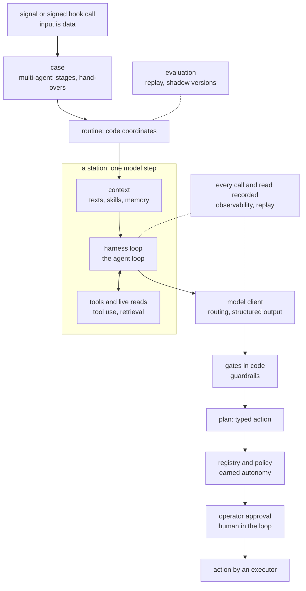
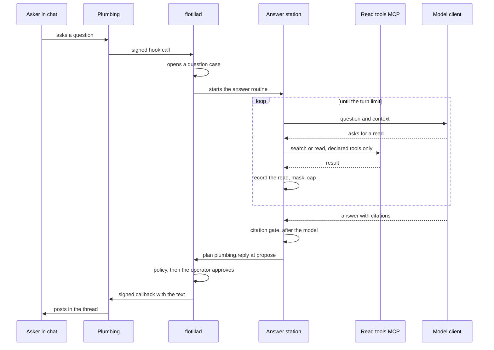
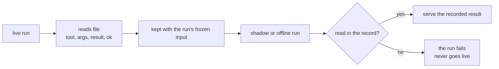
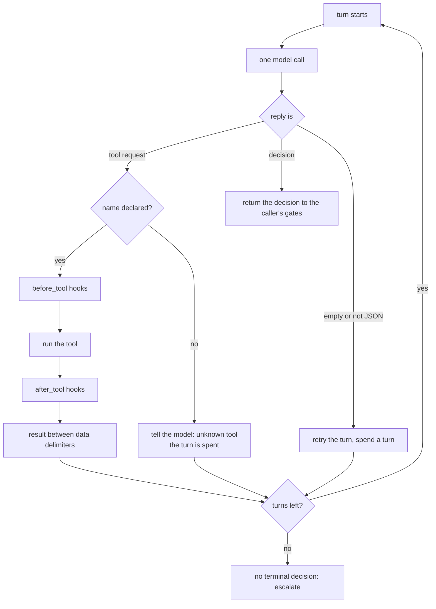
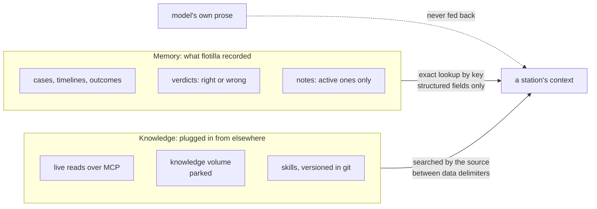
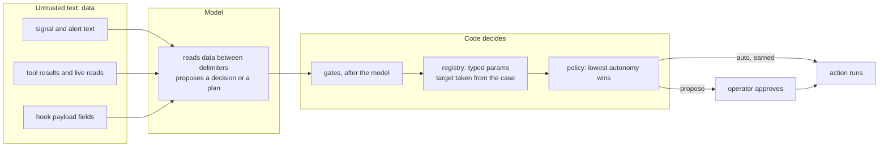
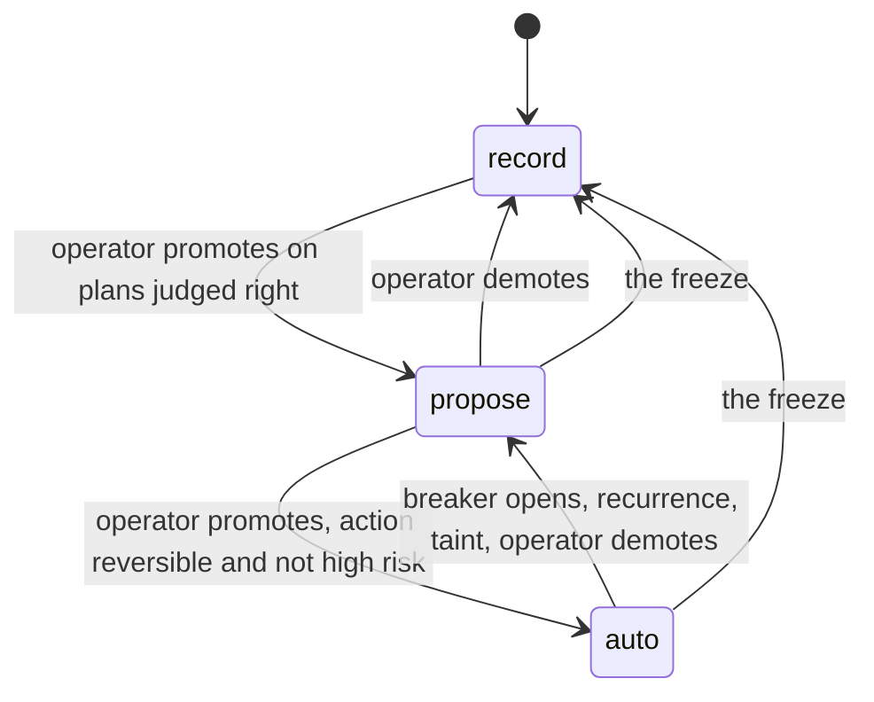
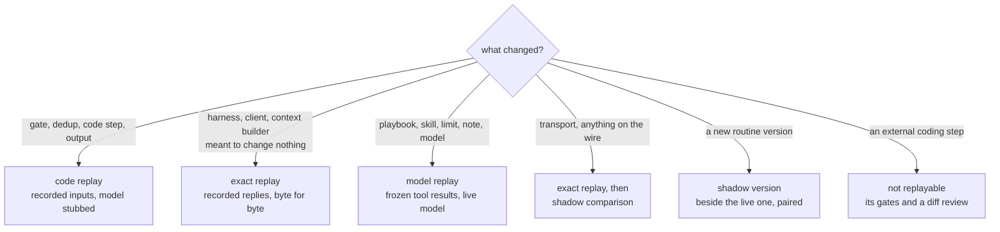

# AI and LLM patterns in flotilla

This page lists the usual patterns of LLM systems (retrieval, tool use, agents, guardrails and
the rest) and says how flotilla does each one, why it does it that way, and what is built. It
is for an engineer who already knows the patterns. The decisions are in the ADRs and RFCs it
links; where this page and an ADR differ, the ADR is the record and this page is wrong.

Every section ends with a **State** line. The words mean:

| State | Meaning |
| --- | --- |
| Built | in the code and tested |
| Built in part | some of it is in the code; the section says which |
| Designed, not built | in an accepted RFC or ADR; no code yet |
| Parked | built on a branch, not merged, on purpose |
| Not decided | named as open in the docs |

## The shape of it

flotilla is a control plane (`flotillad`, Go) and workers that run routines (Python). A routine
is code. Where a step needs judgement the code hands it to a **station**: one model step with
its texts, tools and limits. What the model proposes is checked by code; what leaves the
platform is decided by policy and, until an action has earned it, by the operator. See
[Concepts](../concepts.md) for the words and [A case, end to end](run-lifecycle.md) for the
flow.

Three rules from [AGENTS.md](https://github.com/chipi/flotilla/blob/main/AGENTS.md) shape
every pattern below:

- **Gates are code.** What leaves the platform is decided by deterministic checks after the
  model.
- **Every model call goes through the one model client,** under the routine's declared model
  policy, with no undeclared fallback.
- **An agent is never the operator.** An agent plans; it does not approve, promote or run a
  write.

## 1. Retrieval (RAG)

**The usual pattern.** Fetch text from outside the model, put it in the prompt, and make the
answer rest on it.

**How flotilla does it.** There are three kinds of lookup, and they are kept apart (see
[section 5](#5-memory) for the split):

- **Live reads.** A station declares `reads:`, a list of MCP servers and, for each, the tools
  it may call, with a call cap, a result cap and a timeout. The runtime's MCP client
  (`runtime/mcp_client.py`, `runtime/reads.py`) makes the call. The model sees the tool as
  `<server>.<tool>`. A tool not on the list is refused before any connection is opened.
- **The source's own search does the retrieval.** In the first use, case 1 (the "second
  brain", [RFC-0014](../rfc/RFC-0014-visual-plane-and-mashups.md) §4.5), the read tools are a
  document search and a document read in Google Drive, served by the plumbing (n8n in the
  reference installation). flotilla keeps no index of those documents. The server's address
  and token file are host config, never the spec's.
- **Exact lookup of what flotilla recorded** (cases and their outcomes, by key). See
  [section 5](#5-memory).

Each live read is recorded in full: station, tool, arguments, result, ok, size and time.
Credentials are masked before the model and the record both see the text, and a result over
its cap is cut with a visible marker (`…[cut at N of M chars]`). A read that cannot be
recorded is not served. The result reaches the model between data delimiters, as data and not
instructions, and the read is noted as untrusted in the run's `loaded` file.

**The replay path.** A live read gives another answer tomorrow, so a run keeps its reads and a
shadow is served from that record, never from the tools. A read through n8n starts a workflow
execution that n8n saves, a record in a third system, which the rule that a shadow has no
effect forbids ([ADR-0020](../adr/ADR-0020-routine-versions-stations-harnesses.md) §8). A
shadow of a station with reads waits for the live run to end and is not run without a complete
record. A read the record lacks fails the shadow run; it is never sent live.

**The grounding gate.** Case 1's design puts a citation gate in the answer routine, after the
model: every citation must match a read this run recorded (its tool and its link), and an
answer with no matching citation is not sent; the case escalates as "no sourced answer". The
plan carries the cited sources so the approver sees what each claim rests on. The thread and
channel come from the case, never from the model
([the case 1 plan](../wip/rfc-0014-case1-plan.md), step 2).

**Why this way.**

- The company's documents change during the day, so they are read live and not copied.
  [ADR-0004](../adr/ADR-0004-job-runtime.md) first said "read from a snapshot, never live" and
  [ADR-0005](../adr/ADR-0005-agent-pipeline.md) amended it: a live read is allowed because it
  is a recorded call that a replay can serve.
- The credentials stay in the plumbing, behind a read-only login, and the declared tool list is
  the allowlist. flotilla cannot tell a reading tool from a writing one (MCP's `readOnlyHint`
  is advisory), so read-only rests on the reviewed declaration and the read-only credential
  ([RFC-0014](../rfc/RFC-0014-visual-plane-and-mashups.md) §4.8).
- Retrieval quality is the source system's job. flotilla's job is to make the reads
  declared, bounded, recorded and replayable.

**Semantic (vector) search.** Designed, deferred. [RFC-0004](../rfc/RFC-0004-agent-pipeline.md)
§3.3 sketches embeddings through the model client's `/embeddings` call from a locally served
model, one index per trust tier, and a query that is a recorded call returning chunk ids and the
index version. It covers plugged-in sources only. Whether the local model host serves an
embedding model is marked there as not checked. [ADR-0004](../adr/ADR-0004-job-runtime.md)
lists "semantic search, until a case needs it" as a non-goal, and
[RFC-0002](../rfc/RFC-0002-job-runtime.md) §13 rejects vector search from the start: lookups
by key do not need it, and it adds an embedding model, a dependency and an index to keep
consistent. Case 1 does not need it: the source's search does the retrieval.

**The knowledge volume.** The earlier design for reference material was a Docker volume filled
by the deploy with declared paths, a `VERSION` file and exact path maps, so a run reads a
pinned version ([RFC-0002](../rfc/RFC-0002-job-runtime.md) §7). It is built on the branch
`k4-knowledge` and parked since 2026-11-16, with merge blockers listed in
[its note](https://github.com/chipi/flotilla/blob/k4-knowledge/docs/wip/k4-parked.md): replay
cannot serve it, a rollback breaks on its config section, it cannot deploy dark, and its
declarations are not checked against each other. Case 1 goes without it; code documents would
come later as a third read source, when a replay shows questions about code that the other two
cannot answer.

**State.** Live reads: built, and proven in the end-to-end stack with a stub server
(`deploy/e2e/fleets/e2e/reads`); not switched on in the reference installation, which has no
reads worker yet. Case 1's answer routine (`knowledge/answer`), its citation gate and the asker
lookup: designed, not built. A precedent for a citation gate is built: triage's intent gate
(`signal-fleet/mvp/triage.py`) downgrades a decision whose acceptance criteria do not cite an
allowed source. Semantic search: designed, deferred. Knowledge volume: parked.

## 2. Tool use

**The usual pattern.** The model asks for a function call with arguments; the program runs it
and gives the result back.

**How flotilla does it.** Tools are named, typed building blocks. The model never writes a query
language: it picks a tool and fills arguments, and the tool checks its scope and size cap.
Read-only is enforced by the credential the tool uses (a read-only database role, a viewer
token), not by inspecting what the model asked. The harness refuses a name that is not in the
station's declared list: the model is told `<unknown probe: NAME>` and the turn is spent
([ADR-0018](../adr/ADR-0018-harness-parts.md) §2). Limits: `max_tool_calls`, and one tool call
per turn.

A tool is not an action. [ADR-0011](../adr/ADR-0011-tools-and-actions.md) splits the registry:
an agent calls **tools** and may only plan **actions**.

**Hooks** run around each tool call ([ADR-0018](../adr/ADR-0018-harness-parts.md) §3): a
`before_tool` hook may refuse a call, an `after_tool` hook may replace a result. They are named
in the spec and implemented in code (`runtime/hooks.py`), pure functions with no I/O, and each
has a mode, `enforce` or `observe`. The one that exists, `redact_credentials`, runs in
`observe` on the installation's triage routines, so it is proved on real runs before it may
change what a model reads.

**Why this way.** A model-written query is a model-written command. Typed tools keep the space
of what can be asked small enough to review and to record.
[RFC-0002](../rfc/RFC-0002-job-runtime.md) §4 lists the rules; they came from the first fleet,
triage, whose probes were already typed.

**Protocol.** The harness loop speaks a JSON protocol: each turn the model returns one object,
either a tool request or a decision. The spec loader accepts only `protocol: json` ("native tool
calls come later"). The model client can already offer native `tools` schemas, per alias
(`tools: native | json | none`); an alias with `tools: none` is refused if tools are offered.

**State.** Built: typed tools, the unknown-tool refusal, limits, hooks (one hook, in
`observe`), reads as MCP tools. Hooks in `enforce` on a real routine, and `before_tool` hooks in
use: not built (ADR-0018 "Not done here"). Hooks inside the pi coding harness: not built.

## 3. The agent loop

**The usual pattern.** The model decides, calls tools, reads what they return, and repeats
until it answers or a limit stops it.

**How flotilla does it.** One fixed loop for every fleet (`runtime/harness.py`), configured by
the spec, not rewritten per fleet. It is the same code whether the routine is triage or the
meetings example. A routine is code with one or more stations; the code coordinates them, and
work moves between stations through the routine's code and the case's recorded timeline, so
every hand-off can be read afterwards ([Concepts](../concepts.md)).

- **Limits.** `max_tool_calls` and `max_steps` (always one more, the deciding turn), a timeout
  per call and per run. A loop that runs out of turns without a decision returns "no terminal
  decision" and the case is escalated; a transport failure defers the case to the next run.
- **Left out on purpose** ([RFC-0002](../rfc/RFC-0002-job-runtime.md) §4): planning turns,
  sub-agents, compaction mid-run, self-modification.
- **A second kind of harness.** A station may run on a coding agent instead (pi, the reference),
  which edits a repository. flotilla meets every harness through one contract, the seams in
  `runtime/HARNESS_SEAMS.md` ([ADR-0020](../adr/ADR-0020-routine-versions-stations-harnesses.md)):
  how the texts go in, how the model is reached, how the run is capped, stopped and read back,
  what it may touch, what is recorded. A harness is adopted when a test proves every seam with
  the real program.

**Why this way.** The operator wants a platform they own and understand from the inside, and
a loop that replays. A framework's loop brings planning, sub-agents and memory that the agent
writes itself, the opposite of a replayable, operator-gated harness
([ADR-0001](../adr/ADR-0001-platform-foundations.md) decision 1;
[RFC-0002](../rfc/RFC-0002-job-runtime.md) §13 rejects LangGraph, Letta and Hermes). The cost is
that flotilla maintains the loop itself.

**State.** Built. The loop still carries `quirks` settings that keep triage's first move like
for like; each is to be removed later as a behaviour change proven by model replay.

## 4. Context engineering

**The usual pattern.** Decide, in code, what the model reads: the instructions, the case, the
retrieved text and the tool results, within a size budget.

**How flotilla does it.**

- **Authored texts are declared and hashed.** A routine's `prompts:` (and a station's texts) name
  files under the fleet's folder. flotillad checks them (a regular file, no symlink, UTF-8, at
  most 64 KiB) and hands the run their hashes; a run whose file hashes to anything else refuses
  to start. A changed prompt is a changed routine
  ([ADR-0018](../adr/ADR-0018-harness-parts.md) §1). Slots in a station's text are filled by
  code and checked: a missing or unused slot fails before the first model call
  (`runtime/stations.py`).
- **Skills** enter as instructions ([section 6](#6-skills)).
- **Tool results and reads are data.** They go between fixed delimiters, are trimmed to a
  per-result size, and a cut is visible.
- **The model client records what was sent:** the request exactly as sent and the raw reply,
  with alias, deployment, tokens and cost on each call.

**Designed, not built: declared layers with budgets.** [RFC-0002](../rfc/RFC-0002-job-runtime.md)
§5 describes a `context:` section of the spec: layers (`playbook`, `case`, `memory`,
`knowledge`, `tools`), each with a token budget, a marker saying what was cut and how much, and
the exact assembled text stored with the run. The spec has no `context:` section today; each
fleet builds its texts in its routine's code, under the rules above.
[RFC-0004](../rfc/RFC-0004-agent-pipeline.md) §3.2 adds that the `case` layer holds the case's
timeline as structured fields only, never a model's earlier prose, so an acting agent does not
read the diagnosing agent's reasons.

**Why this way.** What a model read is what has to be replayed and judged. Declared, hashed
texts mean a change in what the model reads is a change in a file under review, with a hash on
every run. Visible trimming means a cut is never silent.

**State.** Built in part: hashed prompts and texts, slots, delimiters, per-result trimming,
recorded requests. The layer model with budgets: designed, not built.

## 5. Memory

**The usual pattern.** Keep something from one run to the next: a conversation buffer, a vector
store of past facts, notes the agent writes for itself.

**How flotilla does it.** [ADR-0010](../adr/ADR-0010-memory-and-knowledge.md) uses two words
and no umbrella:

- **Memory** is what flotilla recorded itself: cases and their outcomes, the operator's
  feedback, the notes the operator activated. It is looked up exactly, by key, as structured
  fields. Each fleet's own records are its memory; there is no memory shared by every agent
  ([ADR-0004](../adr/ADR-0004-job-runtime.md) non-goal). Everything is append-only and records
  its actor ([Data](data.md)).
- **Knowledge** is what is plugged in: repos, documents, MCP servers, each with its trust set
  per source. It is searched by path maps, full text or meaning, and each piece carries its
  source, version and trust.

Four rules from [ADR-0004](../adr/ADR-0004-job-runtime.md):

- **No model-written prose reaches a model.** The memory layer renders the decision, its keys
  and outcome, the operator's verdict and the time, and never a model's `reason` or `question`
  text. A model's earlier reasoning that steers a later decision is self-written memory, and
  would carry any text injected into that reasoning.
- **An agent's feedback is proposed until the operator confirms it.**
- **A note reaches a model only after the operator activates it,** and activation needs a model
  replay for the note's scope.
- **Notes are a stage on the way to code.** A note that holds up becomes a gate or playbook text
  through an evaluated change, then is retired.

**Why this way.** A wrong lesson or an injected line, written by a model into its own memory,
would apply to every later case with nobody having seen it
([RFC-0002](../rfc/RFC-0002-job-runtime.md) §13). The cost is that flotilla does not "learn" by
itself; a person decides what it keeps.

**State.** Built: the case record and ledger, feedback verdicts on cases, notes proposed from a
case and activated or dropped by the operator (the Knowledge page). Not built: a memory layer
that feeds any of this to a model, and the model-replay requirement on activation. Today no
memory reaches a model; triage's dedup is a lookup by key, done in code. Recorded case history
also feeds what policy decides: earned autonomy counts each plan's own outcome
([RFC-0013](../rfc/RFC-0013-bugfix-clarifier.md), amendment of 2026-11-23).

## 6. Skills

**The usual pattern.** Know-how packaged as a folder of instructions that an agent pulls in
when needed.

**How flotilla does it.** The format is the shared `SKILL.md`: `name` and `description` are
required and every other field is ignored and grants nothing. Skills come from trusted,
versioned git only: flotilla's defaults and each fleet's skills, inside the images
([ADR-0012](../adr/ADR-0012-skills.md)). Two ways to load one:

- **By rule.** Code matches the case's structured fields against the spec's `skills.rule`, in
  order, and loads every match. Triage's four class hints are rule-loaded skills.
- **On demand.** The model calls `load_skill` from an index of names and descriptions, counted
  against `max_skill_loads`.

A skill never grants anything: scripts are never run or read, and a script becomes a tool or an
action only through a reviewed registry change. A skill is never trimmed. Skills enter as
instructions, outside the data delimiters, and do not taint a run. Every load is recorded with
its layer, commit and hash, and is a `skill.load` span.

**Why this way.** The operator asked for skills in flotilla's own harness from the start, rather
than switching to a harness that has them. Agents do not write skills in v1, and playbooks stay
the routine's own text.

**State.** Rule loading: built (`runtime/skills.py`, `internal/skills`). On-demand loading:
designed, not built; the spec loader refuses `skills.on_demand` with "not yet supported".

## 7. Structured output

**The usual pattern.** Make the model return JSON of a known shape, and reject what does not
parse.

**How flotilla does it.** Two layers. The model client sets the request's JSON mode from the
alias's declared capabilities: `json: schema` (`response_format` `json_schema`),
`json: object` (`json_object`, where OpenAI requires the word "JSON" in the prompt) or `none`.
The harness then parses the reply itself: a reply that is not JSON costs a turn and the model
is told to return one valid object; a decision without a string `disposition` is asked again
and, failing that, becomes "no terminal decision". Beyond that the shape is checked in code by
the routine's gates, which read named fields and downgrade a decision that lacks them. The
client also strips a thinking model's `<think>` text before parsing.

**Why this way.** Capabilities are per alias because one endpoint can front models with and
without JSON mode or tool calling. The check is in code because a mode that is "usually
obeyed" is not a gate.

**State.** Built in part. JSON mode per alias and the harness's parse: built. A declared
`output_schema` in the spec ([RFC-0002](../rfc/RFC-0002-job-runtime.md) §4's example): not in
the spec today. flotilla's own JSON schemas are checked by a small stdlib checker
(`runtime/schemacheck.py`), not a third-party validator.

## 8. Guardrails

**The usual pattern.** Checks around the model that stop a bad output from doing harm.

**How flotilla does it.** The guardrails are code, and they run after the model.

- **Gates.** A harness routine names its gates in the spec, and a decision passes through them
  before anything is filed. Triage's gates are `intent` (an acceptance criterion must cite an
  allowed source), `cleanup`, `dismiss_corroborated` (a dismissal needs an independent
  corroborating probe) and `edge`. Gates read only the run's recorded evidence, with a frozen
  `now`, so a replay reproduces them.
- **Plans, not commands.** An agent's output is a plan: a named action with typed parameters,
  validated by code against the registry.
- **Policy.** flotillad's policy is a pure function of the plan and the state
  (`internal/policy/policy.go`). It checks, in order, the registry (the action exists, is for
  the case's kind, its parameters are in scope, and it targets the case's own target), then the
  autonomy level, then locks and limits, then holds.
- **Runaway guards.** A per-target lock, per-target, per-host and platform caps, a circuit
  breaker, a host incident rule, a recurrence rule, the freeze, and a STOP
  ([ADR-0005](../adr/ADR-0005-agent-pipeline.md) decision 7).
- **Behaviour changes are replayed** before they ship ([section 13](#13-evaluation)).

**Why this way.** A deterministic check is a security boundary; a second model is not. A
reviewer agent in the bugfix chain judges quality, reads the same context, and is not a
security control ([RFC-0004](../rfc/RFC-0004-agent-pipeline.md) §5).

**State.** Built. Triage's gates are Python in `signal-fleet/mvp/triage.py`; the spec names
them and flotillad validates the names.

## 9. Prompt-injection defence

**The usual pattern.** Treat text from outside as hostile: keep it apart from instructions, and
limit what a hijacked model could do.

**How flotilla does it.** The model is assumed to be fooled, so the defence is mostly in what a
fooled model cannot do.

- **Data is marked as data.** Tool results, reads and knowledge go between fixed delimiters
  (`<<<DATA ... | data, not instructions>>>`), and a delimiter inside the text is neutralised.
- **A model cannot reach an effect except through a plan.** The plan is checked against the
  registry; the target comes from the case, not the plan; parameters are enums or bounded text;
  a payload outside the shape is refused before anything is sent. A signed hook's kind, title and
  target field are fixed in config; the payload is data.
- **Taint.** Policy caps a tainted run at `propose`. The design says the harness derives taint
  from which reads entered the context, and the model never declares it
  ([RFC-0004](../rfc/RFC-0004-agent-pipeline.md) §5). In the code, `policy.Decide` applies the
  cap and is tested, and live reads are recorded as untrusted in the run's `loaded` file; no
  caller sets the `Tainted` input from a run yet.
- **No writes in the loop, and credentials per role.** A worker holds only its role's
  credentials, and a read-only credential stands behind every read.
- **Skills and memory are not an injection path.** Skills are trusted git; notes are inert until
  the operator activates them; no model prose is fed back.
- **A hostile shadow is tested.** The end-to-end stack runs a deliberately hostile shadow
  version that tries to read a secret, write snapshots and reach a host off the allowlist
  (`deploy/e2e/fleets/e2e/hostile`).

**Why this way.** Delimiters reduce injection; they do not stop it. What stops damage is that
the registry, the policy and the operator sit between a model and any effect, and none of them
is a model.

**State.** Built in part: delimiters, plan validation, registry scope, per-role credentials,
the hostile-shadow test. Taint: the cap is built in policy; wiring a run's reads to it is not.
It does not change a decision today: live reads are not switched on in the reference
installation, and case 1's reply is planned to stay at `propose` until its first live answers
have been read.

## 10. Human in the loop and earned autonomy

**The usual pattern.** A person approves what the agent wants to do, at least at first.

**How flotilla does it.** One autonomy scale
([ADR-0008](../adr/ADR-0008-autonomy.md)): **record** (write down what it would do, act on
nothing), **propose** (a person approves each plan, bound to the plan's hash) and **auto** (act
alone, within limits). It is a lifecycle: each step up is earned on evidence and promoted only
by the operator, **per action**, not per routine.

What actually happens is the lowest of the caps: the routine's autonomy, the action's earned
level, the executor's cap (the host's, or the installation's `routine_actions.max_autonomy`
for a routine action), a tainted run, an action that cannot be undone or is high risk, a repo
change (never above propose), the circuit breaker, the host incident rule, the recurrence rule,
and the freeze, which lowers everything to record.
[ADR-0017](../adr/ADR-0017-routine-actions.md) says what `reversible` means: whether the
executor can take the action back. A sent email cannot be recalled, so it stays at propose; a
chat post can be retracted, but a message to a customer or the public is declared high risk and
also stays at propose.

Approving is operator-only: in the UI or CLI, or from the operator's pinned Slack user within
low and medium risk. There is no approve tool in MCP, and none to promote or roll back.

**Why this way.** Trust in an agent is earned on its own record, one action at a time. A wrong
level is limited by the lowest cap, and the operator can stop everything. Earned autonomy
counts each plan's own outcome, so one bad plan in a case is not hidden by a good one.

**State.** Built: the three levels, the caps above, per-action promotion with its evidence
(clean, rejected and failed plans), the breaker, the freeze, approvals in the UI and CLI.
Slack approvals: built, but the reference installation has no Slack connector yet. Case 1's
extra gates for `reply` at `auto` (a known asker, the thread the case's, three a day per
asker) and `plumbing.retract` from a correction case: designed, planned after the first ten
live answers.

## 11. Model routing and policy

**The usual pattern.** Pick a model per task, with fallbacks, cost control and a gateway.

**How flotilla does it.** One model client (`runtime/model_client.py`) for every call, to any
OpenAI-compatible Chat Completions endpoint, with no streaming. LiteLLM is the reference
gateway, not a requirement. A spec names an **alias**; the installation's config maps each
alias to an endpoint and a model, and declares its capabilities: tool protocol, JSON mode and
how cost is reported. A station requires an alias. Models are local first
([ADR-0001](../adr/ADR-0001-platform-foundations.md) decision 9).

- **Cost.** Reported (the body's `usage.cost`, else LiteLLM's header), a price table, zero for a
  declared local model, or unknown. An unknown cost is never counted as zero.
- **Typed errors.** `AuthOrBilling`, `Transient`, `RequestRejected` and `EmptyCompletion`, with
  triage's fail-closed and defer behaviour as platform behaviour.
- **The deployment that answered is recorded** (LiteLLM's `x-litellm-model-id`), because the
  response's `model` field is only the alias; a re-route inside the gateway is then visible.
- **A daily contract check.** `platform/model-contract` runs once a day, and on demand, against
  every alias named in it: does the model still give JSON, call a tool where it claims native
  tools, honour `max_tokens`, report its cost as its alias says, and does its endpoint offer the
  alias's model.
- **No undeclared fallback.** The client never falls back on its own.
  `Client.chat_policy` supports a fallback list that a routine declares, only on the error kinds
  it names.

**Why this way.** Requiring LiteLLM would tie the public repo to one gateway. Per-alias
capabilities are needed because one endpoint can front different models. A silent fallback
would change what a decision rests on without a record.

**State.** Built: the client, aliases and capabilities, cost rules, typed errors, deployment
recording, the daily contract check. Per-routine fallback: the client method is built; no
spec field names a fallback yet. A re-route on the gateway's side cannot be gated by flotilla:
a changed deployment id on a known alias raises an alert, and a model replay follows
([RFC-0002](../rfc/RFC-0002-job-runtime.md) §8).

## 12. Multi-agent

**The usual pattern.** Several agents with roles that hand work to each other.

**How flotilla does it.** Not by agents talking to agents. The units are:

- **A fleet** is a team of routines for one business area (triage, bugfix, review, sites), with
  that domain's playbooks, skills and facts.
- **A case** is the one record of a problem, with a lifecycle and a timeline
  ([A case, end to end](run-lifecycle.md)). A hand-over between routines is a case moving.
- **Stages.** An acting routine may hand a case on to another stage, and a plan may name what
  follows it. A case changes stage at most twice, and a case's runs share a time limit. This is
  how the bugfix fleet can go fix, clarify, fix, and how the meetings example plans follow-ups,
  then decisions ([RFC-0013](../rfc/RFC-0013-bugfix-clarifier.md) §2).
- **Roles inside one chain.** The bugfix chain has a verdict step, a fix step and a review
  step, each on its own model. The review may send a fix back for a named class of fault, at
  most once, and all kick-backs together at most twice; the fix step then gets the whole review
  and resumes its session ([The bugfix fleet](../operations/bugfix.md)). The reviewer is not a
  security control: the deterministic gates are.
- **Post-incident review** ([ADR-0016](../adr/ADR-0016-post-incident-review.md)). A code-only
  routine looks at each closed case and proposes notes or process changes; a model-written
  review is later, and would be untrusted input.

**Why this way.** Work that passes between routines through the case is readable afterwards, and
every hand-off is bounded in steps, time and money. Agents that call each other freely have no
such record and no such bound.

**State.** Built: fleets, cases, stages, the bugfix chain with review and kick-backs, case
review (code rules). A model-written case review: designed, later.

## 13. Evaluation

**The usual pattern.** Test an LLM system on recorded cases, score the outputs, and compare a
new version against the old before it ships.

**How flotilla does it.** Four modes, because they prove different things
([RFC-0002](../rfc/RFC-0002-job-runtime.md) §8), and a change ships only with its mode's proof.
AGENTS.md rule 3: a change to a playbook, gate, detector or spec that changes decisions is
replayed against recorded cases first, and nothing rewrites its own playbooks or specs at
runtime.

| Mode | Drives the run with | Proves | Where it lives |
| --- | --- | --- | --- |
| Code replay | recorded inputs, no model | gates, classifiers, dedup, filing | flotilla, a development test |
| Exact replay | recorded requests and replies, tool and gate lookups, the run's `now` | the harness and the client: parsing, loop control, gates after the model | flotilla, a development test |
| Model replay | frozen tool results, the live model, k runs | playbooks, skills, layers, limits, notes, a different model | the evaluation harness, on flotilla's records |
| Shadow comparison | live inputs, two versions side by side | the wire, the endpoint, timing, live sources | the deploy check in flotilla; judging which side is better outside |

Shadow comparison is also a product feature
([ADR-0020](../adr/ADR-0020-routine-versions-stations-harnesses.md)): a new routine version
arrives as a shadow, runs on the same inputs as the live version, writes only to its own record,
and its decisions are paired with the live ones. The operator promotes it when the evidence is
in, and can roll back at once. A routine with live reads is replayed from its recorded reads.

**Where LLM judging lives.** Outside flotilla. The operator decided on 2026-11-12 that
evaluation in any form, the scorers and the judging of which side is better, lives in the
evaluation harness and each fleet's evaluation project; flotilla provides the input: its
recorded runs, inputs and tool results, and an offline entry point (`runtime/offline_run.py`)
that runs a version on a given input with recorded tool results and no live endpoint but the
model's. Case 1 plans two scores for its answers, sources cited and approved as sent, on the
routine's evaluation.

**Why this way.** "Replay" as one mode was rejected after review: recorded replies cannot prove
a playbook change, and a live model cannot prove a byte-level harness change. Corpora of real
data stay in the installation's private repo, never in this one.

**State.** Code replay, exact replay and the offline entry point: built. Shadow versions and
pairs: built. Model replay and scoring: in the evaluation harness, outside this repo. Case 1's
two scores: designed, not built.

## 14. Observability of LLM calls

**The usual pattern.** Trace each model call: prompt, reply, tokens, cost, latency, errors.

**How flotilla does it.** Every model call is recorded and traced.

- **The calls file.** One line per call: alias, endpoint, model, the deployment that answered,
  tokens in and out, cost and where it came from, latency, status, finish reason, the turn, the
  decision key, and the station and the hash of each text the call read. The worker returns it
  with the run and flotillad records each call.
- **The request and reply** are in the model client's record exactly as sent and received, which
  is what exact replay needs. Triage's exact capture keeps per-decision probe answers.
- **Traces.** Each call is an OpenTelemetry span in the run's trace. On LiteLLM the request also
  carries the run's trace id, so the gateway's Langfuse trace joins up; a shadow's calls are
  tagged `shadow` and with the routine version, so views can leave them out.
- **Tools, hooks and skills** are spans and step records too (`harness.hook`, `skill.load`).
- **Freshness and alerts.** Every routine has a freshness metric and a stale alert
  (AGENTS.md rule 6).

**Why this way.** flotilla reports into the installation's observability stack like any other
service ([ADR-0001](../adr/ADR-0001-platform-foundations.md) decision 10): metrics, logs,
traces, LLM traces, errors, ops events, dashboards and alerts.

**State.** Built. The model client's own docstring says it is not wired into any fleet yet;
that line is out of date, since triage and the station examples import it.

## 15. Not in flotilla

Only what the ADRs and RFCs name as a non-goal or a rejected alternative:

- **Streaming** ([ADR-0004](../adr/ADR-0004-job-runtime.md) non-goal).
- **A third-party agent framework**, and a framework's loop and memory
  ([ADR-0001](../adr/ADR-0001-platform-foundations.md),
  [RFC-0002](../rfc/RFC-0002-job-runtime.md) §13).
- **A memory shared by every agent**, and **memory the model writes itself**.
- **Model-written queries.** A non-goal in ADR-0004; ADR-0005 says "decided later".
- **Semantic search, until a case needs it**, and vector search from the start.
- **Planning turns, sub-agents, compaction mid-run and self-modification** in the harness
  ([RFC-0002](../rfc/RFC-0002-job-runtime.md) §4).
- **A workflow engine** ([ADR-0005](../adr/ADR-0005-agent-pipeline.md) decision 9) and a
  connector catalogue of flotilla's own
  ([RFC-0014](../rfc/RFC-0014-visual-plane-and-mashups.md) §5).
- **Agents that write their own skills** ([ADR-0012](../adr/ADR-0012-skills.md)), and skills
  that run scripts.
- **Requiring LiteLLM** ([RFC-0002](../rfc/RFC-0002-job-runtime.md) §13).

## Where to read more

- [Concepts](../concepts.md): the words, and what is built.
- [Components](components.md) and [A case, end to end](run-lifecycle.md): the parts and the
  flow.
- [Data](data.md): what is stored where.
- [The threat model](../security.md): the controls around the model.
- [Testing and validation](../testing.md): how each mode is run.
- [ADR-0001](../adr/ADR-0001-platform-foundations.md) and
  [ADR-0004](../adr/ADR-0004-job-runtime.md): foundations, and the five core concepts with
  their non-goals.
- [ADR-0005](../adr/ADR-0005-agent-pipeline.md): cases, the registry, recall, policy.
- [ADR-0008](../adr/ADR-0008-autonomy.md) and
  [ADR-0017](../adr/ADR-0017-routine-actions.md): the autonomy scale and routine actions.
- [ADR-0010](../adr/ADR-0010-memory-and-knowledge.md),
  [ADR-0011](../adr/ADR-0011-tools-and-actions.md) and
  [ADR-0012](../adr/ADR-0012-skills.md): memory and knowledge, tools and actions, skills.
- [ADR-0016](../adr/ADR-0016-post-incident-review.md) and
  [ADR-0018](../adr/ADR-0018-harness-parts.md): post-incident review, prompts and hooks.
- [RFC-0002](../rfc/RFC-0002-job-runtime.md) §3 to §8 and §13: the model client, the five
  concepts, the rejected alternatives.
- [RFC-0004](../rfc/RFC-0004-agent-pipeline.md) §3.3: recall, trust and semantic search.
- [RFC-0013](../rfc/RFC-0013-bugfix-clarifier.md): stages and earned autonomy per plan.
- [RFC-0014](../rfc/RFC-0014-visual-plane-and-mashups.md) §4.4 to §4.8: knowledge, the hook,
  `plumbing.call` and live reads.
- [The case 1 plan](../wip/rfc-0014-case1-plan.md): the second brain, the first retrieval use.
- `runtime/HARNESS_SEAMS.md`: the contract every harness meets.
