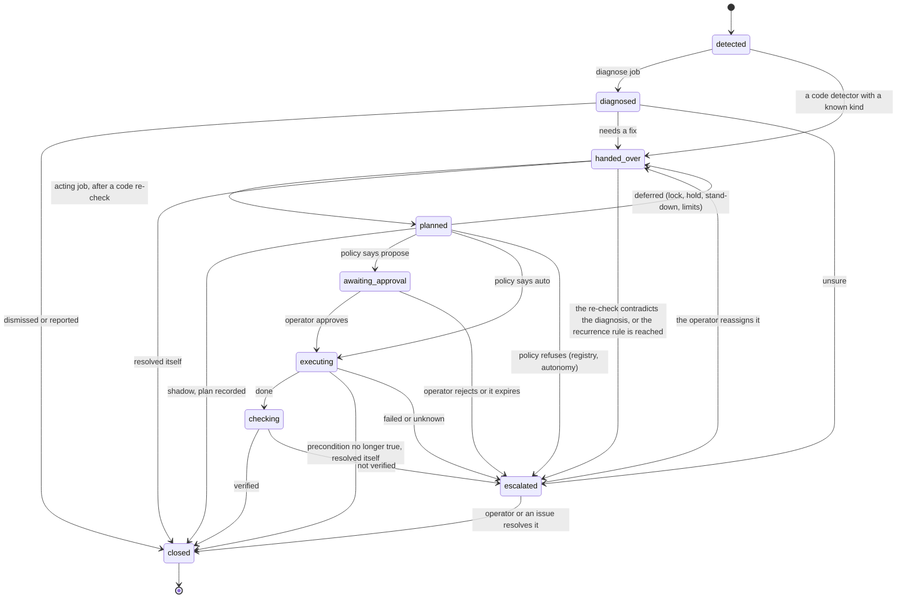

# A case, end to end

Every problem flotilla handles is a **case**: detected, diagnosed, handed to the job that can fix it,
planned, approved where needed, executed, checked and closed, with every step on its timeline
(`flotilla case show <id>`). The full design is [RFC-0004](../rfc/RFC-0004-agent-pipeline.md) §3.5;
the decision is [ADR-0005](../adr/ADR-0005-agent-pipeline.md).

## The lifecycle

The transition table in flotillad enforces these; events (an outcome days later, a recurrence, a
reopened issue) may still be added to a closed case.

## An example: an overnight backup that failed

1. **Detect.** A code-only Ops monitor sees the observability backup is older than 26 hours and opens
   a `failed_backup` case for the mini. Its keys are computed by code; an open case with the same key
   would have received the signal instead.
2. **Hand-over.** A code detector knows the kind, so the case goes straight to `handed_over`, and the
   event starts the Ops remediation job in the `ops-act-host` worker, which takes the case's lease.
3. **Re-check and plan.** The job re-checks by code (backup age, whether the job is running). Still
   a problem, so it plans `backup.rerun_observability(mini)`, citing the numbers.
4. **Policy.** flotillad checks the plan: the capability exists, is declared for `failed_backup`, its
   target is the case's; autonomy is the lowest of the job's stage, the capability's earned level, the
   mini's ceiling, taint and the freeze; the lock is free, limits and holds clear.
   - In **shadow**: the plan is recorded and the case closes.
   - In **propose**: the case waits in `awaiting_approval`; the `approvals` channel shows it in Slack;
     the operator approves there or by CLI, bound to the plan's hash. The approval starts a new run.
   - In **auto**: it goes straight on.
5. **Execute.** flotillad signs the execution and sends it to the mini's host agent, which checks the
   signature, expiry, its own allowlist and ceiling, re-checks the precondition, and runs the exact
   command (`launchctl kickstart system/com.homelab.db-backup`), recording it in its own audit log.
6. **Check.** After the window, a timer starts a code check: a backup newer than the execution. The
   case closes as verified, or escalates. Days later an outcome may be added.
7. **The morning.** The case, its execution, an annotation on the dashboards and a line in the brief
   show what was handled overnight.

Triage runs the same lifecycle with a model in step 1 to 2 (diagnosing alerts and errors); a code bug
becomes a `code_bug` case for the bugfix fleet, with its GitHub issue as the mirror.

## Runs and cases

A **run** is one job execution; a case may span several (a diagnose run, a planning run, an execute
run after an approval, a check run). No run waits: an approval or a due check is an event that
starts the next run.

## Failure behaviour

| Failure | Behaviour |
| --- | --- |
| The model endpoint rejects the key or billing (401, 402, 403) | the run ends `endpoint_down` with one aggregate signal, deduped across runs; no silent switch to another model |
| A transient model error | the case is deferred to the next run, up to the job's limit, then escalated |
| A capability call errors | the error is the call's answer; after the step limit the case escalates |
| Malformed answers until the step limit | the case escalates, with the raw answers in the run's record |
| A worker crashes or hangs | the deadline kills the run; its lease expires; the case returns, or its check resumes if an execution was open (the action never re-runs) |
| A host agent is unreachable | no execution is sent; an execution in flight becomes `unknown`, the target is held, the case escalates |
| An execution's result is unknown | the target is held until the operator clears it; the capability drops one autonomy level |
| flotillad restarts | runs in flight are `interrupted`; cases keep their status; timers resume |
| Budget spent mid-run | the run stops after the case in hand; the rest are deferred |
| Too many failures or new cases | the circuit breaker drops every auto capability to propose; the host incident rule pauses auto on that host |
