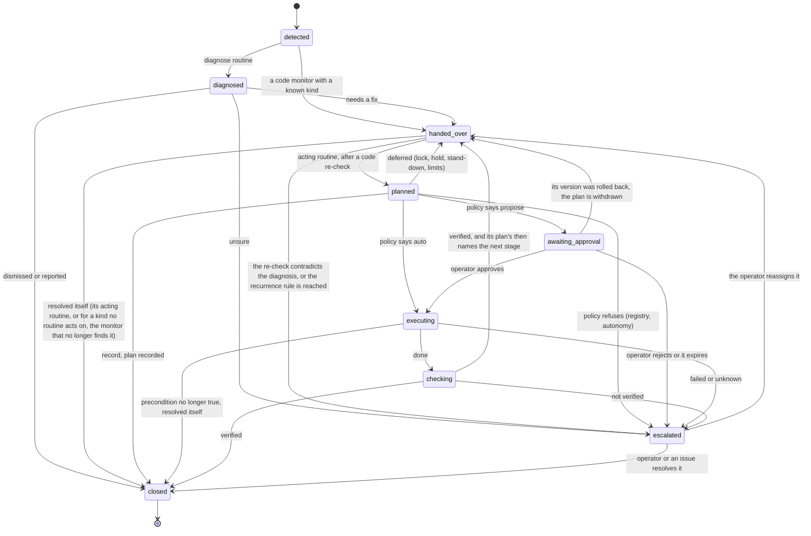

# A case, end to end

Every problem flotilla handles is a **case**: detected, diagnosed, handed to the routine that can
fix it, planned, approved where needed, executed, checked and closed, with every step on its
timeline (`flotilla case show <id>`). The full design is
[RFC-0004](../rfc/RFC-0004-agent-pipeline.md) §3.5; the decision is
[ADR-0005](../adr/ADR-0005-agent-pipeline.md).

## The lifecycle

The transition table in flotillad enforces these; events (an outcome days later, a recurrence, a
reopened issue) may still be added to a closed case.

A plan may name what follows it: `{"outcome": "plan", ..., "then": {"stage": "decisions", "data":
{...}}}`. When its check verifies it, the case goes back to `handed_over` at that stage instead of
closing, and that stage's routine plans the next action, reading the data as `stage_data`
([RFC-0013](../rfc/RFC-0013-bugfix-clarifier.md) §2, amended 2026-11-22). The `meetings`
example plans a meeting's follow-ups this way, then its decisions. Each hand-on counts towards the
case's two stage changes; past them, or with no routine for the stage, the verified case escalates.

## An example: an overnight backup that failed

From the reference installation (the v1 chain).

1. **Detect.** A code-only Ops monitor sees the observability backup is older than 26 hours and opens
   a `failed_backup` case for `backup-01`. Its keys are computed by code; an open case with the same
   key
   would have received the signal instead.
2. **Hand-over.** A code monitor knows the kind, so the case goes straight to `handed_over`, and the
   event starts the Ops remediation routine in the `ops-act-host` worker, which takes the case's lease.
3. **Re-check and plan.** The routine re-checks by code (backup age, whether the backup job is
   running). Still a problem, so it plans `backup.rerun_observability(backup-01)`, citing the numbers.
4. **Policy.** flotillad checks the plan: the action exists, is declared for `failed_backup`,
   its target is the case's; autonomy is the lowest of the routine's, the action's earned
   autonomy, the host's autonomy cap (for a routine action, the installation's
   `routine_actions.max_autonomy` instead, propose unless it opts in), taint and the freeze; the lock
   is free, limits and holds clear.
   - In **record**: the plan is recorded and the case closes.
   - In **propose**: the case waits in `awaiting_approval`; the `approvals` channel shows it in Slack;
     the operator approves there or by CLI, bound to the plan's hash (CLI first; Slack from the first
     action promoted to propose). The approval starts a new run.
   - In **auto**: it goes straight on.
5. **Execute.** flotillad signs the execution and sends it to the host agent, which checks the
   signature, expiry, its own allowlist and autonomy cap, re-checks the precondition, and runs the exact
   command (`launchctl kickstart system/com.example.db-backup`), recording it in its own audit log.
6. **Check.** After the window, a timer starts a code check in the acting worker: a backup newer
   than the execution. The case closes as verified, or escalates. Days later an outcome may be
   added.
7. **The morning.** The case, its execution, an annotation on the dashboards and a line in the brief
   show what was handled overnight.

Triage is not a case producer: it diagnoses alerts and errors with a model and files or dismisses
them through its own ledger and code gates, its output a GitHub issue. A code bug it routes to the
bugfix fleet (the label `triage-fleet/routed:bugfix`) becomes a `code_bug` case there, opened by the
bugfix fleet's intake.

## Runs and cases

A **run** is one routine execution; a case may span several (a diagnose run, a planning run, a check
run). No run waits: an approval makes flotillad sign and send the execution, and a due check is an
event that starts the check run.

## Routine versions and a case

A routine acts at its **live version**; a run records the version it started with, and a promote
leaves a run in flight to finish as that version. A **roll back** (operator only,
`flotilla rollback`) retires the live version and makes the previous one live. Its run in flight is
cancelled as a STOP cancels it. Its plans waiting in `awaiting_approval` are marked rolled back and
can no longer be approved or rejected (409), and their cases move to `handed_over` (event
`case.rolled_back`, the target lock released) so the live version plans them again. A plan the
previous version made stays approvable. See [ADR-0020](../adr/ADR-0020-routine-versions-stations-harnesses.md).

## A shadow version's run

With `shadows.enabled`, each live run records its **input** (what the run was handed, frozen at
its start; `flotilla input show`) and gives every shadow version of the routine a place in the
queue of its shadow worker. A shadow run starts from that input and, for a routine that keeps
state, from the live worker's snapshot of it. It runs under its own key
(`<fleet>/<routine>@v<n>`), one at a time per shadow worker; a scheduled input that waits while a
newer one arrives is dropped and recorded as not run. What it decides is written as shadow
records, never as a filing, a case change, a plan, a note or an execution. STOP, a retire and a
rollback cancel it; a promote lets it finish. When no shadow run waits for an input its snapshot
is deleted, unless the input is pinned. See
[ADR-0020](../adr/ADR-0020-routine-versions-stations-harnesses.md) section 8.

## Stopping a run in flight

Besides its own end and its timeout, a STOP and an operator's cancel end a run that has started; a
pause does not:

| Control | What happens to the run in flight |
| --- | --- |
| **STOP** a fleet (`flotilla stop FLEET`, the UI, an agent's `fleet_stop`) | flotillad cancels each of the fleet's runs in flight, and the fleet's later starts are skipped |
| **`flotilla cancel RUN_ID --reason R`** (`POST /v1/runs/{id}/cancel`, operator only, a reason required) | that one run is cancelled; nothing else changes |
| **Pause** a routine (`flotilla pause`) | nothing: the run finishes, and the routine's next starts are skipped |

A cancel does what the timeout does. The worker sends SIGTERM to the run's process group and SIGKILL
after its 10 s grace (`POST /v1/runs/<run_id>/cancel` on the worker, with its token; for a worker
reached through a link, flotillad sends the link a `cancel` frame with `stop`, and the link calls
that endpoint). The run ends with the status `cancelled` and its spend read as for any run, so the
day's budget counts it. Its detail is `cancelled: <who>, <why>` (for a STOP, `fleet F STOPped`), and
the event log has a `run.cancel` event with the caller and the reason. `cancelled` is neither `ok`
(it is no success, so the stale clock keeps running) nor a failure (no failed count, no
needs-attention item). A run on a case that is cancelled is handled as any run that did not end ok:
the case gets a `run.no_decision` event and nothing is decided from the run, and an executing run's
case becomes `unknown`. A cancel that reaches a run which already ended ok changes nothing.

## Failure behaviour

| Failure | Behaviour |
| --- | --- |
| The model endpoint rejects the key or billing (401, 402, 403) | the run ends `endpoint_down` with one aggregate signal, deduped across runs; no silent switch to another model |
| A transient model error | the next run retries the case, up to the routine's limit, then escalates it |
| A tool call errors | the error is the call's answer; after the step limit the case escalates |
| Malformed answers until the step limit | the case escalates, with the raw answers in the run's record |
| A worker crashes or hangs | the deadline kills the run; its lease expires; the case returns, or its check resumes if an execution was open (the action never re-runs) |
| A worker restarts mid-run, or a remote worker's process does | the run ends `error` (the call fails with a reset, or no result comes in the run's time); a routine that declares `resume` (ADR-0019) has the case's next run continue from the checkpoint the run left. `bugfix/fix` holds a lock on the case's directory, so a resume that starts while the old run is still being stopped waits up to 120 s, and ends busy (exit 75, not counted as an attempt) if it must |
| The link to a remote worker drops mid-run | nothing is lost by the drop: the host agent keeps the finished run's result and delivers it when the link is back, and flotillad waits across reconnects |
| A host agent is unreachable | no execution is sent; an execution in flight becomes `unknown`, the target is held, the case escalates |
| An execution's result is unknown | the target is held until the operator clears it; an `auto` action drops to propose |
| flotillad restarts | runs in flight are `interrupted`, and flotillad asks each one's worker to cancel it (a `run.cancel` event by `flotillad`; a remote worker through its link, when it connects), so no run outlives its client; the leases those routines hold on `handed_over` cases are freed at once, so the case is dispatched in the next pass (a routine that declares `resume` (ADR-0019) continues from the checkpoint); an `executing` case keeps its lease, the action never runs twice; timers resume |
| A routine that may resume (`resume: {on: [interrupted, error], max: 1}`) is cut short | `bugfix/fix` leaves its case directory and a checkpoint. flotillad records `run.started` per run of the case and, when the previous run ended `interrupted` or `error` and fewer than `max` resumes were handed out since the case's last state change, starts the next with `FLOTILLA_RESUME` and records `run.resumed` with the prior run. After an escalation, a reassign or a stage change the next run is fresh. The case's limit (RFC-0013 §2) still bounds all of it ([ADR-0019](../adr/ADR-0019-durable-runs.md)) |
| Budget spent mid-run | the run stops after the case in hand; the rest are deferred |
| Too many failures or new cases | the circuit breaker drops every auto action to propose; the host incident rule pauses auto on that host |
| A case sits too long in a state | `detected`: an alert; `handed_over`: escalates (counted from the first hand-over, so a long hold surfaces); `executing`: `unknown`, target held; `checking`: not verified |
| A plan is deferred (lock, hold, stand-down, limit) | back to `handed_over`; dispatched again when the condition clears or after a backoff |
| The same fix keeps coming back | built (2026-11-15, the operator's rule): a case of the same kind on the same target within 7 days of a close links to it (`recurrence_of`), and after a verified fix policy caps the new plan at propose, so a person decides. Not built: the earlier design's count (3 recurrences in 7 days, raisable per kind to 10) escalating at hand-over, and a signal inside an execution's verify window attaching as `caused_by` |
