# RFC-0004 — The agent pipeline: from signal to verified action

**Status:** Draft for discussion. Nothing is built from it until the operator accepts it.
**Date:** 2026-11-09
**Builds on:** [ADR-0004](../adr/ADR-0004-job-runtime.md) (harness, context, memory, external
knowledge, evaluation). This RFC extends it; it does not replace it.
**Inputs:** the operator, 2026-11-09:
- the core pieces must serve every fleet to come, not only triage;
- fleets must **act**, not only report, and be trustworthy while the operator is away;
- the fleet that finds a problem need not be the fleet that fixes it: a chain through the ledger;
- knowledge is both what flotilla builds and what already exists: each project's own docs and
  runbooks;
- actions run on standard tooling.

RFC-0003 is reserved for the SEO fleet itself.

## 1. The use cases it must serve

| # | Use case | Finds | Does |
|---|---|---|---|
| U1 | **Triage** (live today) | alerts and errors worth a look | dismisses, files an issue, or hands over a fix |
| U2 | **Daily brief** (live today, outside flotilla) | what needs the operator today | a page and a phone push |
| U3 | **Ops review** (e.g. the daily Postgres review) | trends and risks in one system | a report, and hand-overs |
| U4 | **Disk pressure** | a disk filling up | cleans what is safe to clean |
| U5 | **Memory pressure / OOM loop** | a container leaking or OOM-killed in a loop | restarts it |
| U6 | **Config fault** | a fault whose cause is a config value | proposes the change as a PR |
| U7 | **SEO content** | a page that could rank better for a query | writes the change as a PR |
| U8 | **Code bug** (the bugfix fleet) | a bug filed by triage | reproduces, fixes, opens a PR |

**Non-goals:** irreversible actions without the operator (deleting data, schema changes); agents
that write their own prompts, memory or actions; model-written shell commands.

## 2. The pipeline

Every use case is a path through the same stages.

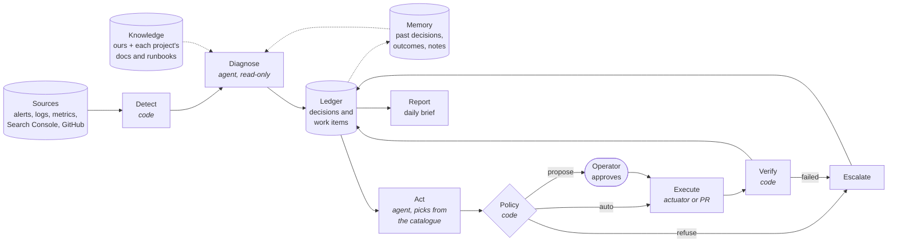

| Stage | Who | In | Out |
|---|---|---|---|
| **Detect** | code | raw signals | candidate cases (deduped, classified) |
| **Diagnose** | agent, read-only tools | one case, its context | a **decision**: dismiss, report, file an issue, hand over, escalate |
| **Ledger** | flotillad | decisions | decisions, and **work items** for the next fleet |
| **Act** | agent | one work item | an **action plan** from the catalogue |
| **Policy** | code | the plan | run now, ask the operator, or refuse |
| **Execute** | an actuator (host actions) or a PR (repo changes) | the approved plan | what was done |
| **Verify** | code | the target's state after | passed or failed, recorded |
| **Report** | the brief | the ledger | what was handled, what waits, what was escalated |

Finding and fixing are **different fleets with different credentials**. The diagnosing agent reads
untrusted text all day (error messages, issue bodies, web pages) and holds no write access. The
acting agent holds write access and never sees that text: a work item carries typed fields only.

## 3. The building blocks

| Block | What it is | Change from ADR-0004 |
|---|---|---|
| **Harness** | the one loop that runs a model step: context in, read-only tools, an answer that matches the step's output type, gates after, everything recorded | two run shapes (per item, once) and three output types (decision, prose, action plan) |
| **Context** | code builds what the model reads, in layers with budgets | the knowledge layer is per **project** |
| **Memory** | what flotilla recorded: decisions, outcomes, operator feedback, notes | outcomes from acting fleets feed it |
| **Knowledge** | reference material: what we write (notes, briefs) and what exists elsewhere (each project's docs, runbooks, ADRs) | sources are declared per project; plug-in kinds |
| **Actions** | named operations a fleet may perform, from a catalogue, run by code | **new** |
| **Work items** | ledger rows that hand a case from one fleet to the next | **new** |

### 3.1 Harness

- **Two run shapes:** *per item* (a list of cases, each with its own limits and record: triage, SEO,
  remediation) and *once* (the daily brief, a review).
- **Three output types:**
  - *decision*: typed fields (triage's disposition, an SEO finding);
  - *prose*: text plus a few typed fields (the brief's opening, a review's report);
  - *action plan*: entries from the action catalogue with their parameters (only acting fleets).
- **Tools are read-only**, named, typed, scoped and size-capped. Shared tools: metric, log and trace
  queries from templates; GitHub reads; allowed URL fetch; knowledge search; memory lookup. A fleet
  adds its own.
- **Limits:** model turns, tool calls, tokens, wall time and cost, per case and per run.
- **Recording:** every request, reply, tool call and result, and the run's time (the format the
  triage capture writes today), so any run can be replayed exactly.

### 3.2 Context

Layers, each with a character budget and a visible cut marker: **playbook** (the fleet's
instructions), **case** (the item), **memory** (structured fields only, never a model's earlier
prose), **knowledge** (the case's project's sources), **tool results**. Memory and knowledge are
wrapped as data, with their source and version. The exact text sent is stored.

### 3.3 Memory

In flotillad: decisions with their dedup keys, outcomes, feedback, notes (active only once the
operator activates them). A job gets a subject's history as structured fields. Measurements (disk
use, connection counts, Search Console rows) are fleet data, not memory.

### 3.4 Knowledge

A **project** is a config entity: its names in signals (labels, GlitchTip projects, hosts), its
issue repo, and its **knowledge sources**. A case about a project gets that project's sources.

| Kind | Example | How it is read |
|---|---|---|
| ours | notes, past briefs | from flotillad |
| git | a project's `docs/`, runbooks, ADRs; the homelab handbook | a refresh job pulls each repo on a schedule, records the commit, builds a full-text index |
| http (later) | vendor docs | fetched by the refresh job |
| mcp (later) | a project's own MCP server | a read-only tool call, recorded like every tool call |

Retrieval: path maps (a service to its runbook) and a `knowledge_search` tool.

### 3.5 Work items

A ledger row from one fleet to another:

| Field | Example |
|---|---|
| `kind` | `disk_pressure`, `oom_loop`, `config_fault`, `content_opportunity`, `code_bug` |
| `target` | host + mount; container; repo + file; site + page |
| `evidence` | references to the diagnosis's records, never its prose |
| `urgency`, `dedup keys` | one item per problem, however many alerts |
| `status` | `open` → `claimed` (with a lease) → `planned` → `awaiting_approval` → `done` / `failed` / `escalated` / `stale` |
| `links` | the decision that made it; the actions and outcome that closed it |

The consumer fleet is started by flotillad when an item for it appears. Code bugs keep going to
GitHub issues, where the operator sees them; the bugfix fleet takes them from there.

## 4. Actions on standard tooling

An action is a named, typed operation implemented with tools we already run (the Docker CLI,
`systemctl`, `git` and `gh`, existing scripts such as the backup jobs), never a command the model
writes.

### 4.1 An action in the catalogue

```yaml
action: docker.restart
params: {host: enum(mini, dgx), container: string}
scope: containers labelled flotilla.restartable=true      # never a database
risk: medium
reversible: true                                          # a restart undoes nothing it cannot redo
pre: [container_is_running, not_restarted_in(30m)]
verify: {healthy_for: 5m, within: 10m}
limits: {per_target_per_day: 3, at_once_per_host: 1}
runs: actuator.docker_restart                             # code on the host, not the model's text
```

### 4.2 From plan to verified result

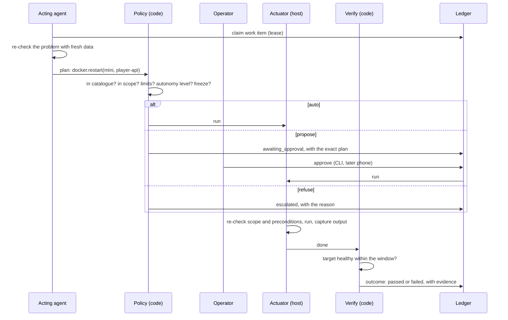

### 4.3 The actuator

One small service per host. It accepts only catalogue action names with validated parameters, over
its own key that can do nothing else. It re-checks scope and preconditions itself (a second line of
defence), refuses to delete anything that is in use, and returns what it did. The flotilla worker
never holds a shell or the Docker socket.

### 4.4 Earned autonomy, per action type

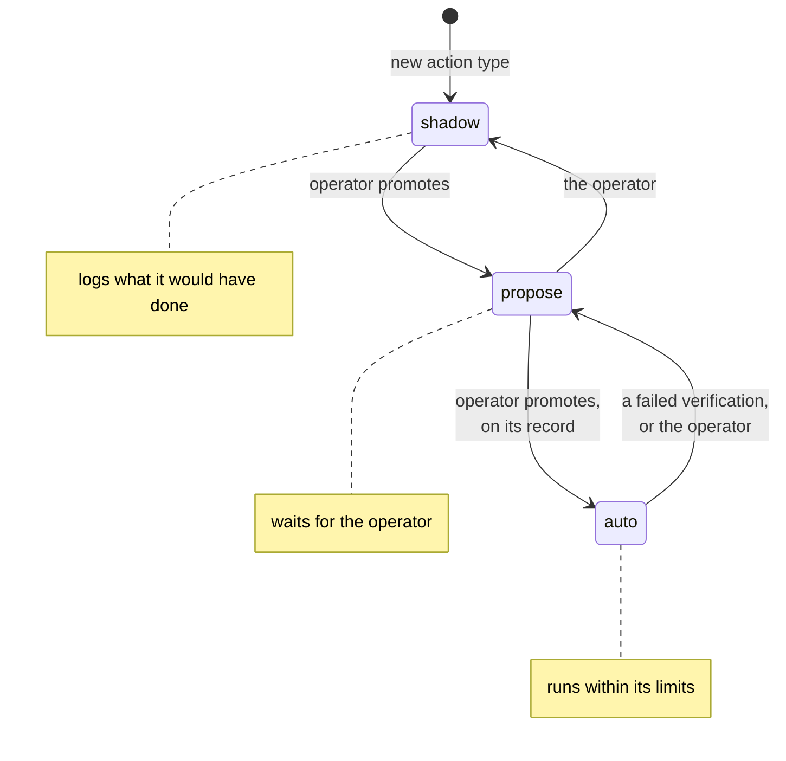

Only the operator promotes. The record behind a promotion: plans approved unchanged, verifications
passed, outcomes measured. An action type that cannot be undone never goes beyond *propose*.

## 5. The use cases, end to end

### U1 Triage

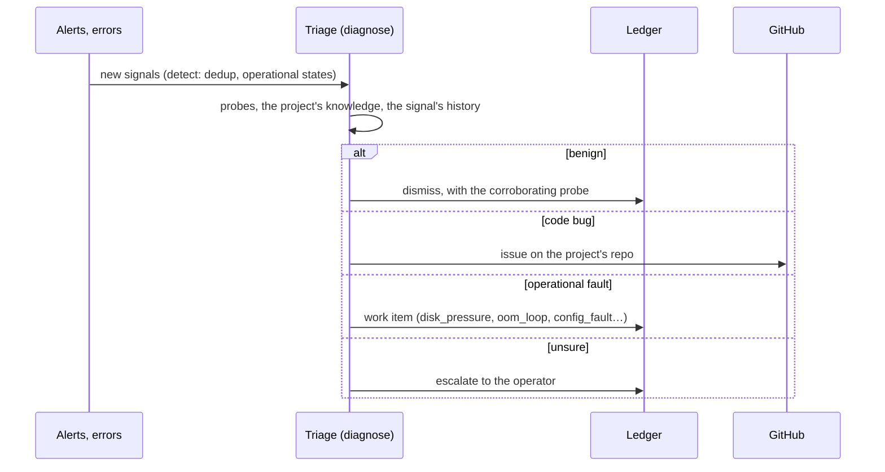

Blocks: harness (per item, decision), context (playbook, signal, history, project knowledge),
memory, knowledge, work items. Acts only through issues and work items.

### U2 Daily brief

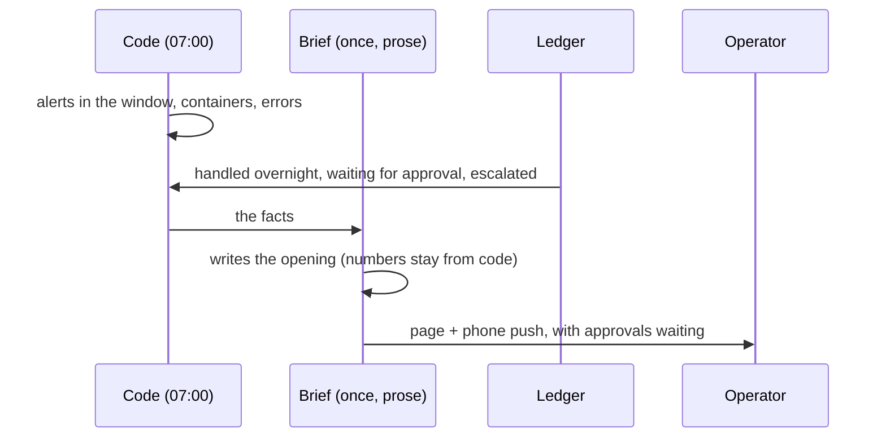

Blocks: harness (once, prose), context, ledger reads. No actions. It is the operator's morning view
of everything the acting fleets did.

### U3 Ops review (e.g. Postgres, daily)

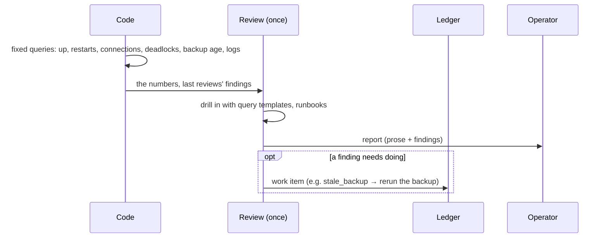

Blocks: harness (once, prose), context, memory (past findings and whether they were resolved),
knowledge (the system's runbooks, alert rules), work items.

### U4 Disk pressure

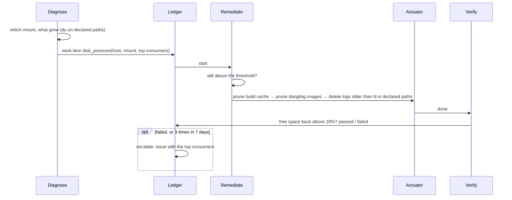

Only regenerable things are in the catalogue for this kind. Nothing outside declared paths; nothing in
use.

### U5 Memory pressure / OOM loop

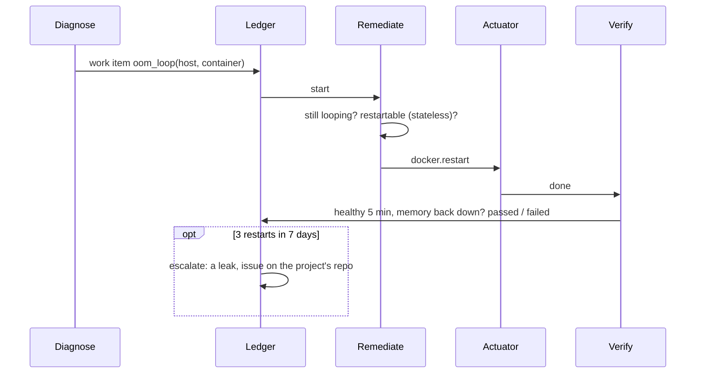

### U6 Config fault

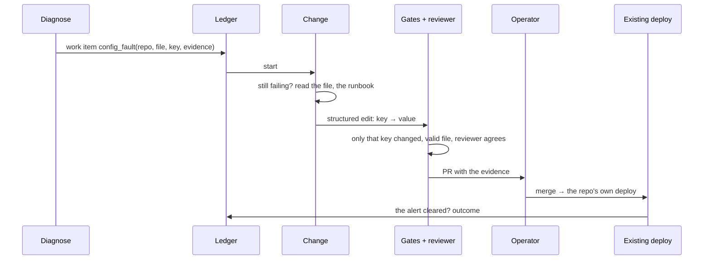

Never automatic in v1: a config change goes through the repo, its CI and its deploy, so it has a
review, a diff and a revert.

### U7 SEO content

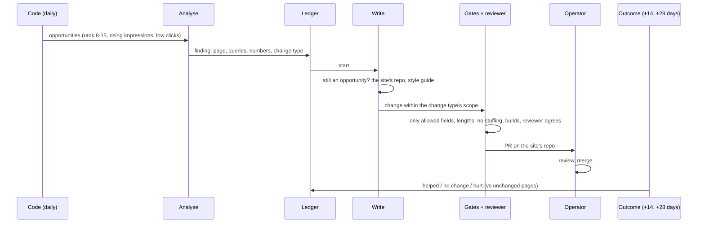

A *hurt* outcome opens a revert PR. Change types (title, meta description, a section, internal
links) each earn their own autonomy; auto-merge is a later promotion, per change type.

### U8 Code bug

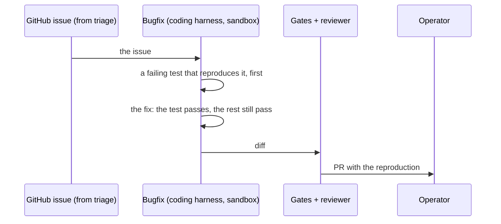

The coding harness is an `external` step (ADR-0004): its model calls go through the model client's
endpoint, and its diff is gated like any other change.

## 6. Review: do the building blocks still hold?

| | U1 | U2 | U3 | U4 | U5 | U6 | U7 | U8 |
|---|---|---|---|---|---|---|---|---|
| Harness shape | per item | once | once | per item | per item | per item | per item | external |
| Output type | decision | prose | prose | plan | plan | plan (edit) | decision → plan (edit) | diff |
| Read tools | probes | — | query templates | du, metrics | metrics, logs | file read | Search Console, page | repo |
| Memory | history | ledger | past findings | past items | past items | — | past outcomes | — |
| Knowledge | project | — | runbooks | runbooks | project | project | site repo | project |
| Writes | issue, item | page, push | report, item | actuator | actuator | PR | PR | PR |

What the review changed from ADR-0004 (the rough edges):

1. **The harness needs run shapes and output types**, not only triage's per-signal decision.
2. **Knowledge belongs to projects, not fleets**, and is mostly plugged in from repos that exist
   already.
3. **Actions are a block of their own.** ADR-0004's "outputs" (an issue, a PR) are the low-risk
   end of the same catalogue, under the same policy and autonomy ladder.
4. **The ledger is also a hand-over queue**: leases, staleness and dedup across producers (triage and
   an ops monitor can both see the same full disk; one item, not two).
5. **Outcomes arrive late** (SEO: weeks). An outcome job per acting fleet writes them back; memory
   reads them.
6. **Query templates vs freedom.** U3's drill-in wants ad-hoc queries; ADR-0004 forbids
   model-written queries. Templates in v1; raw read-only queries only by a later decision.
7. **One approval path for everything**: the CLI now. A way to reach the operator's phone (alerts,
   approvals at night) is a separate decision still to be designed. Home Assistant, which pushes
   alerts today, is a temporary hack outside flotilla and not part of this design (operator,
   2026-11-09).
8. **Recurrence is a signal**: the same item kind on the same target 3 times in 7 days becomes an
   issue about the cause.

## 7. Open decisions

Each with a recommendation; the operator marks only what to change.

**Harness, context, knowledge**
1. One harness with *per item* and *once* shapes. **Recommended.**
2. Model-written queries: templates only in v1. **Recommended.**
3. Output validation: our own small validator (types, required fields, enums). **Recommended**
   (no new dependency).
4. Knowledge freshness: scheduled snapshots for repos; live reads allowed as recorded tool calls.
   **Recommended.**
5. *Project* as a config entity owning its knowledge, repo and labels. **Recommended.**
6. Search: full-text in v1, semantic later. **Recommended.**

**Actions**
7. Named catalogue actions only. **Recommended.**
8. Every action type starts in shadow; the operator promotes on its record. **Recommended.**
9. A per-host actuator with an allowlist; workers get no shell. **Recommended.**
10. Config changes only by PR through the repo's own pipeline. **Recommended.**
11. First host: the mini. **Recommended.**
12. Night approvals: proposals wait for the morning in v1, until the phone channel is designed.
    **Recommended.**

**The chain**
13. Work items in the ledger for machine work; GitHub issues for code work. **Recommended.**
14. Only typed fields cross from finder to actor. **Recommended.**
15. flotillad starts the consumer when an item appears. **Recommended.**
16. The actor always re-checks with fresh data. **Recommended.**
17. A fixed playbook per item kind; the model picks parameters within it. **Recommended for v1.**
18. Recurrence: 3 in 7 days escalates. **Recommended.**

**Repo changes (U6, U7)**
19. Small change types as structured edits applied by code; larger ones by a coding harness with a
    diff-scope gate. **Recommended.**
20. An independent reviewer agent (another model) for every change. **Recommended.**
21. Auto-merge: not in v1. **Recommended.**
22. SEO outcome at 14 and 28 days against unchanged pages. **Recommended.**

## 8. Not in this RFC

- The order of building, and what v1 contains: proposed after these decisions.
- The UI.
- Actuators on the DGX and the production VPS (after the mini's record).
- Each fleet's playbooks, thresholds and catalogue entries (each fleet's own RFC or spec).

## 9. Discussion

- 2026-11-09: drafted from the operator's use cases and the discussion that day; not yet reviewed.
