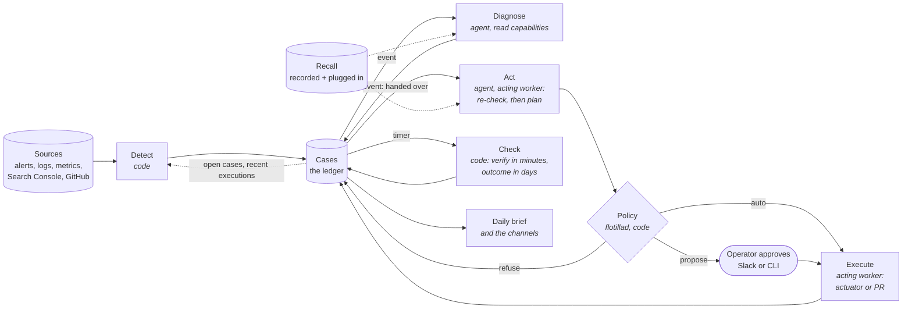
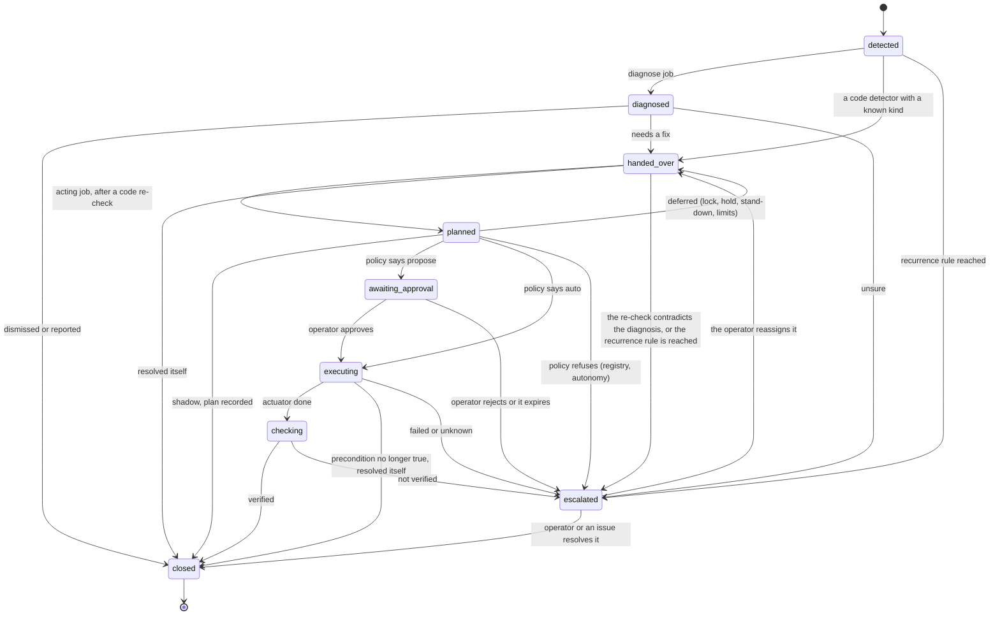
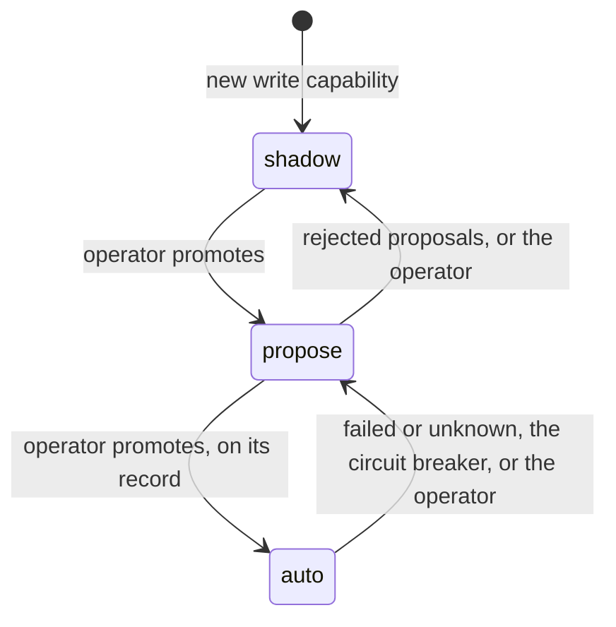
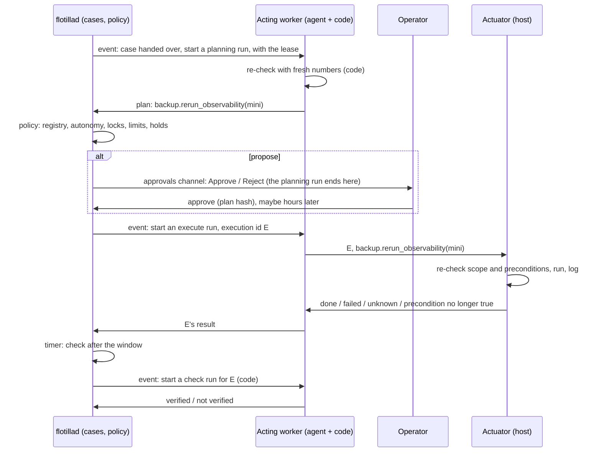
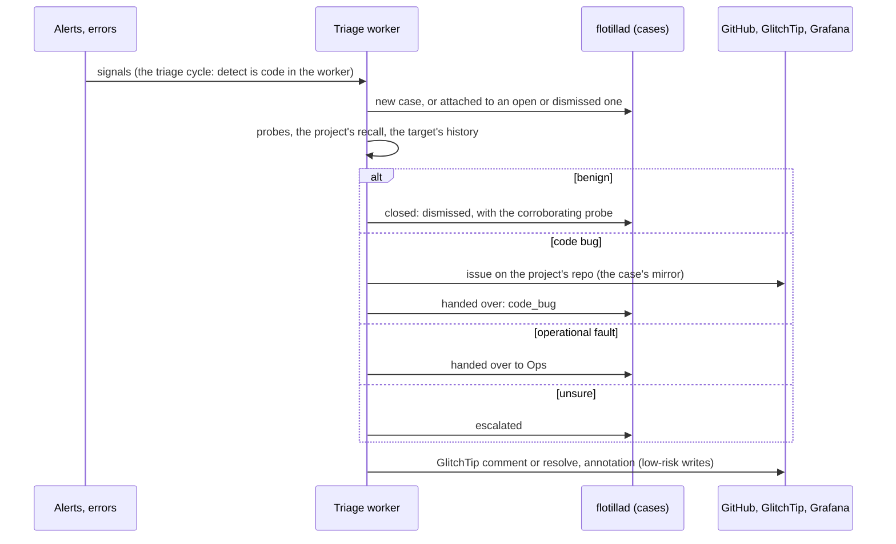
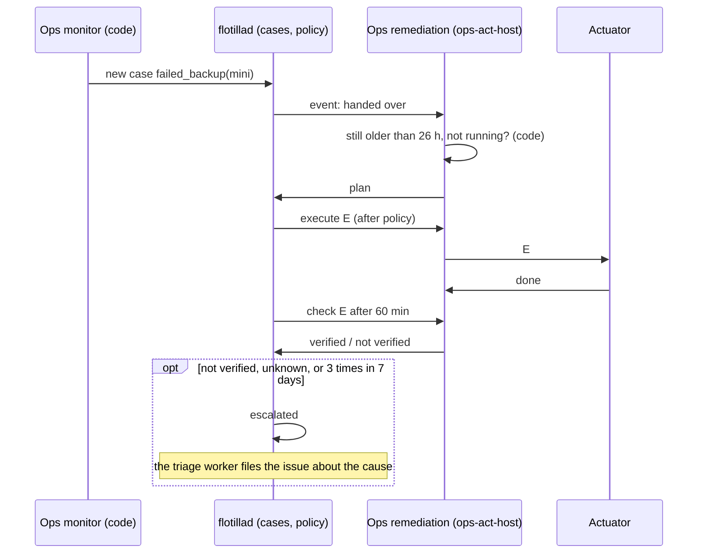
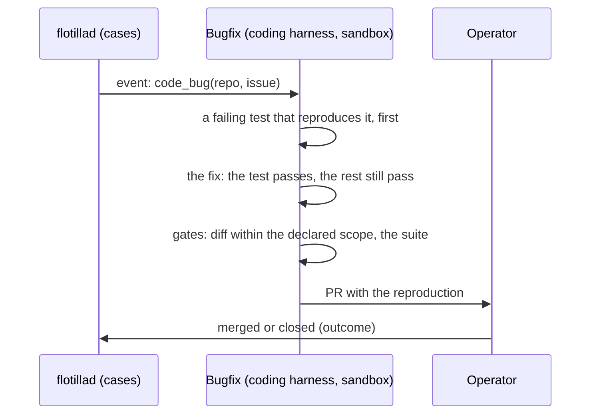

# RFC-0004 — The agent pipeline: from signal to verified action

**Status:** Draft, revision 8. Nothing is built from it until the operator accepts it. Reviewed by an
independent advisor in six passes on 2026-11-09 (§15); revision 8 answers the sixth.
**Date:** 2026-11-09
**Builds on:** [ADR-0004](../adr/ADR-0004-job-runtime.md) (harness, context, memory, external
knowledge, evaluation). This RFC extends it and names the ADRs it would amend (§13).
**Inputs:** the operator, 2026-11-09:
- the core pieces must serve every fleet to come, not only triage;
- fleets must **act**, not only report, and be trustworthy while the operator is away;
- the job that finds a problem need not be the job that fixes it: a chain through the ledger;
- knowledge is both what flotilla records and what already exists: each project's own docs and
  runbooks, from trusted and untrusted sources;
- actions run on standard tooling;
- communication goes through channels with providers, Slack first; Home Assistant is not part of
  flotilla.

RFC-0003 is reserved for the digital marketing fleet's first use case, SEO.

## 1. The fleets it must serve

| Fleet | What it is | Finds | Does |
|---|---|---|---|
| **Triage** (live today) | first look at every alert and error | what is noise, what is a bug, what is an operational fault | dismisses; hands a bug to bugfix and a fault to Ops |
| **Ops** | **the SRE team in action**, and the largest fleet: it watches the operational estate and fixes what it can | failed backups, disk filling, stuck jobs, memory growth, config faults, … (§8.2) | reviews, remediates, escalates; writes the daily brief |
| **Digital marketing** | the sites' reach and growth; more use cases will follow | pages that could rank better (SEO); which posts bring visitors who convert (attribution) | SEO: a PR; attribution: a report |
| **Bugfix** | code fixes | bugs handed over by triage | reproduces, fixes, opens a PR |

Ops is open-ended: each new kind of fault is a new **case kind** (a playbook and capabilities), not a
new fleet. Digital marketing grows the same way.

**Non-goals:** irreversible actions without the operator (deleting data, schema changes); agents
that write their own prompts, memory or capabilities; a workflow engine (§14).

## 2. The pipeline

Every problem flotilla handles is a **case**. A case is detected, diagnosed, handed to the job that can
fix it, planned, approved where needed, executed, checked, and closed, and every step is recorded on
it. One case, one timeline: `flotilla case show <id>`.



| Stage | Runs where | Does |
|---|---|---|
| **Detect** | a worker, code (for triage today: its cycle) | turns raw signals into cases. A signal whose keys match an open case, or a case closed as dismissed within the recurrence window, is attached to it. A signal on the target of an execution inside its verify window is attached (`caused_by`) and counts against verification; after the window it is a new case. After any close other than dismissed (verified, resolved itself, a shadow plan recorded), a recurrence is a new case linked `recurrence_of` (what the recurrence rule counts) |
| **Diagnose** | a worker with read capabilities (triage's also has the low-risk writes) | decides: dismiss, report, hand over, escalate |
| **Act** | an acting worker | re-checks the problem by code with fresh numbers, then plans from its capabilities, or closes the case as resolved itself |
| **Policy** | flotillad, code | runs, asks the operator, or refuses (§5.1); it decides and records, and executes only flotilla's own controls (a pause, a hold) |
| **Execute** | the acting worker | calls the actuator (host actions) or GitHub (repo changes), with an execution id |
| **Check** | a timer in flotillad starts a code check in a worker | **verify** within minutes (did it work), **outcome** within days or weeks (did it help) |
| **Brief** | the Ops fleet | the operator's morning view; shaped by the operator over time |

flotillad holds no fleet credentials: it decides, records and schedules. Workers hold credentials,
**one worker per role** (§3.5).

### 2.1 What keeps an action safe

Untrusted text (error messages, logs, issue bodies, web pages, third-party docs) reaches both the
diagnosing and the acting agent. Safety does not rest on an agent not being influenced; it rests on
what the agent's output can do:

1. **The output is a plan, not a command:** named write capabilities with typed parameters, validated
   by code against the registry's scope.
2. **Policy and the actuator decide independently of any model:** the policy step in flotillad, then
   the actuator on the host, each re-check scope, limits and preconditions.
3. **Repo changes are structured edits applied by code,** and a diff-scope gate checks that only the
   declared fields or files changed. These deterministic gates are the security boundary. A reviewer
   agent judges quality; it reads the same context and is not a security control.
4. **Credentials per role:** each worker holds only its role's credentials.
5. **Trust per source, taint per run:** recall sources are declared trusted or untrusted in the
   installation's config, per path at a merged commit (for example `docs/` and runbooks in the
   operator's repos); issues, PR bodies and comments are untrusted, and live HTTP and MCP sources are
   untrusted unless declared otherwise. The harness marks a run **tainted** when any untrusted content
   entered its context; policy caps a tainted run's plans at propose. The model never declares it.
6. **Acting jobs re-check by code:** a host action's re-check returns numbers (free bytes, backup age,
   restart count), never log text.

## 3. The building blocks

| Block | What it is | Replaces |
|---|---|---|
| **Harness** | the one loop that runs a model step | ADR-0004's harness, with run shapes and output types |
| **Context** | what the model reads, built by code in layers | ADR-0004's context, with one recall layer |
| **Recall** | everything an agent can look up: what flotilla recorded and what is plugged in | ADR-0004's memory **and** external knowledge |
| **Capabilities** | one registry of named, typed, scoped operations, each a read or a write | tools **and** actions |
| **Cases** | one record per problem, with a lifecycle and a timeline | decisions, work items, approvals and executions |
| **Workers per role** | a job names its worker; each worker holds one role's credentials | one worker per fleet (ADR-0002) |
| **Triggers** | time or an event on a case | `every`, on-item triggers and verify timers |
| **Communication** | channels by purpose, each routed to a provider | the Home Assistant push, ad-hoc mail |
| **Evaluation** | code replay, exact replay, model replay, shadow comparison | ADR-0004's evaluation, unchanged; the new code (policy, the transition table, dedup, checks) is code-replayable from recorded plans and case events |

### 3.1 Harness

- **Two run shapes:** *per case* (each with its own limits and record) and *once* (the brief, a review).
- **Three output types:** *decision* (typed fields), *prose* (text plus typed fields), *plan* (write
  capabilities with parameters).
- **Read capabilities only during the loop;** writes happen after policy.
- **Limits** per case and per run: model turns, capability calls, tokens, wall time, cost.
- **Output validation:** the `jsonschema` package (Python side, pinned by wheel hash); each schema
  fixes its draft; the validator's version is recorded with the run. flotillad's own spec validation
  stays hand-written Go.
- **Recording:** every request, reply, capability call and result, and the run's time; exact replay
  and model replay work from it.

### 3.2 Context

Layers, each with a character budget and a visible cut marker: **playbook**, **case** (its timeline so
far, as structured event fields only: never a model's `reason` text, so an acting agent never reads the
diagnosing agent's prose), **recall** (§3.3), **capability results**. Recall is wrapped as data with its source, version
and trust. The exact text sent is stored.

### 3.3 Recall

One layer an agent consults, with two origins:

| Origin | What | Trust | Lookup |
|---|---|---|---|
| **recorded by flotilla** | past cases and their outcomes, the operator's feedback, notes (active only once the operator activates them) | trusted (notes: only active ones) | **exact**, by key only: this target's history, this kind's recurrences; structured fields only, never a model's earlier prose |
| **plugged in** | each project's docs, runbooks and ADRs (git); vendor docs (HTTP); other MCP servers | per source and path, from config (§2.1) | search: path maps (a service to its runbook), full-text, semantic |

- **ADR-0004's memory and knowledge rules apply to recall unchanged** except where this section amends
  them: an agent's feedback is proposed until the operator confirms it; activating a note needs a model
  replay; read-only is enforced by the credential; sources are declared, never discovered.
- The search indexes (full-text, semantic) cover **plugged-in sources only**; recorded history is
  reached by exact key. Past briefs are not recall: their opening is model prose, and their facts are
  fleet data.
- A **project** is a config entity: its names in signals, its issue repo, its recall sources. A case
  about a project gets that project's sources, among those its fleet's spec declares.
- **Git sources** are refreshed on a schedule by a `knowledge-refresh` worker (git, egress to GitHub),
  versioned by commit. **Live reads** (HTTP, MCP) are recorded capability calls, frozen with the run for
  model replay; MCP sources call only the tools the config lists, with the server's own read-only
  credential.
- **Semantic search:** embeddings through the model client's `/embeddings` call from a locally served
  model (not checked yet: that the DGX or Ollama serves one today); the index records the model and its
  version; one index per trust tier, trusted chunks first; a query is a recorded capability call
  returning chunk ids and the index version.
- **Measurements are fleet data, not recall:** disk use, Search Console rows, the marketing fleet's post
  register. Read through capabilities.

### 3.4 Capabilities

One registry. Every entry is named, typed and scoped, and recorded when used:

```yaml
capability: backup.rerun_observability   # sudoers: exactly `launchctl kickstart system/com.homelab.db-backup`, never `-k`
kind: write                               # read | write
for_kinds: [failed_backup]
params: {host: enum(mini)}
risk: low
reversible: regenerable                   # yes | regenerable | no: the offsite release is one per day, uploaded with --clobber
pre: [backup_age_above(26h), not_running] # age: homelab_backup_offsite_last_success_timestamp; running: launchctl print (the script has no lock)
pre_shadow: [backup_age_above(20h), not_running]   # the shadow threshold, so v1's shadow cases are planned (§10)
check: {verify: {backup_newer_than_execution: true, within: 60m}}
limits: {per_target_per_day: 2}
```

- **Reads** are what an agent calls during its loop: metric, log and trace queries from templates,
  GitHub reads, allowed URL fetch, recall search, case history. Policy does not gate them, but the
  harness derives a run's taint from which reads entered its context, and policy reads that flag.
- **Writes** go through policy (§5.1), every one, including low-risk writes at auto. Today's outputs
  are low-risk writes: an issue or comment on GitHub, a comment on or the resolution of a GlitchTip
  issue, a Grafana annotation; triage's filing, which runs right after its gates today, moves behind the
  policy call (phase 3 step 5).
- **Two enforcement points keep one registry safe:** a spec that lists a write among a harness's loop
  capabilities is refused at load, and a `plan` output accepts only writes; and a worker whose role
  holds no write credential cannot execute a write, whatever the registry names.
- **Decided later** (operator, 2026-11-09): model-written commands, both kinds. If scheduled, they
  come with the guardrails already worked out: (A) read-only investigation on a host service with an
  argv allowlist and a read-only database role, results into diagnosing contexts only; (B) one
  approval-only write, `cmd.proposed`, an argv array of allowlisted binaries, approval bound to its
  hash, by CLI, never auto.

### 3.5 Cases

**Fields:** kind, typed target, the **keys** (`(kind, value)` pairs: for triage, fingerprint, group,
normalised and alert keys, looked up in that order; one of them canonical for "one open case per
key"), urgency (orders the queue), the project, the current status and holder,
and a timeline of events (detected, diagnosed, handed over, planned, approved, executed, checked,
attached signals, the operator's feedback). Evidence is references to records, never prose.

**Lifecycle:**



- **A transition table** in flotillad (from, to, who may make it, the longest a case may stay) is
  enforced on every status change; a disallowed transition is refused and logged. It governs status
  only: **events may be appended to closed cases** (an outcome check days later, a recurrence of a
  dismissed signal, a reopened GitHub issue).
- **Timers for stuck states:** `detected` too long (the diagnosing worker is down) alerts;
  `handed_over` too long escalates; `executing` past its deadline becomes `unknown`, escalates and
  **holds the target** until the operator clears it; `checking` past its window is not verified.
- **Deferral:** a deferred case returns to `handed_over` and is dispatched again when the blocking
  condition clears (the lock released, the hold or stand-down ended) or after a backoff. The
  `handed_over` stuck timer counts from the first hand-over, so a long hold surfaces as an escalation.
- **The recurrence rule fires at hand-over, before any plan:** a case linked `recurrence_of` that
  reaches the threshold (by default 3 in 7 days) goes to `escalated`, not to another fix.
- **Approval is an event, not a wait:** the planning run ends at `awaiting_approval`; flotillad holds
  the case and the per-target lock until the approval or its expiry; an approval starts a new execute
  run (§7). An approval given after the problem went away ends as `resolved itself`.
- **Dedup:** the keys are computed by code from the kind and the canonical target, and are
  authoritative; one open case per canonical key, so a storm is one case. Detect matches a signal's keys
  against open cases and against cases closed as dismissed within the recurrence window. The diagnosing model's suggestion of which open case
  a signal belongs to is recorded in shadow only; switching to it is a behaviour change (AGENTS.md
  rule 3) with a named criterion, and even then the model chooses only among cases code already
  considers candidates.
- **Holders and leases:** a case is held by one job at a time (flotillad holds it while it awaits
  approval); flotillad starts that job and hands it the lease, which the job renews while it runs; an
  expired lease returns the case, unless an execution is open (then the check resumes, the action never
  re-runs).
- **The per-target lock:** taken by policy, atomically, when it admits a plan (auto or propose), and
  held until the case is checked; a deferred plan never takes it. One case at a time touches a
  container, a mount, a file, across kinds and fleets. It covers flotilla only: the homelab's own scheduled jobs
  (the nightly backup, the weekly prune) are kept out by each capability's preconditions.
- **Caps:** at most N open cases per kind and per host; an alert on case age.
- **Hand-overs are the case moving between jobs** (operator, 2026-11-09: through the ledger only). A
  bug is a `code_bug` case; triage still files the GitHub issue, where the operator sees bugs, as the
  case's mirror: one case per repo and issue number; a reopened issue is an event on the case; the
  outcome check syncs both ways (issue closed → case closed; PR merged → the issue closed).
- **Compatibility:** RFC-0002 §9 step 5's promises to the fleet session still hold with cases in place
  of its ledger tables: the multi-key lookup (`decision_keys`), the TSV history imported and marked
  `imported`, the mirror's TSVs byte-compatible while its readers use them, and the filing seams.

### 3.6 Workers per role

| Worker | Holds | Jobs |
|---|---|---|
| `triage` | read tokens; the low-risk writes (GitHub issues and comments, GlitchTip comments and resolution, Grafana annotations) | triage; escalation issues for every fleet |
| `ops-read` | read tokens, query templates | Ops monitors, reviews, the brief |
| `ops-act-host` | the actuator key for each host it may act on | Ops remediation on hosts |
| `ops-act-repo` (when the first repo-changing kind exists) | a GitHub App with write on the infra repo | Ops config changes |
| `knowledge-refresh` | git, read access to the recall repos | refreshing git sources |
| `marketing-*`, `bugfix` | their own | their fleets |

### 3.7 Triggers

One model: a job runs on **time** (`every`, a schedule) or on an **event** on a case (handed over to
its kind, a check due). A check is an event a timer raises: verify after minutes, outcome after days.

### 3.8 Communication

Fleets send to a **channel**; the installation's config routes each channel to a **provider**:

| Channel | Carries |
|---|---|
| `alerts` | an agent escalated (platform health stays with the Grafana rules, so nothing arrives twice) |
| `approvals` | a proposal waiting, with **Approve** and **Reject** |
| `notifications` | what was done; reports |

- **Slack first** (operator, 2026-11-09). Notifications are outbound posts.
- **Approvals in Slack** from the first time an action type reaches propose. flotillad keeps an
  outbound Socket Mode connection, so nothing in the homelab is exposed. Guardrails:
  - a click carries the case id, the **plan's hash** and a nonce, and is accepted only while that case
    is `awaiting_approval` with that hash; a second click does nothing;
  - accepted only from the pinned workspace and the operator's user id;
  - Slack approves only `risk: low | medium` with `reversible` not `no`; the rest need the CLI;
  - a daily cap on Slack approvals, listed in the brief; minimal app scopes; a control switches
    approvals back to CLI-only at once; every approval recorded with the Slack user and the time.
- The daily brief is its own job, which the operator shapes over time; it is not a digest of the
  channels (operator, 2026-11-09).

## 4. Actions on hosts: the actuator

The most privileged component: on the mini, host actions need root above the Docker VM, as the
existing cleanup script already does. It gets its own ADR before it is built. The constraints:

- a service on the host, as a dedicated user, with a sudoers allowlist of exact command lines;
- reached from the acting worker's container through the host gateway, allowed only in
  `ops-act-host`'s egress allowlist, with its own key;
- the write capabilities baked in at deploy: none can be added at runtime;
- re-checks scope and preconditions itself (including that a container is labelled restartable before
  any restart); refuses to delete what is in use;
- idempotent by execution id; returns done / failed / unknown;
- its own append-only log, shipped to VictoriaLogs, independent of the worker's record;
- an explicit exception to ADR-0002's "no Docker socket anywhere", limited to this service.

The `restartable` container label is a new contract on the infra repo's compose files; infra owns it.
`launchctl kickstart` runs whatever is in the operator's checkout, which agents redeploy over SSH
(ADR-0002): flotilla does not add that exposure, but now triggers it. The operator's rule against agents
running `docker image/system prune` stands, with no exemption.

## 5. Policy, autonomy and guardrails

### 5.1 Policy (flotillad)

For each planned write, in order; any "no" refuses, with the reason recorded:
1. **The registry:** the capability exists, its parameters are in scope, it is declared `for_kinds` the
   case's kind, its target equals the case's target (the model cannot retarget), and the plan cites
   the re-check numbers that exist in the record.
2. **Autonomy, lowest wins:** the job's stage (`shadow` → shadow; `propose` → at most propose; `live`
   → the earned level); the capability's earned level (§5.2); the target host's ceiling; a tainted run
   → at most propose; the autonomy freeze → at most propose.
3. **Locks and limits:** the per-target lock is free; per-target, per-host and platform-wide limits
   not reached.
4. **Holds:** no fleet STOP, no deploy stand-down on that host, no operator hold
   (`flotilla hold <host|target> <duration>`), no host incident pause (§5.3).
5. Then: execute (auto), or `awaiting_approval` with the exact plan (propose).

### 5.2 Earned autonomy, per write capability



- Only the operator promotes. Autonomy is per capability and applies on every machine it may touch
  (operator, 2026-11-09). Each host's actuator config declares the **highest autonomy it accepts** (a
  new host starts at propose); the capability's `host:` list limits where it may act; demotion is
  global.
- The record: plans approved unchanged, verifications passed, outcomes.
- Only `reversible: no` (cannot be undone, and what it removes does not come back) is capped at
  propose.

### 5.3 Guardrails against runaway behaviour

| Risk | What stops it |
|---|---|
| **Loops** (a fix fires an alert that becomes a new fix) | `caused_by` attaches follow-on signals to the execution; the per-target lock; per-host actions per hour; recurrence: by default the same kind and target 3 times in 7 days escalates to an issue about the cause, a kind may override up to 10 in 7 days, never disabled, by a reviewed spec change; failed or unknown demotes the capability |
| **Cascades across hosts** | a **platform-wide cap** on executions per hour; a **circuit breaker**: N failed or unknown executions in an hour drop every auto capability to propose |
| **Storms** | one open case per key; caps on open cases per kind and host; a **host incident rule**: more than N new cases on one host in M minutes pauses auto on that host and escalates |
| **Cost** | per-fleet daily budgets (`day_usd`, `day_tokens`); LiteLLM per-key budgets; per-case and per-run limits; fail closed with one aggregate issue on 401/402/403; `cost_spike` pauses a fleet |
| **Jobs fighting** | the per-target lock across kinds and fleets; one policy point; holds and the deploy stand-down; preconditions against the homelab's own scheduled jobs |
| **A bad model or prompt** | schema-validated output; the registry, `for_kinds`, no retargeting; policy and the actuator re-check without a model; shadow first and the stage cap; playbook changes ship only after model replay (AGENTS.md rule 3); a **gateway re-route alert** (a changed `x-litellm-model-id` on a known alias: to build, RFC-0002 §8) |
| **Unsure, but silence is too much** | **`flotilla autonomy freeze`**: every capability drops to propose, diagnosis keeps running; STOP remains for silence |

## 6. Trust while the operator is away

- **Auto** capabilities act within their limits; everything is on the case's timeline, as annotations,
  and in the morning brief.
- **Propose** capabilities wait; the operator is told on the `approvals` channel and approves in Slack
  or by CLI.
- §5.3's guardrails bound what can go wrong overnight.

## 7. Execution, step by step



Verify needs both the actuator's "done" and the target's state improving within the window. An
unknown result holds the target until the operator clears it. Every execution emits an ops event and a
Grafana annotation.

## 8. The fleets, end to end

### 8.1 Triage



### 8.2 Ops: the SRE team

| Job | Worker | Shape |
|---|---|---|
| monitors and reviews (e.g. the daily Postgres review) | `ops-read` | once per run: report + findings + new cases |
| remediation on hosts | `ops-act-host` | per case: plan |
| config changes | `ops-act-repo` | per case: structured edit as a PR |
| daily brief | `ops-read` | once a day: shaped by the operator |

Case kinds, illustrative (each fleet spec sets its own playbooks, limits and autonomy):

| Case kind | Write capability | Check |
|---|---|---|
| `failed_backup` | `backup.rerun_observability` | a fresh backup |
| `disk_pressure` | delete logs older than N in declared paths (Docker pruning stays with the scheduled script) | free space above the threshold |
| `stuck_job` | stop it, rerun it | it completes |
| `memory_growth` | restart a container labelled restartable | memory back down, healthy |
| `oom_loop` | none on the host (Docker restarts it); its memory limit → `config_fault` | — |
| `config_fault` | a structured edit as a PR on the infra repo | the alert clears after the repo's own deploy |
| `cost_spike` | pause the fleet (a flotilla control); a key's budget → `config_fault` | spend rate down |



A config change runs the same way, except the write is a structured edit applied by code, gated on
the diff, reviewed for quality, and opened as a PR; the operator's merge and the repo's own deploy
apply it, and the check is the alert clearing.

### 8.3 Digital marketing

The pipeline mapping only; each use case's own design is its RFC (RFC-0003 for SEO).

| Use case | Detect | Diagnose / act | Writes | Check |
|---|---|---|---|---|
| **SEO content** | Search Console: rank 8-15 with rising impressions and low clicks; drops | analyst diagnoses; a writer job makes a structured edit within the change type's scope | PR on the site's repo | the site builds; outcome at 14 and 28 days against unchanged pages; a "hurt" opens a revert PR |
| **Traffic attribution** | Umami referrers and campaign tags, matched to the post register; conversions where the site sends them (humancopilot.eu: `cta-book-call`, `cta-email`, `outbound`) | analyst compares posts by platform, topic, timing | a report in the brief | — |

### 8.4 Bugfix



The coding harness is an `external` step (ADR-0004), pointed at the same model endpoint under the
fleet's own key; its inputs and outputs are recorded; it reads the issue body as untrusted evidence.

## 9. Review: do the building blocks hold?

| | Triage | Ops review | Ops remediation | Ops config | Brief | SEO | Attribution | Bugfix |
|---|---|---|---|---|---|---|---|---|
| Worker | triage | ops-read | ops-act-host | ops-act-repo | ops-read | marketing | marketing | bugfix |
| Harness shape | per case | once | per case | per case | once | per case | once | external |
| Output | decision | prose | plan | plan (edit) | prose | decision → plan (edit) | prose | diff |
| Reads untrusted text | yes | yes | no (numbers only) | yes (file, runbook) | yes | yes (pages) | yes | yes (issue) |
| What bounds it | low-risk writes only | read-only | registry, policy, actuator | diff gate, PR | — | diff gate, PR | — | diff gate, PR |

## 10. v1: prove it with the least build

**One chain, one host, one write.** A **code-only Ops monitor** reads the observability backup's age
and opens a `failed_backup` case. An `ops-act-host` job in **shadow** plans
`backup.rerun_observability`. A timer checks it on the same metric. Each execution emits an ops event
and a Grafana annotation; the `notifications` channel posts it to Slack.

- **Platform pieces:** cases with the transition table, leases, dedup, the per-target lock and
  stuck-state timers; event and time triggers; execution ids and checks; policy in flotillad with
  holds, the deploy stand-down, the platform cap, the circuit breaker, the host incident rule and the
  autonomy freeze; the actuator on the mini with that one write; `flotilla case show`; the
  `notifications` channel. Approvals by CLI; Slack approvals come with the first promotion to propose.
- **It depends on** the case tables, which take the place of phase 3 step 5's ledger tables in the
  store (today: runs, events, controls and spend only).
- **Producing a record:** in shadow only, the monitor opens cases from a lower threshold (a backup older
  than 20 h), and the capability's `pre_shadow` uses the same threshold, so the re-check plans
  instead of closing every case as resolved. The gate: 5 shadow plans that match what the operator
  would have done, each with its target equal to the case's, then propose (with the 26 h threshold),
  then auto.
- **Prerequisites:** the actuator's ADR accepted before the first write; the `ops-act-host` worker image.
- **Kept as code, not proven by v1:** the host incident rule, the per-target lock (one kind and one
  write cannot exercise them), and loop bounding (`caused_by`, the hourly cap: a backup rerun fires no
  alerts; the first restart-class write, `memory_growth`, brings that proof with it).
- **Not in v1:** triage as producer (phase 3 steps 2 to 6); the brief on flotilla (RFC-0001 phase 4);
  recall (no model in v1 reads any); the reviewer agent; config-change PRs; `cost_spike`; the marketing
  fleet; actuators on the DGX and the production VPS.

## 11. Not in this RFC

The UI (next, as its own design: the case timeline is its main screen); each fleet's playbooks,
thresholds and capabilities; the actuator's own ADR; model-written commands (decided later).

## 12. Decisions (operator, 2026-11-09)

| # | Decision | Chosen |
|---|---|---|
| 1 | Harness run shapes | one harness, *per case* and *once* |
| 2 | Model-written queries | raw read-only queries for Ops, through the investigation tool: **decided later** with it |
| 3 | Output validation | the `jsonschema` package |
| 4 | Knowledge freshness | live reads too, with trusted and untrusted sources declared in config |
| 5 | Project entity | yes |
| 6 | Search | semantic, plus path maps and full-text |
| 7 | Workers | per role |
| 8 | Writes | the registry; model-written commands (both kinds) **decided later** |
| 9 | Policy and execution | flotillad decides, workers execute |
| 10 | Job stage and autonomy | the stage caps per-capability autonomy |
| 11 | Autonomy scope | per capability, on every machine (with host ceilings) |
| 12 | Actuator | a host service, with its own ADR |
| 13 | The no-prune rule | no exemption |
| 14 | Executions | ids, idempotent actuator, unknown holds the target |
| 15 | Checks | one timer, two windows: verify (minutes) and outcome (days) |
| 16 | Config changes | only by PR |
| 17 | Hand-overs | through cases only; triage keeps filing GitHub issues |
| 18 | Dedup | the code keys (several per case), authoritative; the model's suggestion recorded in shadow |
| 19 | Triggers | time or an event on a case |
| 20 | Locks | per-target lock, `flotilla hold`, deploy stand-down |
| 21 | `caused_by` | within the verify window |
| 22 | Recurrence | 3 in 7 days by default; a kind may override up to 10, never disabled |
| 23 | Choosing writes | the model chooses from the registry, within `for_kinds` |
| 24 | Communication | channels and providers, Slack first; approvals in Slack whenever needed (high-risk by CLI) |
| 25 | Repo changes | structured edits for small change types, a coding agent for larger ones |
| 26 | Reviewer agent | yes, for quality |
| 27 | Auto-merge | not until a change type earns it |
| 28 | Runaway guardrails | platform cap, circuit breaker, host incident rule, autonomy freeze, gateway re-route alert |
| 29 | Workflow engine | none: the case lifecycle with a transition table, stuck-state timers and `flotilla case show` |
| 30 | Consolidation | cases (decisions, items, approvals, executions); one capability registry; recall (memory and knowledge); one trigger model. The brief stays its own job |
| 31 | Ops workers to start | `ops-read` and `ops-act-host`; `ops-act-repo` with the first repo-changing kind |

## 13. Docs amended on acceptance

- **ADR-0004:** recall replaces memory and external knowledge (live reads with trust tiers and taint,
  amending "read from a snapshot, never live"; semantic search); capabilities replace tools and outputs;
  cases; run shapes and output types; its non-goal on model-written queries noted as decided later.
- **ADR-0002:** workers per role, not one per fleet; the actuator's exception to "no Docker socket
  anywhere".
- **ADR-0003:** `jsonschema` and what it pulls, pinned by hash; the vector store; the Slack Socket Mode
  client; each approved when it is built.
- **RFC-0001** §4 (its Decision, Proposal and Stage concepts) and §6.1 (the decisions table), both
  superseded by cases.
- **RFC-0001** §5 (specs stay validated by hand-written Go) and §8, **AGENTS.md rule 2**, and
  **deployment.md** ("Operator identity"): approvals also from the operator's pinned Slack user,
  within §3.8's limits.
- **docs/architecture:** components.md (policy in flotillad, execution in workers, the trigger model),
  deployment.md (workers per role, the Home Assistant secret removed), context.md (Home Assistant
  removed), data.md (cases with their keys in place of `decisions` and `decision_keys`, the transition
  table, executions, the per-target lock).

## 14. Alternatives considered

- **One agent that diagnoses and acts.** One model would hold both untrusted input and write
  credentials. Rejected.
- **The model writes commands, unbounded.** Nothing can check them before they run. Rejected; the
  bounded forms are decided later (§3.4).
- **GitHub issues as the hand-over queue.** No leases, locks or dedup across producers. Kept as the
  mirror of bug cases, where the operator sees them.
- **flotillad executes writes itself.** The control plane would hold every fleet's credentials.
  Rejected.
- **Autonomy per job only (the stage).** Too coarse. Kept as the cap.
- **A workflow engine (Temporal, Airflow) or a DAG runtime.** Temporal adds a cluster, a database and an
  SDK, and would hold the state the cases should hold; Airflow is poor at waiting hours for a human. The
  case lifecycle with a transition table gives the same guarantees in flotillad. Revisit only if a job
  needs fan-out and fan-in with retries inside it; then a declared step graph in the job spec, still no
  engine.
- **Separate memory and knowledge blocks; separate tools and actions; separate decisions, items and
  executions.** Each pair shares its rules; kept apart, every rule would be written twice. Merged.
- **The brief as a digest of the channels.** Rejected by the operator: the brief will grow beyond what
  the channels carry.
- **A third-party agent framework's action layer.** Not built for operator-gated, replayable actions;
  the goal is to own the machinery (RFC-0001 §1).

## 15. Discussion

- **Revision 1 (2026-11-09):** drafted from the operator's use cases.
- **Advisor pass 1:** right shape, not agreeable: the "actor never sees untrusted text" claim was false;
  the ledger shown executing; credentials per fleet; the actuator undesigned; two trust ladders; no
  loop, lock or partial-failure design. Revision 2 fixed these.
- **Advisor pass 2:** all landed; three fixes (triage's writes named, escalation filed by a worker that
  holds GitHub write, reversibility with `regenerable`). Revision 3.
- **Revision 4:** the operator's 27 decisions.
- **Advisor pass 3:** the decisions stand; their guardrails (taint, the host-service sandbox,
  `cmd.proposed` bounded, host ceilings, Slack approval guardrails, the backup action corrected).
  Revision 5.
- **Advisor pass 4:** ready after one attribution fix; answered the operator's questions: 90% of the
  value from seven core ideas, four runaway guardrails to add, no workflow engine.
- **Revision 6:** the operator kept everything except model-written commands (decided later), merged
  verify and outcome and started Ops with two workers, accepted the four guardrails and the case
  lifecycle in place of an engine, and consolidated the blocks: cases, one capability registry,
  recall, one trigger model; the brief stays its own job. Slack approvals stay, wherever approvals are
  needed.
- **Advisor pass 5 (on revision 6):** the consolidation is sound with fixes. Revision 7: the lifecycle
  gains the shadow path, deferral distinct from escalation, approval as an event (no run waits),
  stale approvals closing as resolved, events on closed cases with the two recurrence rules, the way
  back from escalated and the re-check contradicting the diagnosis, and a stuck timer on `detected`;
  cases carry several keys; recall drops past briefs and states ADR-0004's rules still apply; the case
  layer shows structured fields only; the registry's two enforcement points; evaluation restored as a
  block; "unknown holds the target", the post-window new-case rule, lease renewal, urgency and the
  step 5 compatibility promises restored; detect placed in the worker; the v1 threshold mismatch fixed
  and its prerequisites named; RFC-0001 §4 and §6.1 added to the docs to amend.
- **Advisor pass 6 (on revision 7):** every fifth-pass finding landed. Revision 8 adds what it found
  left: `detected → handed_over` for a code detector (v1's own path), a recurrence-rule escalation that
  fires at hand-over, the rule for closes other than dismissed, the lock taken by policy atomically,
  `pre_shadow` in the registry entry, deferral re-dispatch and its timer, and one merged v1 bullet.
