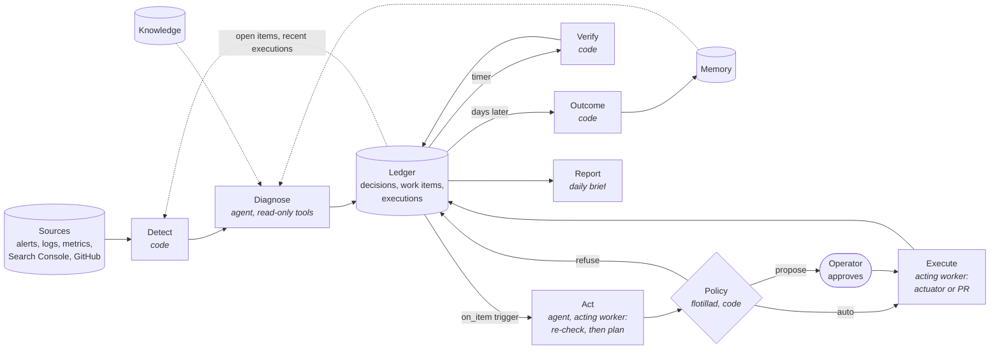
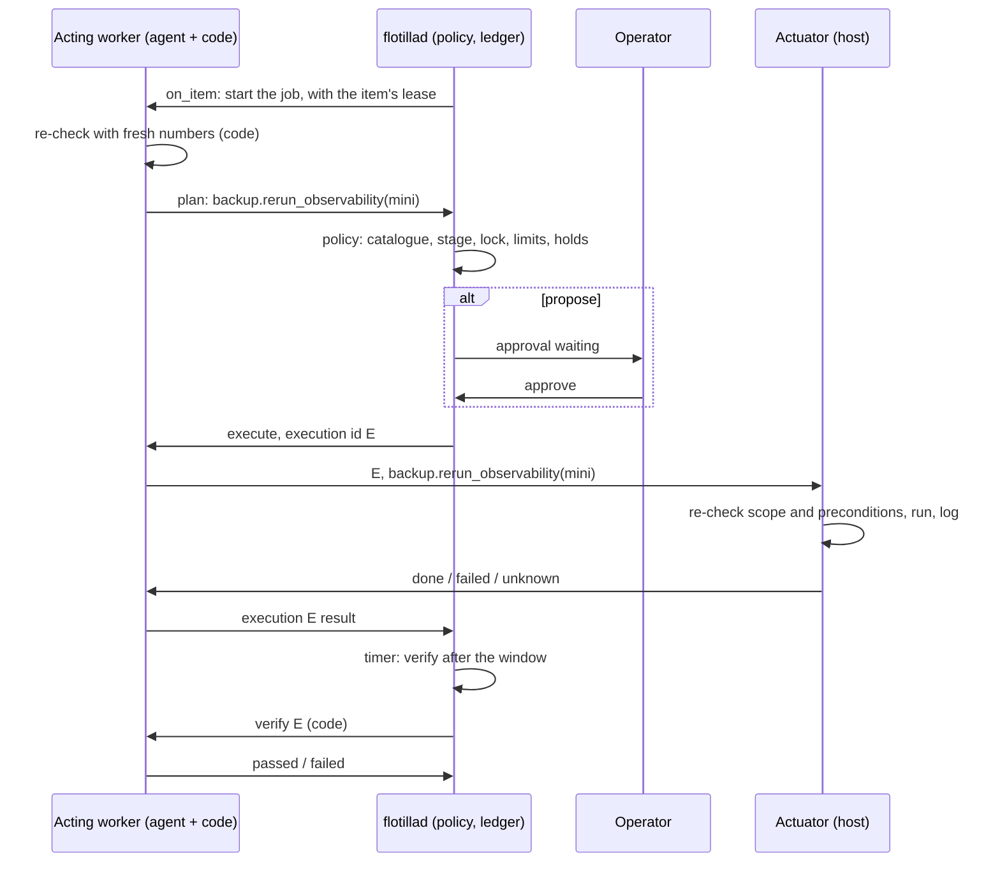
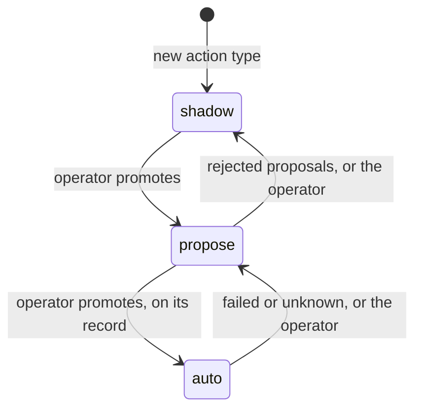
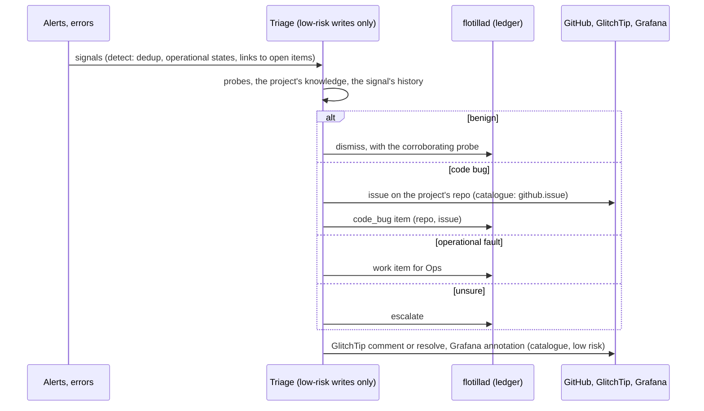
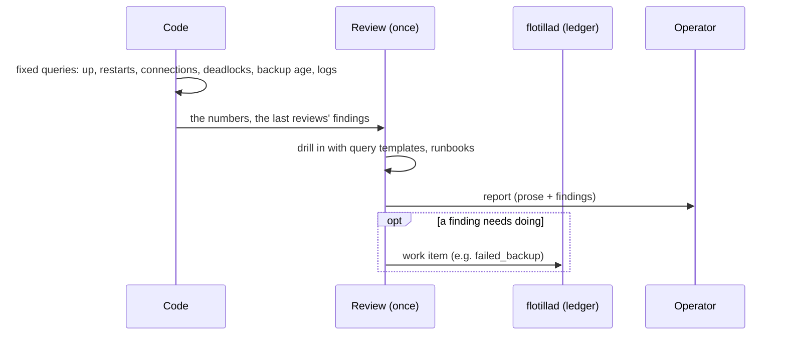
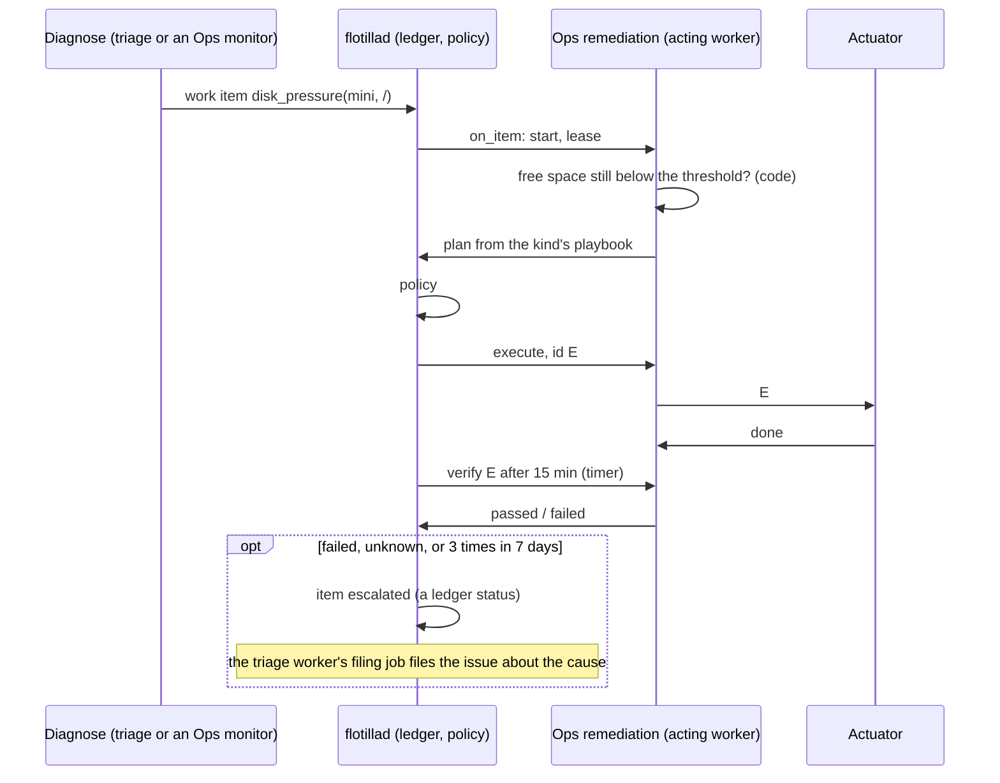
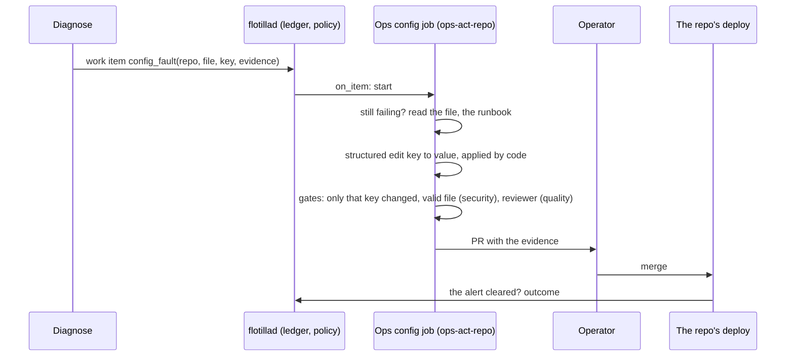
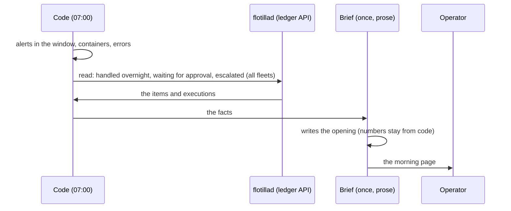
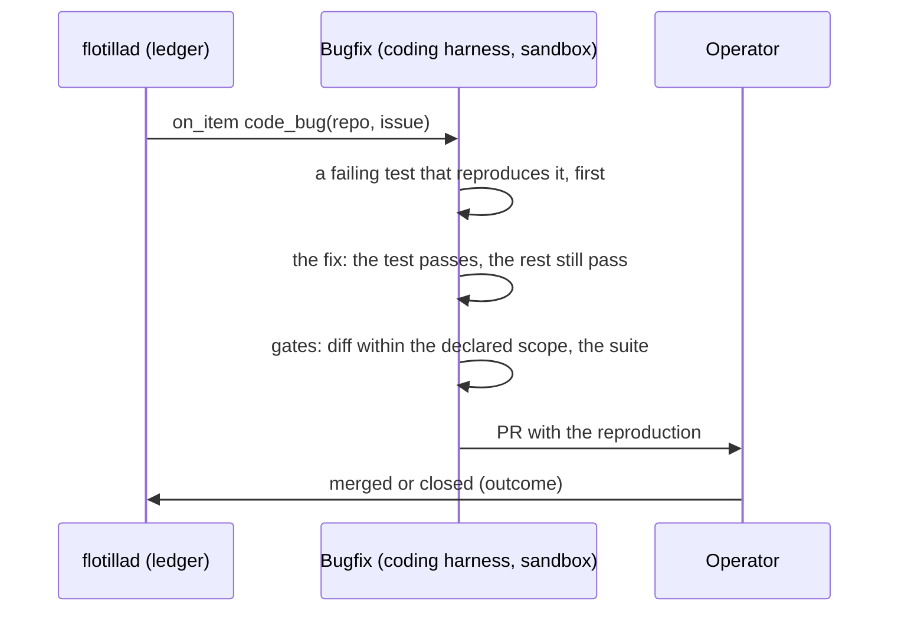

# RFC-0004 — The agent pipeline: from signal to verified action

**Status:** Draft, revision 5: the operator's decisions (§10) with the guardrails from the advisor's
third pass. Nothing is built from it until the operator accepts it.
**Date:** 2026-11-09
**Builds on:** [ADR-0004](../adr/ADR-0004-job-runtime.md) (harness, context, memory, external
knowledge, evaluation). This RFC extends it and names the ADRs it would amend (§11).
**Inputs:** the operator, 2026-11-09:
- the core pieces must serve every fleet to come, not only triage;
- fleets must **act**, not only report, and be trustworthy while the operator is away;
- the job that finds a problem need not be the job that fixes it: a chain through the ledger;
- knowledge is both what flotilla builds and what already exists: each project's own docs and
  runbooks;
- actions run on standard tooling;
- Home Assistant is not part of flotilla (a temporary phone-push hack only).

RFC-0003 is reserved for the digital marketing fleet's first use case, SEO.

## 1. The fleets it must serve

| Fleet | What it is | Finds | Does |
|---|---|---|---|
| **Triage** (live today) | first look at every alert and error | what is noise, what is a bug, what is an operational fault | dismisses; hands a bug to bugfix and a fault to Ops |
| **Ops** | **the SRE team in action**, and the largest fleet: it watches the operational estate and fixes what it can | disk filling, failed backups, stuck jobs, memory growth, config faults, … (§6.2) | reviews, remediates, escalates; writes the daily brief |
| **Digital marketing** | the sites' reach and growth; more use cases will follow | pages that could rank better (SEO); which posts bring visitors who convert (attribution) | SEO: a PR; attribution: a report |
| **Bugfix** | code fixes | bugs handed over by triage | reproduces, fixes, opens a PR |

Ops is open-ended: each new kind of fault is a new **item kind** (a playbook and catalogue actions),
not a new fleet. Digital marketing grows the same way.

**Non-goals:** irreversible actions without the operator (deleting data, schema changes); agents
that write their own prompts, memory or actions; a model-written command that runs without the
operator's approval (§4.6).

## 2. The pipeline



| Stage | Runs where | In | Out |
|---|---|---|---|
| **Detect** | a worker, code | raw signals, and the ledger's open items and recent executions | candidate cases; a signal on the same target as an open item, or within an execution's verify window, is linked to it (`caused_by`) and counts as evidence against the verification passing; after the window it is a new case |
| **Diagnose** | a worker with read-only tools (triage's may also run low-risk catalogue writes) | one case and its context | a **decision**; a work item when something must be done |
| **Act** | an **acting** worker, agent | one work item, plus a code re-check of the problem with fresh numbers | an **action plan** from the catalogue, or "resolved itself" |
| **Policy** | **flotillad**, code | the plan | run, ask the operator, or refuse (§4.2); it decides and records. It executes only flotilla's own controls (pause a fleet, a hold), which need no fleet credential |
| **Execute** | the acting worker, code | the approved plan, with an execution id | the call to the actuator (host actions) or to GitHub (repo changes) |
| **Verify** | flotillad's timer starts a code check in a worker | the execution | passed / failed / unknown, within minutes |
| **Outcome** | a daily code job | executions and PRs | helped / no change / hurt, days or weeks later, into memory |
| **Report** | the Ops fleet's brief | the ledger | what was handled, what waits, what was escalated |

flotillad holds no fleet credentials (components.md): it decides, records and schedules. Workers
hold the credentials, **one worker per role**, not per fleet (§3.6).

### 2.1 What actually keeps an action safe

Untrusted text (error messages, logs, issue bodies, web pages, third-party docs) reaches both the
diagnosing and the acting agent. The design does not rely on an agent not being influenced. It relies
on what the agent's output can do:

1. **The output is a plan, not a command.** An acting agent can only name catalogue actions with
   typed parameters; code validates them against the catalogue's scope. The one exception is the
   approval-only `cmd.proposed` entry (§4.6 B), which can never run without the operator.
2. **Policy and the actuator decide independently of any model:** the policy step in flotillad, then
   the actuator on the host, each re-check scope, limits and preconditions.
3. **Repo changes are structured edits applied by code**, and a diff-scope gate checks that only the
   declared fields or files changed. These deterministic gates are the security boundary. A reviewer
   agent judges quality; it reads the same context and is not a security control.
4. **Credentials per role:** each worker holds only its role's credentials. `ops-read` cannot write
   at all; triage holds only the low-risk writes (issues, comments, annotations); `ops-act-host` holds
   only the actuator key.
5. **Trust tiers for knowledge:** sources are declared trusted or untrusted in the installation's
   config. Trust is per **path at a merged commit** (for example `docs/` and the runbooks in the
   operator's own repos); issues, PR bodies and comments in the same repos are untrusted, and live HTTP
   and MCP sources are untrusted unless declared otherwise. Untrusted content is wrapped as data.
   **Taint is per run:** the harness marks a run tainted when any untrusted source or fetched result
   entered its context; policy caps a tainted run's plans at propose. The model never declares it.
6. **Acting jobs re-check by code:** a host action's re-check returns numbers (free bytes, backup
   age, restart count), never log text; raw query results (§4.6 A) enter diagnosing contexts only.

## 3. The building blocks

| Block | What it is | Change from ADR-0004 |
|---|---|---|
| **Harness** | the one loop that runs a model step: context in, read-only tools, an answer of the step's output type, gates after, everything recorded | run shapes and output types |
| **Context** | code builds what the model reads, in layers with budgets | knowledge per project |
| **Memory** | decisions, outcomes, operator feedback, notes | outcomes from acting fleets feed it |
| **Knowledge** | reference material, ours and each project's | sources declared per project |
| **Actions** | named operations from a catalogue, decided by policy, run by an actuator or GitHub | **new** |
| **Work items** | ledger rows that hand a case from one job to the next | **new** |
| **Workers per role** | a job names its worker; a fleet can have several | **changes** "one worker per fleet" |
| **Communication** | channels by purpose (alerts, approvals, notifications), each routed to a provider | **new** |

### 3.1 Harness

- **Two run shapes:** *per item* (a list of cases, each with its own limits and record) and *once*.
- **Three output types:** *decision* (typed fields), *prose* (text plus typed fields), *action plan*
  (catalogue entries with parameters).
- **Tools are read-only**, named, typed, scoped and size-capped: metric, log and trace queries from
  templates, GitHub reads, allowed URL fetch, knowledge search, memory lookup, plus each fleet's own.
  Diagnosing jobs also have the investigation tool for model-written read-only commands and queries
  (§4.6 A).
- **Output validation:** the `jsonschema` package, Python side only (model output), pinned by wheel
  hash like the OpenTelemetry packages; each schema fixes its draft; the validator's version is
  recorded with the run, since upgrading it is an exact-replay change. flotillad's own spec validation
  stays hand-written Go (`internal/spec`).
- **Limits** per case and per run: model turns, tool calls, tokens, wall time, cost.
- **Recording:** every request, reply, tool call and result, and the run's time.

### 3.2 Context

Layers with character budgets and visible cut markers: playbook, case, memory (structured fields
only), knowledge (the case's project's sources), tool results. Memory and knowledge are wrapped as
data with their source and version. The exact text sent is stored.

### 3.3 Memory

In flotillad: decisions with dedup keys, outcomes, feedback, notes (active only once the operator
activates them). Measurements are fleet data, not memory: disk use, connection counts, Search Console
rows, and the marketing fleet's **post register** (what was published, where, when).

### 3.4 Knowledge

A **project** is a config entity: its names in signals (labels, GitHub repos, GlitchTip projects,
hosts), its issue repo, and its knowledge sources. A case about a project gets that project's
sources, among those its fleet's spec declares (ADR-0004: declared, never discovered).

- **Sources:** git repos (refreshed on a schedule by a `knowledge-refresh` worker with git and egress
  to GitHub, versioned by commit), HTTP docs, and other MCP servers. MCP sources may call only the
  tools the config lists, with the server's own read-only credential. Live reads are recorded tool
  calls and are frozen with the tool results for model replay (operator, 2026-11-09; this amends
  ADR-0004's "read from a snapshot, never live").
- **Trust:** declared per source and path in the installation's config, with taint per run (§2.1).
- **Search:** semantic search from the first fleet that reads knowledge (operator, 2026-11-09), with
  path maps and full-text search:
  - embeddings through the existing model client's `/embeddings` call, from a locally served model;
    not checked yet: that the DGX or Ollama serves an embedding model today;
  - the index records the embedding model and its version (changing it is a model-replay change);
  - one index per trust tier, chunks carry provenance, trusted chunks are retrieved first, so
    untrusted text cannot crowd out a runbook;
  - a semantic query is a recorded tool call returning chunk ids and the index version;
  - the vector store is a dependency for ADR-0003.

### 3.5 Work items

| Field | Rule |
|---|---|
| `kind`, `target` | typed: `disk_pressure` on host + mount; `code_bug` on repo + issue number; … |
| `dedup key` | **computed by code** from `kind` + the canonical target, and authoritative; one open item per key: a storm is one item. The diagnosing model's suggestion of which open item a case belongs to is recorded in shadow only (operator, 2026-11-09: both, the data decides). Switching to it is a behaviour change (AGENTS.md rule 3) with a named criterion: agreement rate and operator-labelled misses over N weeks. Even then the model chooses only among items code already considers candidates (same host or project) |
| `evidence` | references to records, never prose |
| `urgency` | orders the queue |
| `status` | `open` → `claimed` → `planned` → (`awaiting_approval`) → `executing` → `verifying` → `done` / `failed` / `unknown` / `resolved_itself` / `escalated` |
| `lease` | taken by the runner when flotillad starts the consumer job (push); renewed while the job runs; an expired lease returns the item to `open`, unless an execution is open (then verification resumes, the action never re-runs) |
| `links` | the decision that made it; executions; the outcome; `caused_by` signals |

**Rules:**
- **A per-target lock** from `claimed` to the end of verification, across kinds and fleets: one
  thing at a time touches a container, a mount, a file.
- **Staleness:** an item unclaimed for N hours escalates; a problem gone on re-check closes as
  `resolved_itself`, with the numbers.
- **Caps:** at most N open items per kind and per host; an alert on queue age (RFC-0001 §6.2).
- **Hand-overs go through the ledger only** (operator, 2026-11-09), bugfix included: triage hands a
  bug over as a `code_bug` item. Triage keeps filing the GitHub issue on the project's repo, where the
  operator sees bugs; bugfix takes its work from the item. The item is the chain's truth and the issue
  its mirror: one item per repo and issue number; a recurrence that reopens the issue is an event on
  the item, never a new one; the outcome job syncs both ways (issue closed → item closed; PR merged →
  bugfix comments and closes the issue). Bugfix reads the issue body as untrusted evidence.

### 3.6 Workers per role

A job's spec names its worker (`fleets/triage/cycle-shadow.yaml` already does). Each worker holds
only its role's credentials:

| Worker | Holds | Jobs |
|---|---|---|
| `triage` | read tokens; the low-risk catalogue writes: GitHub issues and comments, GlitchTip comments and resolution, Grafana annotations | triage; filing; escalation issues for every fleet |
| `ops-read` | read tokens, query templates | Ops monitors, reviews, the brief |
| `ops-act-host` | the actuator key for each host it may act on | Ops remediation on hosts |
| `ops-act-repo` (later) | a GitHub App with write on the infra repo | Ops config changes |
| `marketing-read`, `marketing-act` (later) | Search Console, Umami; write on the site repos | the marketing fleet |
| `bugfix` | the coding harness, write on the fleets' repos | bugfix |

### 3.7 Triggers

flotillad today runs jobs `every N` (`internal/sched`). The pipeline adds `on_item(kind)` (a consumer
job starts when an item for it appears), and timers per execution for verification.

### 3.8 Communication

Fleets never talk to a provider. They send to a **channel**, and the installation's config routes
each channel to a **provider** (operator, 2026-11-09):

| Channel | Carries |
|---|---|
| `alerts` | something broke; an agent escalated |
| `approvals` | a proposal waiting for the operator, with **Approve** and **Reject** |
| `notifications` | what was done; reports; the brief |

- **The first provider is Slack** (it already carries critical alerts). Others (email, a phone app)
  come later; Home Assistant is not one of them.
- **Notifications** are outbound posts (a webhook, as Grafana's Slack path already is).
- **Approving in Slack** (when the first action type reaches propose; not in v1): flotillad keeps an
  outbound connection to Slack (Socket Mode, an app-level token on flotillad's secrets volume), so
  nothing in the homelab is exposed. Guardrails:
  - a click carries the proposal id, the **plan's hash** and a nonce; flotillad accepts it only while
    the proposal is `awaiting_approval` with that hash; a second click does nothing;
  - accepted only from the pinned workspace **and** the operator's user id;
  - Slack approves only `risk: low | medium` with `reversible` not `no`; high-risk types, `reversible:
    no` and every `cmd.proposed` (§4.6 B) need the CLI;
  - a daily cap on Slack approvals, and a brief line listing them;
  - minimal app scopes; a control switches the `approvals` channel back to CLI-only at once;
  - every approval is recorded with the Slack user and the time.
- **`alerts`** carries agent escalations only. Platform health stays with the Grafana rules
  (RFC-0001 §6.2), so the same alert never arrives twice.

## 4. Actions

### 4.1 The catalogue, on standard tooling

An action wraps tooling that already runs:

```yaml
action: backup.rerun_observability   # sudoers: exactly `launchctl kickstart system/com.homelab.db-backup`, never `-k`
for_kinds: [failed_backup]
params: {host: enum(mini)}
risk: low
reversible: regenerable              # yes | regenerable | no: the offsite release is one per day, uploaded with --clobber
pre: [backup_age_above(26h), not_running]   # age: homelab_backup_offsite_last_success_timestamp; running: launchctl print (the script has no lock)
verify: {backup_newer_than_execution: true, within: 60m}
limits: {per_target_per_day: 2}
```

Outputs that exist today join the catalogue at its low-risk end, under the same policy: an issue or
comment on GitHub, a comment on or the resolution of a GlitchTip issue, a Grafana annotation, a
queued proposal.

### 4.2 Policy (flotillad)

For each planned action, in order; any "no" refuses (recorded with the reason):
1. In the catalogue, parameters within its scope; the action declared `for_kinds` the item's kind; its
   target equal to the item's typed target (the model cannot retarget); the plan cites the re-check
   numbers, and they exist in the record.
2. **Caps on autonomy, lowest wins:** the job's stage (`shadow` → every action is shadow; `propose` →
   at most propose; `live` → the earned level); the action type's earned level (§4.4); the target
   host's ceiling (§4.4); a tainted run (§2.1) → at most propose.
3. The per-target lock is free; per-target and per-host limits not reached (including a per-host
   cap on actions per hour).
4. **Holds:** no fleet STOP, no deploy stand-down on that host, no operator hold
   (`flotilla hold <host|target> <duration>`, for when the operator is working on it).
5. Then: run now (auto), or `awaiting_approval` with the exact plan (propose).

### 4.3 Execution and verification



- **Every execution has an id.** The actuator is idempotent by that id: a retried call never runs the
  action twice.
- **Unknown** (a timeout, a hung command): the target is held, the item escalates, and the action
  type drops one autonomy level.
- **Verify** needs both: the actuator reported done, and the target's state improved within the
  window. The backup succeeding on its own does not count as the action working when the actuator failed.
- **Every execution emits an ops event and a Grafana annotation**, so detect can link the alerts it
  causes to it (§2), and humans see it on dashboards.

### 4.4 Earned autonomy, per action type



Only the operator promotes. Autonomy is per action type and applies on every machine the type may
touch (operator, 2026-11-09). Two guardrails keep that safe: each host's actuator config declares the
**highest autonomy it accepts** (a new host starts at `propose` until the operator lifts it), and the
catalogue's `host:` list limits which machines a type may touch. Demotion is global: one host's
failure demotes the type everywhere. The record: plans approved unchanged, verifications passed, outcomes. Each
action declares `reversible: yes | regenerable | no`. Only `no` (it cannot be undone, and what it
removes does not come back) is capped at propose.

### 4.5 The actuator

The most privileged component: on the mini, Docker actions need root in the Docker VM, and the
existing cleanup runs on the macOS host with `sudo` (`docker-prune.sh`). It gets its own ADR before
it is built. The constraints it must meet:

- a service on the host, as a dedicated user, with a sudoers allowlist of exact scripts;
- a listener on the host, reached from the acting worker's container through the host gateway and
  allowed only in `ops-act-host`'s egress allowlist, with its own key;
- the catalogue baked in at deploy: no entry can be added at runtime;
- re-checks scope and preconditions itself; refuses to delete what is in use;
- idempotent by execution id; returns done / failed / unknown;
- its own append-only log, shipped to VictoriaLogs, independent of the worker's record;
- an explicit exception to ADR-0002's "no Docker socket anywhere", limited to this service;
- `cmd.proposed` (§4.6 B) runs under the same user and sudoers: anything outside the allowlist fails.

One exposure the ADR records: `launchctl kickstart` runs whatever is in the operator's checkout, which
agents redeploy over SSH (ADR-0002). flotilla does not add that exposure, but now triggers it.

The operator's rule against agents running `docker image/system prune` stands: no exemption
(operator, 2026-11-09). Docker pruning stays with the scheduled script and the operator.

### 4.6 Model-written commands

Two kinds, beside the catalogue (operator, 2026-11-09):

- **A. Investigation (diagnosis):** the model writes read-only commands and queries; they run on a
  **host service like the actuator** (in the actuator's ADR), not in a container, since a throwaway
  container would need the Docker socket ADR-0002 forbids and host folders RFC-0002 §7 forbids.
  Guardrails:
  - an argv grammar allowlist (`du`, `df`, `ls`, `docker stats --no-stream` through a GET-only socket
    proxy, `psql` as a read-only role); no shell, no pipes, no expansions;
  - SQL through a dedicated read-only role with `statement_timeout`, `work_mem` and row caps;
    PromQL and LogsQL through the size-capped query tool with a deadline;
  - CPU, memory, time and output caps; no egress; every call recorded as a tool call;
  - results are untrusted text and enter diagnosing contexts only, never an acting job's.
- **B. Proposed command (fixing, the escape hatch):** one catalogue entry, `cmd.proposed`, with
  `max_autonomy: propose` and `reversible: no`, so it can never run on auto. Guardrails:
  - the command is an **argv array** of allowlisted binaries (`launchctl`, `docker restart|stop|start`,
    `systemctl`, the existing scripts); no shell; absolute paths, shown resolved to the operator;
  - the approval binds to the command's hash and is by CLI only;
  - the actuator runs it under its own user and sudoers; it is recorded like any execution;
  - the same argv approved 3 times becomes a candidate for a real catalogue action, added by a
    reviewed change.

## 5. Trust while the operator is away

- **Auto** action types act within their limits; everything is in the ledger, the annotations and the
  morning brief.
- **Propose** action types wait for the operator, who is told on the `approvals` channel (Slack)
  and approves there or by CLI (§3.8).
- **Loops are bounded:** detect links follow-on alerts to the execution; the per-target lock serialises;
  the per-host hourly cap and the recurrence rule (by default the same kind and target 3 times in 7
  days becomes an issue about the cause) stop repetition; STOP and holds stop everything. An item kind
  may override the recurrence rule only up to a hard ceiling (at most 10 in 7 days, never disabled), by
  a reviewed spec change; the per-host hourly cap and per-target limits cannot be overridden; the
  brief shows recurrence counts per kind.

## 6. The fleets, end to end

### 6.1 Triage



### 6.2 Ops: the SRE team

| Job | Worker | Shape |
|---|---|---|
| monitors and reviews (e.g. the daily Postgres review) | `ops-read` | once per run: report + findings + work items |
| remediation on hosts | `ops-act-host` | per item: action plan |
| config changes (later) | `ops-act-repo` | per item: structured edit as a PR |
| daily brief | `ops-read` | once a day: prose |

Item kinds, illustrative (each fleet spec sets its own playbooks, limits and autonomy):

| Item kind | Act | Verify |
|---|---|---|
| `disk_pressure` | logs older than N in declared paths (Docker pruning stays with the scheduled script and the operator: no exemption) | free space above the threshold |
| `failed_backup` | rerun the backup job | a fresh backup (its dead-man metric) |
| `stuck_job` | stop it, rerun it | it completes |
| `memory_growth` | restart a container labelled restartable, whose memory grows without hitting its limit | memory back down, healthy |
| `oom_loop` | none on the host: Docker already restarts it; the fix is its memory limit → `config_fault` | — |
| `config_fault` | a structured edit as a PR on the infra repo; the repo's own deploy applies it | the alert clears |
| `cost_spike` | pause the fleet (a flotilla control, applied by flotillad); a key's budget is LiteLLM config → `config_fault` | spend rate down |

The `restartable` container label is a new contract on the infra repo's compose files; infra owns it.

#### Monitors and reviews



#### Remediation on a host



#### A config change



A config change is always a PR: a review, a diff and a revert.

#### Daily brief



### 6.3 Digital marketing

The pipeline mapping only; each use case's own design is its RFC (RFC-0003 for SEO).

| Use case | Detect | Diagnose / act | Writes | Verify / outcome |
|---|---|---|---|---|
| **SEO content** | Search Console: rank 8-15 with rising impressions and low clicks; drops | analyst writes a finding; a writer job makes a structured edit within the change type's scope | PR on the site's repo | the site builds; outcome at 14 and 28 days against unchanged pages; a "hurt" opens a revert PR |
| **Traffic attribution** | Umami referrers and campaign tags, matched to the post register; conversions where the site sends them (humancopilot.eu: `cta-book-call`, `cta-email`, `outbound`) | analyst compares posts by platform, topic, timing | a report in the brief | — |

### 6.4 Bugfix



The coding harness is an `external` step (ADR-0004): it points at the same model endpoint under the
fleet's own key; its inputs and outputs are recorded.

## 7. Review: do the building blocks still hold?

| | Triage | Ops review | Ops remediation (host) | Ops config | Daily brief | SEO | Attribution | Bugfix |
|---|---|---|---|---|---|---|---|---|
| Worker | triage | ops-read | ops-act-host | ops-act-repo | ops-read | marketing | marketing-read | bugfix |
| Harness shape | per item | once | per item | per item | once | per item | once | external |
| Output | decision | prose | plan | plan (edit) | prose | decision → plan (edit) | prose + findings | diff |
| Reads untrusted text | yes | yes | v1: no (numbers only) | yes (file, runbook) | yes | yes (pages) | yes | yes (issue) |
| What bounds it | gates; catalogue | — | catalogue, policy, actuator | diff-scope gate, PR | — | diff-scope gate, PR | — | diff-scope gate, PR |

What changed from ADR-0004: run shapes and output types; knowledge per project; actions and work
items as blocks; workers per role; the outputs that exist today become the low-risk end of the
catalogue.

## 8. v1: prove it with the least build

**One chain, one host, one action.** A **code-only Ops monitor** (no model) reads the observability
backup's age (`homelab_backup_offsite_last_success_timestamp`) and raises a `failed_backup` item. An
`ops-act-host` job starts in **shadow** and plans the one catalogue action, `backup.rerun_observability`.
Verify runs by timer on the same metric. Each execution emits an ops event and a Grafana annotation;
the `notifications` channel (an outbound Slack post) reports it.

- **Platform pieces:** work items with leases and dedup, the per-target lock, `on_item`, execution ids
  and verification timers, policy in flotillad, `flotilla hold` and the deploy stand-down, the actuator
  on the mini with that one entry, the `notifications` channel (an outbound post). Approvals in v1
  are by CLI; Slack approvals (Socket Mode) come with the first promotion to propose.
- **It depends on** the ledger tables (`decisions`, items, executions) that phase 3 step 5 adds to the
  store: today it holds runs, events, controls and spend only. v1 comes after them.
- **Producing a record:** a failed backup is rare. In shadow only, the monitor raises items from a
  lower threshold (a backup older than 20 h), so plans accrue. The gate: 5 shadow plans that match what
  the operator would have done, each with its target equal to the item's, then propose, then auto.
- **What v1 does not prove:** loop bounding (`caused_by`, the hourly cap). A backup rerun fires no
  alerts. The first restart-class action (`memory_growth`) brings those with it.
- **Not in v1:** triage as producer (it moves onto the runtime in phase 3 steps 2 to 6); the daily
  brief on flotilla (RFC-0001 phase 4); knowledge (no model in v1 reads any, so no sources, no
  search); the model-written commands (§4.6); Slack approvals; the reviewer agent;
  config-change PRs; cost_spike; the marketing fleet; actuators on the DGX and the production VPS.

## 9. Not in this RFC

The UI; each fleet's playbooks, thresholds and catalogue entries (fleet specs and fleet RFCs); the
actuator's own ADR; the phone channel.

## 10. Decisions (operator, 2026-11-09)

| # | Decision | Chosen | Note |
|---|---|---|---|
| 1 | Harness run shapes | one harness, *per item* and *once* | as recommended |
| 2 | Model-written queries | **raw read-only queries for Ops**, in the investigation sandbox (§4.6 A) | changes ADR-0004's non-goal |
| 3 | Output validation | **the `jsonschema` package** | a new dependency (ADR-0003) |
| 4 | Knowledge freshness | **live reads too** (recorded tool calls), with **trusted and untrusted sources** declared in config | amends ADR-0004 |
| 5 | Project entity | yes | as recommended |
| 6 | Search | **semantic from v1**, a local embedding model | |
| 7 | Workers | per role | as recommended |
| 8 | Actions | **the catalogue, plus model-written commands of two kinds** (§4.6): read-only investigation, and approval-only proposed commands | |
| 9 | Policy and execution | flotillad decides, workers execute | as recommended |
| 10 | Job stage and action autonomy | the job stage caps per-action autonomy | as recommended |
| 11 | Autonomy scope | **per action type, on every machine** | |
| 12 | Actuator | a host service, with its own ADR | as recommended |
| 13 | The no-prune rule | **no exemption** | v1's action is a backup rerun |
| 14 | Executions | ids, idempotent actuator, unknown holds the target | as recommended |
| 15 | Verification | timer for verify, daily job for outcomes | as recommended |
| 16 | Config changes | only by PR | as recommended |
| 17 | Hand-overs | **the ledger only**; triage keeps filing GitHub issues for the operator | |
| 18 | Dedup | **both**: the code-computed key and the model's suggestion, recorded; the data decides | |
| 19 | Trigger | flotillad starts the consumer | as recommended |
| 20 | Locks | per-target lock, `flotilla hold`, deploy stand-down | as recommended |
| 21 | `caused_by` | linked within the verify window | as recommended |
| 22 | Recurrence | **3 in 7 days by default; an item kind may override** | |
| 23 | Choosing actions | **the model chooses from the catalogue** | |
| 24 | Approvals while away | **communication channels** (§3.8), Slack first, approvals in Slack (high-risk types by CLI) | replaces the Grafana email |
| 25 | Repo changes | structured edits for small change types, a coding agent for larger ones | as recommended |
| 26 | Reviewer agent | yes, for quality | as recommended |
| 27 | Auto-merge | not until a change type earns it | as recommended |

## 11. Docs amended on acceptance

- ADR-0004: actions and work items as blocks; workers per role; outputs into the catalogue.
- ADR-0002: the actuator's exception to "no Docker socket anywhere".
- `docs/architecture/components.md`: policy in flotillad, execution in workers; `on_item` triggers.
- `docs/architecture/deployment.md`: workers per role; the Home Assistant notify secret removed from
  the ops worker.
- `docs/architecture/context.md`: Home Assistant removed.
- `docs/architecture/data.md`: work items, executions, the per-target lock.
- ADR-0004 also: "read from a snapshot, never live" and the snapshot-only rule, both amended (live
  reads with trust tiers and taint); semantic search; model-written read-only queries and proposed
  commands (its non-goal amended).
- ADR-0003: `jsonschema` and what it pulls (`attrs`, `referencing`, `rpds-py`, `jsonschema-specifications`),
  pinned by hash; the vector store; the Slack Socket Mode client (a Go websocket dependency), each
  approved when it is built.
- RFC-0001 §5 ("a JSON Schema validates every spec"): specs stay validated by hand-written Go.
- **AGENTS.md rule 2**, **RFC-0001 §8** and **deployment.md** ("Operator identity"): approvals also
  from the operator's pinned Slack user, within §3.8's limits.

## 12. Alternatives considered

- **One agent that diagnoses and acts.** Simpler, but one model would hold both untrusted input and
  write credentials. Rejected.
- **The model writes commands, unbounded.** Nothing can check them before they run. Rejected;
  accepted only as §4.6 (allowlisted argv, read-only investigation, approval-only fixes).
- **GitHub issues as the only hand-over queue.** Visible to the operator, but no leases, locks or
  dedup across producers, and every hand-over would be public in the operator's repos. Kept for bugs
  only, as evidence.
- **flotillad executes actions itself.** One fewer hop, but the control plane would hold every
  fleet's credentials. Rejected (components.md).
- **Autonomy per job only (the stage).** Too coarse: one Ops job holds safe and risky action types.
  Kept as the cap, with per-type autonomy under it.
- **A third-party agent framework's action layer.** Not built for operator-gated, replayable
  actions; the goal is to own the machinery (RFC-0001 §1).

## 13. Discussion

- **2026-11-09, revision 1:** drafted from the operator's use cases.
- **2026-11-09, advisor review of revision 1:** right shape, not agreeable yet. Revision 2 changes:
  - **"The acting agent never sees untrusted text" was false** (acting jobs read logs, files, pages,
    issue bodies). §2.1 now states the real defences; v1 acting host jobs re-check by code.
  - **The diagrams had the ledger executing and filing.** Policy is in flotillad, execution in the
    acting worker, issues filed by worker code.
  - **The credential split contradicted one worker per fleet.** Workers per role (§3.6).
  - **The actuator** has its constraints (§4.5) and gets its own ADR; the ADR-0002 exception is named.
  - **Two trust ladders:** the job stage caps per-action autonomy; autonomy is per type and host.
  - **Loops, locks, holds:** `caused_by` linking, a per-target lock, `flotilla hold`, deploy
    stand-down, a per-host cap.
  - **Partial failure:** execution ids, an idempotent actuator, `unknown`, verify needing both the
    actuator's report and the state.
  - **Item kinds:** illustrative, the autonomy column removed; disk cleanup wraps the existing script
    (with its `fstrim`); `oom_loop` is a config fault, `memory_growth` the restart case; `cost_spike`
    split.
  - **Knowledge:** back to ADR-0004's snapshot rule for v1; live and third-party sources later, by
    amendment.
  - **Triage's writes** listed in full (GlitchTip, annotations), as low-risk catalogue entries.
  - **Work items:** code-computed dedup keys, push with leases, staleness, caps; bugfix through items.
  - **Verify and outcome** separated (timer vs daily job).
  - **Away:** said plainly; email until a phone channel exists.
  - **The reviewer agent** is quality, not security.
  - **Marketing** reduced to its pipeline mapping (RFC-0003 holds SEO); the post register is fleet
    data.
  - **v1 narrowed** to one chain, one host, one action; alternatives considered added; docs to amend
    listed.
- **2026-11-09, the advisor's second pass on revision 2:** all 15 findings landed; ready for the
  operator's decisions once three fixes land. Revision 3 makes them and the smaller ones:
  - triage is a worker with low-risk catalogue writes, not "read-only"; it also files escalation
    issues for every fleet (the acting host worker holds only the actuator key);
  - escalation is a ledger status, filed by triage's filing job;
  - reversibility is `yes | regenerable | no`, and only `no` is capped at propose, so the v1 action can
    reach auto;
  - flotillad executes only flotilla's own controls;
  - `caused_by` is bounded by the verify window;
  - the waiting-approvals email is a Grafana rule on the pending-approval age, through the existing
    contact point;
  - the actuator is reached through the host gateway and the egress allowlist, not the tailnet;
  - the prune's last run is read from the script's own metric;
  - v1's producer is a code-only monitor; its dependencies on the ledger tables and the brief are
    stated; its record gate is 5 shadow plans; ops events and annotations are in; and what v1 does
    not prove is said.
- **2026-11-09, revision 4:** the operator's 27 decisions recorded (§10). Changes from the
  recommendations: raw read-only queries for Ops; `jsonschema`; live knowledge reads with trusted and
  untrusted sources; semantic search from v1; model-written commands in two kinds (§4.6); autonomy per
  action type on every machine; no exemption from the no-prune rule (v1's action is now a backup
  rerun); hand-overs through the ledger only, with triage still filing issues; both dedup methods
  recorded; a per-kind recurrence override; the model choosing from the catalogue; and a new block,
  communication channels with Slack first, approvals in Slack.
- **2026-11-09, the advisor's third pass on revision 4:** the decisions stand; it named the guardrails
  each needs. Revision 5 adds them: per-run taint and trust per path at a merged commit; the
  investigation tool as a host service with an argv allowlist and a read-only database role;
  `cmd.proposed` as one approval-only catalogue entry with argv and a bound hash; host autonomy
  ceilings and global demotion; `for_kinds`, no retargeting and cited numbers in policy; a hard
  ceiling on recurrence overrides; the code dedup key authoritative, the model's suggestion in shadow;
  item and issue kept in sync; Slack approval guardrails (plan hash, nonce, pinned user and workspace,
  low and medium risk only, a daily cap) and Slack approvals out of v1; the backup action fixed
  (regenerable, `launchctl print`, never `-k`); jsonschema pinned with the validator version
  recorded; semantic search through the model client, indexed per trust tier; the docs to amend
  completed (AGENTS.md rule 2, RFC-0001 §5 and §8, deployment.md).
