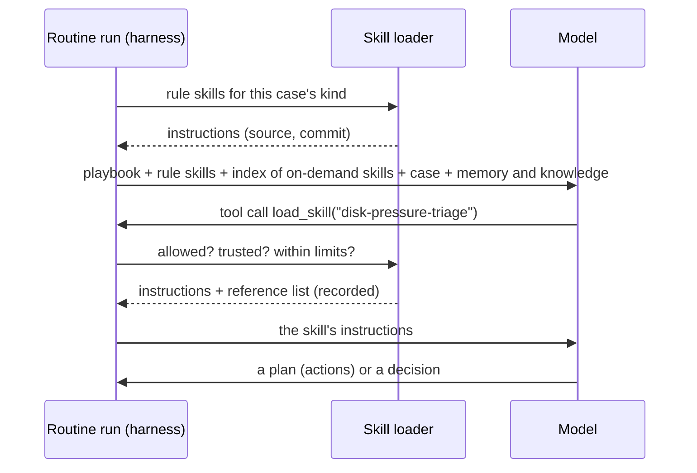

# RFC-0005 — Skills in the harness

**Status:** Draft (2026-11-11), for the operator's review. Nothing is built from it until it is
accepted.
**Builds on:** [ADR-0004](../adr/ADR-0004-job-runtime.md) (the harness and context),
[ADR-0005](../adr/ADR-0005-agent-pipeline.md) (cases, policy), [ADR-0010](../adr/ADR-0010-memory-and-knowledge.md)
(memory and knowledge), [ADR-0011](../adr/ADR-0011-tools-and-actions.md) (tools and actions).

## 1. Why

A **skill** is a folder with a `SKILL.md`: a name, a "use when" description and instructions, plus
optional reference files and scripts. It is the format Claude Code and opencode already read; the
operator keeps dozens of them. A skill packages know-how once and lets an agent pull it in only when
it needs it, so the context stays small and the know-how is reused across routines and fleets.

flotilla's harness has one fixed text per routine, the **playbook**, and the triage fleet adds
**class hints**: fragments its code chooses by the case's class. Both are skills in all but name.
This RFC makes skills a first-class part of the harness from the start, in flotilla's own harness:
switching to a harness that has them built in (the Claude Agent SDK, Claude Code headless, opencode)
would tie flotilla to one model family or a second runtime, and lose policy, taint, recording and
budgets.

## 2. What a skill is in flotilla

The same format, unchanged, so a skill written for flotilla also reads in Claude Code and opencode:

```text
skills/<name>/
  SKILL.md          frontmatter: name, description ("what it does. Use when …"); then instructions
  references/*.md   optional: longer material the instructions point to
  scripts/          optional: code; never run by the harness (§5)
```

flotilla reads two optional frontmatter fields under `metadata.flotilla`: `tools` and `actions`, the
registry entries the skill's instructions rely on (§5). Other harnesses ignore them.

**Playbook and skills:** the playbook says what the routine is for and is always in its context;
skills are reusable know-how loaded when needed ("reading a failed backup log", "telling a deploy
blip from an outage"). The class hints become skills loaded by rule (§4).

## 3. Where skills come from

Skills are instructions and code: they come only from **trusted, versioned git sources**, like
playbooks, never from untrusted knowledge.

| Source | Example |
| --- | --- |
| flotilla's repo, `skills/` | generic know-how any fleet may use |
| a fleet's own, `fleets/<fleet>/skills/` | triage's class hints |
| an installation's trusted repo (config) | the operator's own skills repo, at a pinned commit |

The `knowledge-refresh` worker refreshes them like other git knowledge; each load records the source
and commit. An untrusted source cannot provide a skill: the loader refuses it.

## 4. Which skills a routine gets, and how they load

A routine's spec lists the skills it may use; the default is none:

```yaml
skills:
  rule:                       # loaded by code, before the model's first turn
    - when: {kind: failed_backup}
      load: [reading-backup-logs]
  on_demand: [disk-pressure-triage, deploy-blips]   # the model may load these
```

- **By rule** (code picks): deterministic, the same in every replay. The class hints move here.
- **On demand** (the model picks): the context lists each allowed skill's name and description only
  (a small, budgeted layer); a built-in tool `load_skill(name)` returns the instructions and the list
  of its references; `read_skill_file(name, path)` returns one reference, size-capped. Both are
  ordinary tools: limited, recorded, counted in the routine's tool-call limit.
- **Models without tool calls** (an alias with `tools: none`) get rule-loaded skills only; the spec
  check refuses `on_demand` for a routine whose model cannot call tools.



## 5. Scripts: only through the registry

The harness never runs a skill's scripts. A script can become a **tool** or an **action** only by a
reviewed change to the registry that names it as the implementation:

- a read-only script → a **tool**, run in the routine's worker with that role's credentials, scoped
  and size-capped like any tool;
- a script that changes something → an **action**: planned by the agent, decided by policy, run by a
  host agent's `actions` role under that host's allowlist.

A skill's `metadata.flotilla.tools` and `actions` say which registry entries its instructions rely
on; the spec check refuses a routine that may load a skill whose entries the routine is not allowed.
So a skill can teach an agent how to use a tool or when to plan an action; it can never grant one.

## 6. Context, taint and recording

- **Context:** two new layers with budgets: *skills (rule)* and the *skills index*; on-demand skill
  text arrives as tool results. The cut marker shows when a budget is hit.
- **Taint:** a skill comes from a trusted source, so loading it does not taint the run. A tool result
  still taints as before.
- **Recording:** every load records the skill's name, source, commit and content hash; exact replay
  serves the recorded text; model replay can test a changed skill against recorded cases.
- **Telemetry:** a span per load (`skill.load`, name and commit); the case page's "What the agent
  looked at" lists the skills loaded, beside memory and knowledge.

## 7. Evaluation

A changed skill is a changed prompt: it is replayed like a playbook change (ADR-0004's evaluation
modes). For on-demand skills two questions are measured on recorded cases, per model alias: did the
agent load the skill when the case needed it, and did loading it improve the decision. Not verified
yet: how well the cheaper models (DeepSeek through OpenRouter, the local Qwen) choose skills on their
own; the first on-demand skill ships in shadow with that measurement.

## 8. The operator's existing skills

The format is the same, so the operator's read-only skills (`o11y-review`, `deploy-verify`,
`dgx-status`) can be offered to flotilla routines from the trusted skills repo. Their scripts run SSH
and query services; in flotilla each becomes a registered tool first (§5), reviewed, with the worker's
credentials, never the operator's. Skills that change state stay out until their steps are actions.

## 9. Vocabulary

| Term | Meaning |
| --- | --- |
| **skill** | a `SKILL.md` folder of reusable know-how, from a trusted git source; loaded by rule or on demand |
| **playbook** | a routine's own instructions, always in its context |
| **skills index** | the names and descriptions of the skills a routine may load on demand |

## 10. v1

The loader (trusted sources, commit and hash), the spec field, both loading modes, `load_skill` and
`read_skill_file`, the two context layers, recording, the span, the spec checks (§4, §5). The first
users: triage's class hints moved to rule-loaded skills (RFC-0002 §9 step 3 already moves them to
files), which must replay byte-identical to today's prompt. No script becomes a tool in v1.

## 11. Open questions for the operator

1. **Playbooks as skills?** A playbook could itself be a `SKILL.md` always loaded. Proposal: no, keep
   the playbook as the routine's own text; one more concept is not worth the uniformity.
2. **The operator's skills repo as a trusted source:** which repo and path, and should flotilla pin
   a commit per deploy or follow `main`? Proposal: pin per deploy, like specs.
3. **Write to skills:** should an agent ever propose a new or changed skill (like notes)? Proposal:
   not in v1; later, as a pull request the operator reviews, never live.

## 12. Alternatives considered

- **Switch harness** to one with skills built in: model lock-in or a second runtime, and losing
  policy, taint, recording and budgets in the loop.
- **Everything in the playbook:** no reuse, and the context grows with every case kind.
- **MCP prompts** as the carrier: no on-demand loading by the model, no trust per source, and a server
  to run for what is a folder of files.
- **Let skills run their scripts** (as Claude Code does): an injected or wrong skill would be arbitrary
  execution; the registry and policy exist to prevent exactly that.
