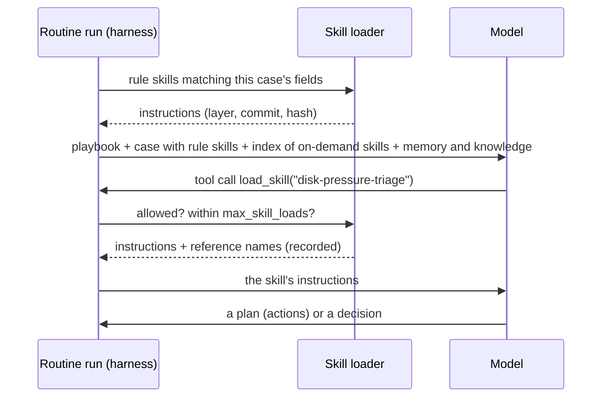

# RFC-0005 — Skills in the harness

**Status:** Draft, revision 2 (2026-11-11): the operator's decisions (§12) and an advisor review's
changes applied. Nothing is built from it until it is accepted.
**Builds on:** [ADR-0004](../adr/ADR-0004-job-runtime.md) (the harness and context),
[ADR-0005](../adr/ADR-0005-agent-pipeline.md) (cases, policy),
[ADR-0010](../adr/ADR-0010-memory-and-knowledge.md) (memory and knowledge),
[ADR-0011](../adr/ADR-0011-tools-and-actions.md) (tools and actions),
[RFC-0002](RFC-0002-job-runtime.md) §5 and §9 (context templates; triage's hints to files).

## 1. Why

A **skill** is a folder with a `SKILL.md`: a name, a "use when" description and instructions, plus
optional reference files and scripts. It is the format Claude Code and opencode already read; the
operator keeps dozens of them. A skill packages know-how once, and an agent pulls it in only when it
needs it, so the context stays small and the know-how is reused across routines and fleets.

flotilla's harness has one fixed text per routine, the **playbook**, and the triage fleet adds **class
hints**: fragments its code picks by the signal's class. Both are skills in all but name. This RFC
makes skills part of flotilla's own harness from the start.

Switching to a harness that has skills built in (the Claude Agent SDK, Claude Code headless, opencode)
would tie flotilla to one model family or a second runtime, and lose policy, taint, recording and
budgets.

## 2. What a skill is in flotilla

The same format, so a skill written for flotilla also reads in Claude Code and opencode:

```text
skills/<name>/
  SKILL.md          frontmatter, then the instructions
  references/*.md   optional: longer material the instructions point to
  scripts/          optional: code; never copied, never run by the harness (§5)
```

**Frontmatter.** flotilla requires `name` (equal to the folder name; lower-case letters, digits and
dashes, at most 40, the spec's own name rule) and `description` (not empty, at most 1024
characters; the index shows it as written). It reads `metadata.flotilla.tools` and
`metadata.flotilla.actions`: lists of the tools and actions the instructions rely on (§5). Unknown
keys under `metadata.flotilla` are refused. Every other field is ignored and grants nothing,
including another harness's `allowed-tools`. (To check before building: whether the Agent Skills
format allows lists under `metadata`; if not, a comma-separated string.)

**What a load inserts:** the `SKILL.md` body after the frontmatter, as written, with leading and
trailing whitespace trimmed.

**Playbook and skills:** the playbook says what the routine is for and is always in its context
(decided 1). Skills are reusable know-how loaded when needed ("reading a failed backup log",
"telling a deploy blip from an outage"). Triage's class hints become skills loaded by rule (§4).

## 3. Where skills come from

Skills are instructions and code: they come only from **trusted, versioned git sources**, never from
knowledge. Three layers, each pinned per deploy, so every deploy has one exact set of skills and a
rollback restores the previous set (decided 2):

| Layer | Where | Ships how | Version |
| --- | --- | --- | --- |
| **flotilla's default skills** | flotilla's repo, `skills/` | inside the image | the image tag |
| **a fleet's skills** | `fleets/<fleet>/skills/` (triage's class hints) | inside the image, like the specs | the image tag |
| **the installation's skills** | a repo and path in the installation's config, pinned by full 40-character commit (the operator's skills repo) | fetched by the deploy (below) | the pinned commit |

**A name is unique across all three layers;** the check refuses a duplicate, and no layer shadows
another.

**The installation layer's fetch.** The deploy copies the pinned commit into a volume named by that
commit (`<prefix>-skills-<sha7>`), the way `secrets.sh` fills volumes: `git archive <commit> --
<path>` on the host, through the docker CLI's stdin, with no network. Only `SKILL.md` and
`references/` are copied, never `scripts/` or `.git`. `deployed.tsv` records the skills commit
beside the image tag, and a rollback mounts the recorded volume. The commit is in the workers' and
flotillad's environment (`FLOTILLA_SKILLS_COMMIT`), so a pin change recreates them, and a run in
flight ends `interrupted`, as with a config change: no run loads a skill from one commit and a
reference from another. A commit that cannot be fetched fails the deploy before anything changes, as
a missing flotilla commit does.

## 4. Which skills a routine gets, and how they load

A routine's spec lists the skills it may use; the default is none:

```yaml
skills:
  rule:                                  # loaded by code, before the model's first turn
    - when: {class: external-transient}
      load: [hint-external-transient]
  on_demand: [disk-pressure-triage, deploy-blips]   # the model may load these
```

- **By rule** (code picks): `when` is an equality match on the structured fields the routine's code
  steps put in the case layer (triage: `class`; Ops: `kind`). Rules are tried in spec order; every
  rule that matches loads, each skill once, in that order. Deterministic: the same in every replay.
- **On demand** (the model picks): the context holds an **index**, one line per allowed skill,
  `- <name>: <description>`, in the order of the spec's `on_demand` list. `load_skill(name)` returns
  the skill's instructions and the names of its references; `read_skill_file(name, path)` returns one
  reference. Both are tools the runtime provides, offered only to routines with `on_demand`.
- **Limits:** a load uses a model turn and counts against its own limit, `max_skill_loads` (default
  2), not against the routine's tool-call limit, so a load never costs a probe the replay corpus
  measured. Loading the same skill twice returns the same text and counts again.
- **Models that cannot call tools:** the check refuses `on_demand` for a routine whose model, or any
  alias in its declared fallback, has `tools: none`. `tools: json` counts as able: `load_skill` is a
  tool in the fleet's JSON protocol, like a probe.



## 5. Scripts and the tools a skill names

The harness never runs a skill's scripts, and the installation fetch never copies them. A script
becomes a **tool** or an **action** only by a reviewed change to the registry that names it as the
implementation: a read-only script becomes a tool, run in the routine's worker with that role's
credentials; a script that changes something becomes an action, planned by the agent, decided by
policy, run by a host agent's `actions` role under that host's allowlist.

A skill can teach an agent how to use a tool or when to plan an action; it can never grant one. In
v1 the check compares a skill's `metadata.flotilla.tools` with the routine's `harness.tools` list
(RFC-0002 §4); `actions` are checked against the registry once ADR-0011's registry exists. A skill
without `metadata.flotilla` is not checked: if its instructions name a tool the routine lacks, the
call fails and the error is the call's answer, as for any unknown tool.

## 6. Loader rules and the check

- **Who checks:** flotillad's `-check` (it runs before every deploy), with every layer mounted
  read-only in flotillad as in the workers. It verifies: each skill a routine lists exists in exactly
  one layer; its frontmatter is valid (§2); its size is under the caps; its `metadata.flotilla` names
  are among the routine's allowed tools (§5); `on_demand` only with models that can call tools (§4).
- **At run time** the worker loads the same files and records their hash; a hash that differs from
  what `-check` saw fails the run.
- **Paths:** `name` matches the name rule and is the folder's name. `read_skill_file`'s `path` is
  relative, has no `..` and no leading `/`, and must resolve inside that skill's `references/`. The
  loader refuses symlinks (it checks the link itself) and any file but `.md` and `.txt`.
- **Sizes:** `SKILL.md` and each reference have a character cap, set from the first real skills. A
  file over its cap is refused at `-check`, never cut. The same for the index and the rule-loaded
  skills against their layer budgets: a cut instruction is worse than none. Only tool results keep
  the visible cut marker.

## 7. Context, taint and recording

- **Where skills render:** where a layer renders is the fleet's context template (RFC-0002 §5). For
  triage's like-for-like move, rule-loaded skills render inside the `case` template, after the
  `SIGNAL:` text and one blank line, exactly as the hint is appended today. Moving them anywhere else
  is a behaviour change, proven by model replay. The index renders after the playbook.
- **Instructions, not data:** a skill enters outside the data delimiters that wrap memory and
  knowledge, which is why only trusted, reviewed git sources may provide one. A skill's `references/`
  are held to the same standard: no pasted logs, issue text or vendor pages; those belong in
  knowledge.
- **Taint:** loading a skill does not taint the run; a tool result taints by its source's trust, as
  before.
- **Recording:** every load records the skill's name, layer, source, commit and content hash; exact
  replay serves the recorded text.
- **Telemetry:** a span per load, `skill.load`, with name, layer, commit and hash; the case page's
  "What the agent looked at" lists the skills loaded, beside memory and knowledge.

## 8. Evaluation

A changed skill is a changed prompt: it is replayed like a playbook change (ADR-0004's evaluation
modes). The evaluation can force a skill as if rule-loaded, so a changed on-demand skill is tested on
every recorded case, not only those where the model chose it (`SF_NO_CLASS_HINT` in `triage.py` is the
same switch in the other direction). For on-demand skills two questions are measured per model alias:
did the agent load the skill when the case needed it, and did loading it improve the decision. Not
verified yet: how well the cheaper models (DeepSeek through OpenRouter, the local Qwen) choose skills
on their own; the first on-demand skill ships in shadow with that measurement.

## 9. The operator's existing skills

Later, one skill at a time, each rewritten for the tools the routine has: the operator's skills name
operator paths and SSH targets and say "Use when asked…", which an agent with tools and no shell
cannot follow as written. Their scripts become registered tools first (§5), reviewed, with the
worker's credentials, never the operator's. Skills that change state stay out until their steps are
actions.

## 10. Vocabulary

| Term | Meaning |
| --- | --- |
| **skill** | a `SKILL.md` folder of reusable know-how, from a trusted git source, pinned per deploy; loaded by rule or on demand |
| **playbook** | a routine's own instructions, always in its context |
| **skills index** | the names and descriptions of the skills a routine may load on demand |

## 11. v1, in two parts

- **With RFC-0002 §9 step 3** (triage's playbook and hints to files): the loader over the two
  in-image layers, the `skills.rule` spec field, rule loading rendered in the `case` template,
  recording, the span, and the `-check` rules (§6). Triage's four class hints become rule-loaded
  skills and must replay byte-identical to today's prompt.
- **With RFC-0002 §9 step 4** (the loop to the harness): `skills.on_demand`, the index,
  `load_skill`, `max_skill_loads`.
- **Built with the first skill that needs them:** `read_skill_file` (no skill has references yet)
  and the installation layer's fetch (no installation skill is adopted yet). Their rules (§3, §6) are
  decided here.
- **Builder's note:** `internal/spec/spec.go` parses strictly (`KnownFields`) and has no `harness` or
  `skills` field yet; both are new fields.

## 12. Decided (operator, 2026-11-11)

1. **Playbooks stay the routine's own text,** not skills.
2. **Skills are pinned per deploy,** in three layers (§3): flotilla's defaults and the fleets' skills
   ship in the image; the installation's skills repo is pinned by commit in config and fetched by the
   deploy. Which repo and path the homelab uses is set when the first installation skill is adopted.
3. **Agents do not write skills in v1.** Later, at most as a pull request the operator reviews.

## 13. Docs amended on acceptance

- RFC-0002 §5: `context.fragments` gives way to `skills.rule`; §9 step 3's `hints/*.md` become
  `fleets/triage/skills/hint-*/SKILL.md`.
- ADR-0004's context layers, and `docs/architecture/components.md` (the context builder), gain the
  rule skills and the skills index.
- `docs/testing.md`: "a playbook or fragment" becomes "a playbook or skill".
- `docs/architecture/data.md` (the spec row) and `docs/security.md` T7 add skills to what changes only
  by a reviewed commit and a deploy.
- `docs/architecture/index.md`: the vocabulary gains "skill".
- `deploy/compose/` and `deploy/mini/deploy.sh`: the installation layer's volume and its record in
  `deployed.tsv`, when that layer is built.

## 14. Alternatives considered

- **Switch harness** to one with skills built in: model lock-in or a second runtime, and losing
  policy, taint, recording and budgets in the loop.
- **Everything in the playbook:** no reuse, and the context grows with every case kind.
- **MCP prompts** as the carrier: no on-demand loading by the model, no trust per source, and a server
  to run for what is a folder of files.
- **Let skills run their scripts** (as Claude Code does): a wrong or injected skill would be arbitrary
  execution; the registry and policy exist to prevent exactly that.
- **One skills volume refilled in place:** a rollback would run the old image with the new skills,
  and a run in flight could mix commits; a volume per commit avoids both.
- **Count skill loads against the tool-call limit:** a load would cost a probe the replay corpus
  measured; a separate limit keeps the corpus valid.
