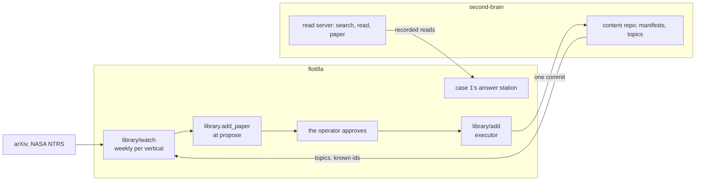

# RFC-0015 — The library in flotilla: proposing papers and reading them

**Status:** Draft, for the operator's review (2026-11-26). The library itself, its corpus, index
and read server, is a project of its own: the public tooling
[second-brain](https://github.com/chipi/second-brain) (its RFC-0001) with the content in a private
repo, decided by the operator the same day. This RFC is only flotilla's side: the routine that
proposes papers, the action a person approves, and case 1 reading the library.
**Builds on:** [RFC-0014](RFC-0014-visual-plane-and-mashups.md) §4.4 to §4.8 and case 1
([plan](../wip/rfc-0014-case1-plan.md)); [ADR-0004](../adr/ADR-0004-job-runtime.md) (knowledge is
plugged in from elsewhere, read-only); [ADR-0017](../adr/ADR-0017-routine-actions.md) (routine
actions); the [patterns page](../architecture/patterns.md) §1.

## 1. Where flotilla stops

flotilla stores no corpus and runs no index: the library is external knowledge, like the
company's documents in case 1. flotilla does what it does for every source: it schedules the work,
proposes changes for a person to approve, earns autonomy per action, and records and replays every
read. second-brain does not depend on flotilla, and flotilla does not import its code: they meet
at two points, its read server (MCP) and a commit to its content repo.

## 2. `library/watch`: proposing papers

- A routine of the example fleet `library`, on a schedule per vertical (weekly). It reads the
  vertical's `topics.yaml` and the ids already in or rejected, at the content repo's commit, through
  a read-only credential.
- Code queries arXiv's API and NASA's NTRS API for papers since its last run, drops known ids and
  ranks the rest by the topics' terms. One model step on a station writes each candidate's
  one-line "why" and picks its sub-topic, the abstract given as data; its gates check the
  sub-topic is one of the vertical's and the "why" is bounded text.
- It opens one case per vertical per run (kind `library_candidates`), whose stage plans one
  `library.add_paper` per candidate, at `propose`. A week with no candidates opens nothing.

## 3. `library.add_paper`: a person decides

- A routine action (ADR-0017), `executor: routine`, `for_kinds: [library_candidates]`. Params:
  `vertical` (enum, the installation's verticals), `id` (text, bounded, matching a source's id
  pattern), `subtopic` (text, bounded), `why` (text, bounded). Risk low; reversible: a paper is
  taken out by a revert. `limits.per_target_per_day` keeps a run from flooding the queue.
- The operator approves or rejects each plan in the UI. A rejection is recorded in the content
  repo's rejected list, so the paper is not proposed again.
- **The executor** (`library/add`) checks the plan's hash, fetches the id's metadata from its
  source to confirm it exists, and writes the manifest as one commit to the content repo, naming the
  plan's hash and the approver, through a credential limited to that repo. The check confirms the
  commit is on the content repo's main.
- **Earned autonomy, later.** After enough approved plans per vertical, the operator may promote
  `add_paper` to `auto` for a vertical, or never.

## 4. Case 1 reads the library

The library's read server is one more `reads:` server on case 1's answer station, beside Docs,
Tasks and Close Listening (`tools: [search, read, paper]`, a call cap and a result cap). Its reads
are recorded and replayed like the others (RFC-0014 §4.8); a citation names the paper and section,
and the citation gate checks it against the run's recorded reads. Each result carries the index's
version, so a replay knows which build it was.

## 5. How we know it works

- **An e2e here:** a stub arXiv answering a fixed feed, `library/watch` proposing two candidates
  and dropping a known id, one plan approved and committed to a fixture content repo, the other
  rejected and not proposed again; case 1's station reading a stub library server, recorded and
  replayed.
- **On the installation:** after a month, the share of proposed papers the operator approves, per
  vertical. A low share means the topics' queries are wrong, which is a change to `topics.yaml`.
- The library's own retrieval evaluation is second-brain's (its RFC-0001 §5).

## 6. Order of work

After second-brain has its seeded content and its read server (its RFC-0001 §6):

1. Case 1 with the library as a read source (RFC-0014 case 1's step 2 gains a server).
2. The example fleet `library`: `watch`, the action, the executor, and the e2e above.
3. On the installation: the content repo's credentials (read for `watch`, write for the
   executor), the action in the private registry, the schedule.

## 7. Decisions for the operator

1. **The executor's write:** a deploy key or a GitHub App installation limited to the content repo
   (recommended: a fine-grained token scoped to that one repo, contents read and write, with an
   expiry), held in the executor's worker volume.
2. **Where `watch` runs:** on the reads worker (it needs arXiv's and NTRS's hosts on its proxy) or a
   worker of its own (recommended: its own proxy then admits only those two hosts and the model
   gateway).
